# ADR-0009 — Task Scheduling System for the multi-product financial platform: scheduler and batch-execution framework selection

**Created:** 2026-10-01 (v1)
**Last updated:** 2026-11-13
**Version:** 5

## Status

**Proposed** (revision 5). Supersedes [ADR-0009 v1](0009-task-scheduling-system.md).

### What changed in v5

The decision itself is unchanged. v5 records the generic trigger system (plan: `payos-job-scheduler/docs/generic-triggers-implementation-plan-v4-2026-11-10.md`), implemented in four phases between 2026-11-11 and 2026-11-13, which replaces the single implicit cron schedule + separate manual-trigger mechanism this ADR originally described with one generic `TssTrigger` concept a job can carry any number of, of any mix of six types.

- **`jobs.json`'s single `trigger: {...}` object is replaced by a `triggers: [...]` array** — a breaking change, not a soft migration: TSS was deployed nowhere yet, so an entry still using the old object is rejected outright, with a warning naming it, rather than silently interpreted or deprecated. Each array entry has its own `id`, `type` and type-specific options.
- **Two families, two engines, no third abstraction layer between them.** A *temporal* trigger (`cron`, `interval`, `once`) only ever needs to hand Quartz its own schedule once, at reconciliation — Quartz still does all the clustering, persistence and misfire handling, unchanged. An *event-driven* trigger (`manual`, the pre-existing one re-modeled as a `TssTrigger`; `queue` and `dependency`, both new) is started and stopped **in memory, independently on every node** (`EventTriggerRuntime`), and decides for itself when to ask Quartz to run the job (`TriggerContext.fire(...)`, which deposits an ordinary one-shot, persistent Quartz trigger) — Quartz still executes every job, through the exact same path either family uses; an event-driven trigger never runs the script itself.
- **`queue` fires a job on a broker message.** TSS opens its own connection to a message broker (`QueueClientConnector`, `ServiceLoader<IQueueClientFactory>`), entirely independent of whatever queue connection the host PayOS application already has for its own purposes — deliberately never through `ma.s2m.payos.queue.QueueClients` (the kernel's own helper), which depends on `PayOSConfig` and would couple this Spring-free, independently-deployable module to the whole kernel just to find a connector on the classpath. An optional configured directory of extra connector JARs (`TSS_QUEUE_ADAPTERS_DIR`) can be loaded alongside the classpath, mirroring the kernel's own `service-adapters-dir` mechanism but reimplemented independently for the same decoupling reason. A tenant job's `queue` trigger only accepts a message tagged with that tenant's own id in its metadata (default-deny); a platform job's accepts every message on the destination, its deliberate cross-tenant integration point. One cluster-scale consequence, accepted rather than engineered around: a destination is backed by one shared, durable consumer group across the whole cluster, so two *different* jobs declaring a `queue` trigger on the *same* destination share its message load between them rather than each receiving every message — one destination per job (or per small group of jobs meant to share it) is the operating rule this implies.
- **`dependency` fires a job once every named upstream job has completed since this job's own last firing.** State lives in two new tables (`tss_dependency_join`, `tss_dependency_state`, applied once like `tss_job_execution.sql`), with a cluster-wide `SELECT ... FOR UPDATE` row lock as the actual concurrency control — the lock is held only long enough to record one completion and check whether the set is now complete, and is always released (transaction committed) **before** the job is ever fired, so a node never holds that lock while asking Quartz for a second connection from the same pool.
- **A ~50-class false start, and why v4/v5 stays at 15.** An earlier, more "enterprise" design (activator/dispatcher/condition/source abstractions per trigger family) was implemented and then reverted as unreadable at that size. The replacement principle — one trigger type is one class, readable top to bottom, with a single `TriggerContext` as the only door to the rest of TSS — is what let `queue` and `dependency` be added as two classes each (one, for `queue`) rather than reopening that whole abstraction layer. Full design rationale, every class, and the cluster sequence diagrams: [class diagram §17](../job-scheduler-class-diagram-v24-2026-11-15.md) and the plan document above.
- **Consequence for this ADR's own class diagram, below.** The embedded diagram's `JobDefinition` record still shows a single `cronExpression` field and `JobSummary` a single `cronExpression`/`nextFireTime`/`previousFireTime` triple — both superseded by the `triggers` list described above. This ADR's own diagram is a dated snapshot (as its own intro note already states); the class diagram document is the one kept in sync with each change, and is authoritative over this section where the two differ.

### What changed in v4

The decision itself (Quartz clustered, Spring Batch under the TSS exception, JobRunr rejected) is unchanged. v4 records how TSS now manages the lifecycle of its jobs, and adds a section on the implemented architecture with a class diagram ([Implemented architecture](#implemented-architecture)).

- **The jobs files are the single source of truth.** At startup, on hot reload and on demand, a `JobReconciler` computes the difference between the declared jobs (`jobs/`) and the jobs registered in Quartz, then adds, reschedules, updates or deletes jobs to match. A changed cron expression, `parallelizable` flag or `arguments` block is applied cluster-wide. A job removed from the files is deleted from the scheduler, with a warning.
- **Hot reload without restarting Quartz.** TSS watches `jobs/` with the kernel's `ConfigWatcher` (the mechanism PayOS already uses for its own configuration), debounces the changes and reconciles live. It has its own watcher instance in both standalone and embedded modes. A file that cannot be read abandons the pass without touching the scheduler.
- **Job arguments are stored with the job** in the Quartz `JobDataMap` (as JSON), so every node of the cluster runs a job with the same arguments, and an edit reaches all nodes at once.
- **Manual trigger, sync and list**, through a CLI (`trigger`, `sync`, `list` commands of the standalone jar) and a secured HTTP admin endpoint. The endpoint authenticates OIDC Bearer tokens through the kernel's `ISecurityService` and authorizes with two roles (platform administrator, tenant administrator scoped to its own tenant). Every operation and every denial goes to the PayOS audit trail. A manual run follows every rule of a scheduled run and is tagged `triggerType = manual` in history events and metrics.
- **Tenant directory provisioning.** For every tenant declared in the PayOS configuration that has no `jobs/<tenantId>/` directory, TSS creates one. If `jobs/template.json` exists, the new directory gets a `jobs.json` made from it, with every `{{tenantId}}` replaced by the tenant's id.
- New consequences and risks (destructive reconciliation, consistency of `jobs/` across nodes) are recorded below.

### What changed in v3 (review)

- **Spring is tolerated inside TSS as an explicit, scoped exception** to the platform's no-Spring rule. The exception covers the standalone TSS process only. Kernel, foundation, runtime, servers, connectors and the embedded TSS deployment stay Spring-free.
- Gate G4, the architecture-fit criterion and Spring Batch's scores were re-evaluated under that exception. Quartz + Spring Batch now passes every gate and scores highest (121/150).
- Spring Batch moves from "contained opt-in library" to **TSS's standard execution framework for Java batch jobs that need checkpoint/restart**. Quartz stays the scheduler and the runner for script jobs, and the existing TSS execution history stays authoritative.
- Spring Batch jobs are tied to the **standalone TSS deployment**, so the embedded TSS inside `payos-runtime` does not bring Spring onto the runtime classpath.
- The Spring-creep risk and its enforcement rule were redrawn around the new boundary. A `javax` / `jakarta` compatibility note was added.
- JobRunr stays rejected: the Spring exception does not affect any of the reasons for that rejection.

### What changed from v1 (v2)

- Two candidates were added to the option list: **JobRunr** (distributed background-job library) and **Spring Batch** (batch-execution framework). The other options were re-evaluated alongside them.
- The qualitative evaluation table was replaced with a weighted scoring matrix and a set of gating criteria. This makes the reasoning auditable and lets a reviewer re-weight it.
- Three decision drivers were added: **batch-processing semantics** (checkpoint/restart, chunking), **architecture fit** (no Spring container, script-first jobs, SPI-based services) and **licensing / vendor independence**.
- The decision still keeps **Quartz in clustered mode** as the platform scheduler. It is now reached against a wider field and refined: **Spring Batch** is sanctioned as an **opt-in execution library for heavyweight Java jobs** and is not the platform default. JobRunr is rejected, and the reasons are recorded.
- Context, idempotence and multi-tenancy sections now reflect what `payos-job-scheduler` already implements (v1.1.3).

---

## Context

The platform operates in a complex enterprise environment:

- Multi-product ecosystem (Gateway, Issuing, Acquiring, Switching, Analytics)
- Multi-tenant by design
- Serving Tier 1–3 financial institutions and SMB segments
- Deployable on-premise, PaaS, and public cloud, including air-gapped on-premise environments with no Internet access
- Operating in regulated financial environments (PCI-DSS, central-bank reporting)
- Experiencing rapid engineering team growth

The platform requires scheduled and asynchronous task execution for:

- Periodic reconciliation jobs
- Settlement processing (including large settlement / clearing files)
- Batch reporting
- Fraud model recalibration (if AI is used for fraud detection)
- Data retention and archival
- Compliance exports (periodic data exports / reports required by regulators / auditors)
- Retry and compensation workflows

The platform's technical baseline also constrains the choice:

- **No Spring, with one exception.** PayOS (kernel, foundation, runtime, servers, connectors) is plain Java 21 with SPI-resolved services (ADR-0002) and no dependency-injection container. Persistence is Hibernate 5.6 (`javax.persistence`) behind `IDatabaseService` / `DynamicDataAccessService`. **TSS is granted an exception:** Spring may be used inside the standalone TSS process, as long as no Spring type crosses a PayOS interface and the embedded TSS deployment stays Spring-free.
- **Script-first business logic.** Tenant business logic runs as sandboxed JavaScript on GraalVM (ADR-0001, ADR-0005). Per the TSS base specification, job logic follows the same rule: jobs are scripts by default, and native Java jobs are an escape hatch.
- **An implementation already exists.** `payos-job-scheduler` (v1.1.3) implements v1 of this ADR on Quartz 2.3.2 in clustered `JDBCJobStore` mode. It provides script and Java jobs, `ExclusiveScriptJob` for non-parallelizable jobs, an execution-history store, misfire detection, per-tenant concurrency quotas, metrics, standalone and embedded bootstraps, and the `$Parallel` binding for concurrent item processing inside one job run. Since v4 it also reconciles Quartz against the jobs files, reloads them without a restart, and offers a secured manual trigger (see [Implemented architecture](#implemented-architecture)).

The question this revision answers is whether that choice still holds once two widely used Java alternatives are put on the table:

- **JobRunr** — a scheduler with a built-in dashboard and retries.
- **Spring Batch** — the reference Java framework for restartable, chunk-oriented batch processing.

---

## Scope

### Includes

- Scheduled tasks (cron-like)
- Periodic batch jobs, including large-volume batch jobs that need checkpoint/restart
- Message-driven job triggering: one message received on a queue destination triggers one job execution. This is an alternative or complement to a timer trigger. See the TSS base specification in `payos-job-scheduler` for the mechanism.
- Distributed execution coordination
- Multi-tenant task isolation
- Retry policies
- Monitoring and observability
- Failover and high availability

### Excludes

- Real-time/continuous stream processing: windowed aggregation, stream-to-stream transformation and stateful stream analytics. These remain the responsibility of a dedicated streaming engine or the message-oriented middleware itself. Treating a single message as a job trigger (one message in, one discrete, idempotent job execution) is job invocation, not stream processing, and stays in scope.
- Workflow orchestration for complex BPM (covered separately)
- Infrastructure-level job schedulers (e.g., OS cron as the primary mechanism)

---

## Decision Drivers

1. **Regulatory compliance**: audit logs of job execution, traceability of every run, deterministic retry policies.
2. **Multi-tenant isolation**: tenant-specific tasks, no cross-tenant interference, tenant-scoped execution context, per-tenant quotas.
3. **High availability**: no single-node scheduler, failover, exactly one node fires a given trigger, at-least-once execution with idempotent jobs.
4. **Operational observability**: central monitoring, execution history, SLA tracking, alerting on failure.
5. **Cloud / on-prem portability**: must work air-gapped, must not depend on SaaS-only schedulers or on Kubernetes being present.
6. **Scalability**: high task volume (number of tenants × jobs per tenant), horizontal scaling.
7. **Consistency across products**: no per-product scheduling silos, one execution model.
8. **Engineering governance**: standard registration API, controlled retry policies, no duplicate cron logic.
9. **Batch-processing semantics** *(new)*: large jobs (settlement files, archival, compliance exports) need chunked processing, checkpoint/restart from the last committed point, and skip/retry at item level.
10. **Architecture fit** *(new)*:
    - Must not force a Spring `ApplicationContext` or another DI container into PayOS. Spring is tolerated inside the standalone TSS process as an exception (see Context).
    - Must support script-first jobs running on the existing GraalVM engine with the `$DB` / `$PlatformDB` bindings.
    - Must not leak framework types through PayOS interfaces.
11. **Licensing and vendor independence** *(new)*: core governance features (cluster-wide non-concurrency, history, access control) must not depend on a commercial licence. Permissive or weak-copyleft open-source licences only.

---

## Considered Options

### Option 1: Infrastructure-level scheduling (OS cron / Kubernetes CronJobs)

Each product defines scheduled tasks at infrastructure level.

**Pros**

- Simple, with no scheduler code to maintain
- Kubernetes CronJob is cloud-native and offers a per-job `concurrencyPolicy: Forbid`

**Cons**

- No centralized governance, no tenant awareness, weak audit trail
- OS cron is per-host and not cluster-safe. Kubernetes CronJob requires Kubernetes, which many on-prem bank environments do not run.
- No message-driven triggering, no checkpoint/restart, no retry policy beyond pod restart
- Job definitions live in deployment manifests, outside the product's configuration and governance

---

### Option 2: In-process scheduler per service (`ScheduledExecutorService`, Spring `@Scheduled`-style)

Each microservice runs its own timer-based scheduler.

**Pros**

- Trivial to implement, no external dependency, no infrastructure

**Cons**

- Not cluster-safe: every node fires every job, so execution is duplicated
- No failover coordination, no persistence, no execution history, no global visibility
- Siloed per product, which is exactly what driver 7 forbids

---

### Option 3: Distributed persistent scheduler — Quartz in clustered mode

A centralized scheduler backed by a shared relational job store (`JDBCJobStore`, `isClustered=true`). Nodes coordinate trigger acquisition through database row locks and recover the jobs of a failed node through check-in heartbeats.

**Pros**

- Exactly one node fires a given trigger. Failover recovers jobs from crashed nodes (`requestsRecovery`).
- Cron and simple triggers, misfire policies, calendars
- Plain Java library (Apache 2.0) with no container requirement. It fits the PayOS no-Spring, SPI-based architecture directly.
- Works with any JDBC database PayOS already supports, air-gapped included
- Job identity can live in configuration: the generic `ScriptJob` reads script, tenant and arguments from the `JobDataMap`, so script-first jobs map naturally.
- Already implemented and tested in `payos-job-scheduler`, including cluster-recovery and concurrency end-to-end tests

**Cons**

- Quartz does not keep execution history. TSS has to add its own (already done: `JobExecutionRepository`).
- No native multi-tenancy. It has to be designed on top: job groups, `JobDataMap` tenant, registration-layer enforcement (already done).
- `@DisallowConcurrentExecution` is class-level, so selective per-job non-concurrency needs a second job class (already done: `ExclusiveScriptJob`).
- Retry is minimal (refire-immediately or nothing). Backoff policies are a TSS concern.
- No checkpoint/restart for large batches. Job authors handle it through the idempotence patterns below.
- No built-in UI. Observability goes through TSS metrics and execution history.
- Shared-DB contention at very high trigger volumes. Quartz's release cadence is slow, and PayOS is pinned to 2.3.2.

---

### Option 4: Event-driven scheduling via the message broker

Use the message broker (NATS JetStream today, through `IQueueClient`) for delayed delivery, retries and job triggering.

**Pros**

- Scalable and decoupled, with natural at-least-once and redelivery semantics
- Reuses infrastructure PayOS already runs
- Excellent fit for message-triggered jobs

**Cons**

- Cron semantics are weak or absent: periodic jobs need an external ticker, which brings back the scheduler problem.
- Execution history, auditability and governance must be built from scratch
- Selective non-concurrency and checkpoint/restart are not provided
- Better as a complementary trigger source, which is how TSS already uses it (§6.2 of the TSS spec)

---

### Option 5: JobRunr *(new)*

JobRunr is a Java library for distributed background job processing. Jobs are expressed as Java lambdas or method references, serialized to JSON together with their arguments, and stored in a relational or document database. Each node runs a `BackgroundJobServer` that polls storage. Recurring jobs (cron) are scheduled by an elected master node. It ships an embeddable web dashboard and automatic retries with exponential backoff. It comes in an open-source edition (LGPL-3.0) and a commercial **JobRunr Pro** edition.

**Pros**

- Very low ceremony: `BackgroundJob.enqueue(...)`, `BackgroundJob.scheduleRecurrently(...)`
- Built-in dashboard showing enqueued, processing, failed and succeeded jobs, with manual requeue
- Automatic retries with exponential backoff out of the box. Failed jobs and their stack traces are persisted.
- Cluster-safe through storage-level optimistic locking. Nodes can be added for horizontal scaling.
- No Spring requirement: it runs as plain Java, though Spring Boot, Quarkus and Micronaut integrations exist.
- Fire-and-forget jobs enqueued from code make message-triggered invocation easy

**Cons**

- **Key governance features are Pro-only.** Cluster-wide mutexes and rate limiters (needed for `parallelizable: false` and per-tenant concurrency quotas), batches, queue/recurring-job pausing, and SSO/audit trails for regulated environments are all in the commercial edition. Without Pro, TSS would re-implement them on top, which removes most of the "less code" benefit. With Pro, a core governance capability depends on a commercial licence (driver 11).
- **Recurring-job volume:** the OSS edition is optimized for about 100 recurring jobs per database instance. A multi-tenant platform with *N* tenants × *M* recurring jobs per tenant passes that quickly (30 tenants × 5 jobs = 150).
- **Job identity is a Java method signature.** Stored jobs reference class + method + serialized arguments, so renaming or refactoring a job class breaks jobs already enqueued. Script-first jobs would all collapse onto one generic method (e.g. `ScriptJobRunner.run(jobId, tenantId)`). That works, but it makes the dashboard much less useful, because every job looks the same.
- No native multi-tenancy (same as Quartz), so tenant isolation is built on top either way
- Polling-based coordination adds latency and storage load, tuned through poll interval
- Adopting it means migrating an implementation that is already working and tested, with its own schema, for a capability set that is not larger in the OSS edition

---

### Option 6: Spring Batch *(new)*

Spring Batch is the reference Java framework for robust batch processing. A `Job` is made of `Step`s. Chunk-oriented steps read, process and write items in transactional chunks (`ItemReader` / `ItemProcessor` / `ItemWriter`). A `JobRepository` (relational metadata tables) persists every `JobInstance`, `JobExecution`, `StepExecution` and its `ExecutionContext`. This gives restart from the last committed chunk, skip and retry policies at item level, and job-instance uniqueness through identifying job parameters. It scales out through multi-threaded steps, partitioning and remote chunking. The current major line, Spring Batch 6, requires Spring Framework 7 and Java 17+.

**Spring Batch is not a scheduler.** It executes and records batch runs, but something else must decide when to launch them: Quartz, `@Scheduled`, a Kubernetes CronJob, or an external orchestrator. In this ADR it is therefore evaluated as **"Quartz triggers, Spring Batch executes"**, the standard pairing, and the scores below reflect that combination.

**Pros**

- Best-in-class batch semantics:
  - checkpoint/restart from the last committed chunk
  - item-level skip and retry
  - transactional chunk boundaries
  - complete, queryable execution metadata (start/end, read/write/skip counts, exit status, per step)
- Its `JobRepository` metadata is effectively a regulatory-grade execution log for batch runs (drivers 1 and 4)
- Job-instance identity through identifying parameters (e.g. `tenantId` + `businessDate`) natively prevents re-running a completed instance. This is the "business idempotency key" pattern, enforced by the framework.
- Partitioning gives controlled, framework-managed parallelism for very large datasets
- Apache 2.0, mature, extensive documentation, well known to Java engineers

**Cons**

- **Requires a Spring `ApplicationContext`.** Jobs, steps, readers and writers are Spring beans, and transactions go through Spring's `PlatformTransactionManager`. Under the TSS Spring exception this is acceptable inside the standalone TSS process. The remaining cost is boundary discipline: the context must stay private to TSS and must not reach the embedded TSS deployment inside `payos-runtime` (driver 10).
- **`javax` / `jakarta` split.** Spring Framework 7 is built on the `jakarta.*` namespace, while PayOS persistence is Hibernate 5.6 on `javax.persistence`. Both can share a JVM because the packages differ, but Spring's JPA/Hibernate integration cannot drive PayOS's Hibernate sessions.
- **Java-only job model.** Steps are Java beans. It does not run the script-first jobs that are the default and majority job type in TSS. Wrapping a script in a `Tasklet` gives none of the chunk/restart benefits, because the script remains one opaque unit.
- **Transaction model mismatch.** Spring Batch owns chunk transactions through Spring's transaction manager, while PayOS jobs use `IDatabaseService` request-scope transactions on Hibernate 5.6. Spring Framework 7's ORM baseline does not target Hibernate 5.6, so in practice readers and writers would be limited to JDBC ones. This needs verifying.
- A second metadata schema (`BATCH_*` tables) sits alongside Quartz's `QRTZ_*` tables and TSS's own history table
- Not a scheduler: it does nothing for cron, failover of triggers, or message triggering on its own
- Heavier operational footprint and a steeper learning curve for job authors than a script

---

### Option 7: Dedicated workflow / job orchestration engine (e.g., Temporal, Camunda)

Use a workflow engine to manage tasks as durable workflows.

**Pros**

- Rich orchestration, durable state, built-in retries and timers, schedules, strong visibility UI
- Workflow-ID uniqueness gives natural deduplication. Namespaces can carry tenant isolation.

**Cons**

- Heavyweight: a separate server cluster plus its own persistence (and often a search/visibility store) to deploy and operate on-prem
- Overkill for discrete scheduled jobs, and complex BPM orchestration is explicitly out of scope
- Its programming model (deterministic workflow code, SDK-specific) does not map to sandboxed JavaScript jobs. Camunda 8 production use requires a commercial licence.

---

## Evaluation

### Gating criteria

An option that fails a gate cannot be the **platform default**. It may still be used in a narrower, opt-in role.

| Gate | Opt. 1 Infra cron | Opt. 2 In-process | Opt. 3 Quartz | Opt. 4 Event-driven | Opt. 5 JobRunr | Opt. 6 Quartz + Spring Batch | Opt. 7 Workflow engine |
| --- | --- | --- | --- | --- | --- | --- | --- |
| G1 — Cluster-safe execution without custom coordination | ✗ (OS cron) / ✓ (K8s) | ✗ | ✓ | ✓ | ✓ | ✓ | ✓ |
| G2 — Runs air-gapped on-prem without Kubernetes or SaaS | ✗ | ✓ | ✓ | ✓ | ✓ | ✓ | ✓ |
| G3 — Core governance features without a commercial licence | ✓ | ✓ | ✓ | ✓ | ✗ (mutex, rate limiting, SSO/audit in Pro) | ✓ | ✓ (Temporal) / ✗ (Camunda 8) |
| G4 — Runs script-first jobs; no DI container outside the TSS exception | ✓ | ✓ | ✓ | ✓ | ✓ | ✓ (Spring confined to standalone TSS; script jobs keep running as Quartz `ScriptJob`s) | ✗ (SDK workflow model) |

The options that pass every gate are **Option 3 (Quartz)**, **Option 6 (Quartz + Spring Batch)** and **Option 4 (Event-driven)**. Option 6 passes G4 only because of the TSS Spring exception. Option 4 has no real cron semantics, so it is only viable as a complementary trigger source.

### Weighted scoring

Each option scores 0–5 against each criterion. Weights run from 1 (nice to have) to 3 (critical). The maximum total is 150. Option 6 is scored as the Quartz + Spring Batch combination.

| Criterion | Weight | Infra cron | In-process | Quartz | Event-driven | JobRunr | Quartz + Spring Batch | Workflow engine |
| --- | --- | --- | --- | --- | --- | --- | --- | --- |
| Cluster-safe firing & failover | 3 | 2 | 0 | 5 | 4 | 5 | 5 | 5 |
| Persistence & execution history / auditability | 3 | 1 | 0 | 3 | 2 | 4 | 5 | 5 |
| Multi-tenant fit | 3 | 1 | 1 | 3 | 3 | 2 | 3 | 4 |
| Selective per-job non-concurrency | 2 | 4 | 1 | 4 | 2 | 1 | 4 | 4 |
| Cron / timer triggers | 2 | 5 | 5 | 5 | 1 | 4 | 5 | 4 |
| Message-triggered jobs | 1 | 0 | 2 | 3 | 5 | 3 | 3 | 4 |
| Checkpoint / restart of large batches | 2 | 0 | 0 | 1 | 1 | 1 | 5 | 5 |
| Retry policies | 2 | 1 | 1 | 2 | 4 | 5 | 5 | 5 |
| On-prem / air-gapped portability | 3 | 3 | 5 | 5 | 4 | 4 | 5 | 3 |
| Architecture fit (Spring only inside TSS, script-first, SPI) | 3 | 1 | 3 | 5 | 3 | 3 | 3 | 1 |
| Licensing / vendor independence | 2 | 5 | 5 | 5 | 5 | 3 | 5 | 3 |
| Operational simplicity | 3 | 4 | 5 | 3 | 3 | 4 | 2 | 1 |
| Built-in observability UI | 1 | 2 | 0 | 1 | 2 | 5 | 1 | 5 |
| **Weighted total (/150)** | | **68** | **68** | **110** | **90** | **102** | **121** | **108** |

Under the TSS Spring exception, Quartz + Spring Batch gets architecture fit 3 (was 1 in v2) and operational simplicity 2 (was 1). It does not get 5 for architecture fit, because Spring Batch steps are Java-only and the Spring boundary has to be enforced and policed.

### Reading the results

- **Quartz + Spring Batch (121) now leads clearly**, ahead of Quartz alone (110) and a workflow engine (108), and it passes every gate under the TSS Spring exception.
- Its lead still comes almost entirely from criteria that matter for **large Java batch jobs**: checkpoint/restart, item-level skip/retry, and rich run metadata. For script jobs, which are the majority, Spring Batch adds nothing over Quartz's `ScriptJob`. Wrapping a script in a `Tasklet` gives no chunk or restart semantics. The combination therefore means Quartz for scheduling and every job type, plus Spring Batch as the execution engine for Java batch jobs. It does not mean Spring Batch everywhere.
- **Workflow engine** is functionally strong but fails G4. It also scores lowest on operational simplicity and architecture fit, and its main strength (multi-step orchestration) is explicitly out of scope.
- **JobRunr (102)** has the best developer experience and the only built-in UI, but fails G3. In its OSS edition it lacks the very features TSS needs most (cluster-wide mutex, per-tenant rate limiting), and its ~100 recurring-jobs-per-database guidance conflicts with multi-tenant scale. Its advantages over Quartz (retries with backoff, history, dashboard) are already provided by TSS or cheap to add. Switching would mean migrating a working implementation for no net capability gain.
- **Event-driven (90)** confirms its v1 role: an excellent trigger source and redelivery mechanism, not a scheduler.
- **Infra cron and in-process schedulers (68)** fail the HA, governance and audit drivers, as in v1.

---

## Decision

### 1. Keep a centralized, distributed, persistent scheduler: Quartz in clustered mode (Option 3) is the platform scheduler

The platform's Task Scheduling System (TSS, `payos-job-scheduler`) remains built on Quartz in clustered `JDBCJobStore` mode:

- **Database-backed job persistence**, which is non-negotiable for a financial platform
- **Cluster-aware execution:** every node connects to the same job store and exactly one node fires a given trigger, so there is no single point of failure
- **Tenant-scoped job metadata**, enforced at the registration layer
- **Centralized monitoring:** all products use the same scheduling system, with one governance model and one audit trail
- **Standardized retry policies**
- **Execution history tracking:** every run is stored in the TSS execution-history table
- **Independence from the OS:** no reliance on Linux cron or the Windows Task Scheduler

The message broker (Option 4) remains a **complementary trigger source** for message-driven jobs, through `IQueueClient`, as specified in the TSS base specification.

### 2. Adopt Spring Batch as TSS's standard execution framework for Java batch jobs (Option 6), under the TSS Spring exception

Spring Batch becomes **the** framework for any TSS Java job that processes a dataset large enough that a failure midway must **resume from the last committed chunk** rather than restart from zero. Typical cases are settlement/clearing file ingestion, mass archival, and multi-million-row compliance exports. New Java batch jobs of this kind are written as Spring Batch jobs, not hand-rolled checkpoint loops. Script jobs are unchanged: they stay the default job type, run as Quartz `ScriptJob`s, and use `$Parallel` plus the idempotence patterns below. Small Java jobs that do not need restart semantics may stay plain TSS Java jobs.

The following conditions apply:

- **Quartz stays the trigger.** A thin TSS Java job launches the Spring Batch `Job` with identifying parameters that always include `tenantId` and the business key (e.g. `businessDate`). Spring Batch never schedules on its own. Quartz itself keeps its current Spring-free bootstrap: there is no gain in moving it under Spring's `SchedulerFactoryBean`.
- **Containment at the TSS boundary.** Spring is allowed only inside the standalone TSS process. Spring Batch and its Spring dependencies live in a dedicated TSS module (e.g. `payos-job-scheduler-batch`) that the standalone TSS distribution includes. That module is not part of the embedded TSS artifact that `payos-runtime` assembles, so `payos-runtime`, kernel, foundation, servers and connectors stay Spring-free. Spring Batch jobs therefore run on standalone TSS deployments only. No Spring type crosses a TSS or PayOS interface.
- **Tenant data access** still goes through PayOS's tenant-resolved data sources (the `DataSource` behind `IDatabaseService` for the job's tenant). Readers and writers are JDBC-based, because Spring's JPA/Hibernate integration (`jakarta`) cannot drive PayOS's Hibernate 5.6 (`javax`) sessions.
- **Auditability** stays unified. The TSS execution-history table remains the authoritative, cross-job record. The record for the launching job references the Spring Batch `JobExecution` ID. The `BATCH_*` metadata tables are subject to the same retention and access controls as the TSS tables. The per-tenant quota and concurrency guards apply to the launching job as they do to any other TSS job.
- The first Spring Batch job goes through a short design review. It confirms the module packaging, the `JobRepository` schema placement (recommended: the TSS scheduler schema, next to `QRTZ_*`), and the transaction-manager wiring.

### 3. Reject JobRunr

JobRunr is not adopted, for three reasons:

- In its open-source edition it lacks the cluster-wide mutex and rate-limiting features TSS depends on, and its recurring-job volume guidance does not suit multi-tenant scale.
- Adopting JobRunr Pro would make core governance depend on a commercial licence.
- Replacing the existing Quartz-based implementation would bring migration cost and risk without a net capability gain.

Revisit this if TSS needs a full operator dashboard and building it in-house proves more expensive than a Pro licence. The TSS Spring exception does not change this outcome: JobRunr was never rejected because of Spring.

### 4. Reject the remaining options as platform default

- Infrastructure cron and in-process schedulers are rejected for the same reasons as in v1.
- A workflow engine stays out of scope for discrete jobs and remains the path to evaluate under the separate BPM/orchestration decision.

### Architectural principles

1. The scheduler runs as a dedicated service or as a cluster component embedded in `payos-runtime`.
2. Jobs are persistent.
3. Execution is coordinated across nodes.
4. All jobs carry tenant context, or are explicitly marked platform-level.
5. Jobs are observable and auditable.
6. There is a standard API and declarative configuration for job registration.
7. *(new)* Spring is tolerated inside the standalone TSS process only. Framework choices for job **execution** (Spring Batch) stay behind TSS's own job abstractions, never leak into PayOS interfaces, and never reach the embedded TSS deployment.
8. *(v4)* The jobs files are the single source of truth for what is scheduled. Quartz's tables hold the scheduling state (next fire time, locks, recovery), never a definition that the files do not declare.

---

## Implemented architecture

*(v4)* This section describes `payos-job-scheduler` as implemented on 2026-11-03. The operational detail (commands, configuration keys, file formats) lives in the [TSS operations guide](../../operations/task-scheduling-system-v21-2026-11-15.md) and the [TSS configuration reference](../../configuration/task-scheduling-system-v11-2026-11-15.md). The detailed, per-story class walkthrough remains in the [TSS class diagram document](../job-scheduler-class-diagram-v24-2026-11-15.md).

### Deployment modes

- **Standalone:** `StandaloneMain` (the `-standalone` jar) runs the scheduler (`run`, the default command) or acts as an admin client (`sync`, `trigger`, `list`). It reads `scheduler.json`, `jobs/` and the PayOS configuration (`payos.json` plus any `IConfigLoader`), opens the tenant databases itself, and optionally starts the Prometheus exporter, the hot reloader and the admin HTTP endpoint.
- **Embedded:** `TaskSchedulerRuntimeIntegration` is an `IRuntimeIntegration` discovered by `payos-runtime`. It reads the `task-scheduler` block of the PayOS configuration and delegates to `RuntimeIntegrationHook`, which reuses the database services PayOS has already opened. Hot reload and the admin endpoint are started by `RuntimeIntegrationHook.startOperations`, with TSS's own `ConfigWatcher` instance (not PayOS's).

Both modes share the same core: `SchedulerBootstrap` builds the clustered Quartz scheduler, `JobReconciler` aligns it with the jobs files, and `ScriptJob` / `ExclusiveScriptJob` run the scripts.

### Class diagram

The diagram shows the production classes of `payos-job-scheduler` (package `ma.s2m.payos.scheduler`) and the PayOS and Quartz types they depend on. Constructors, overloads and private members are left out. Static helpers are underlined by Mermaid (`$`).

```mermaid
classDiagram
    direction TB

    namespace bootstrap {
        class StandaloneMain {
            +main(String[] args)$
            ~runAdminCommand(command, args, out, err)$ int
            ~resolveCommand(String[] args)$ String
            ~settingsForAdminSecurity(Map settings)$ Map
        }
        class TaskSchedulerRuntimeIntegration {
            +start(Map payosSettings)
            +stop()
        }
        class RuntimeIntegrationHook {
            +start(instanceName, threadCount, dataSourceConfig, maxConcurrent, maxParallel)
            +startOperations(boolean hotReloadEnabled, AdminSettings settings)
            +scheduler() Scheduler
            +stop(boolean waitForJobs)
        }
        class StandaloneJobRegistration {
            +registerJobs(bootstrap, registry, jobsRootDir, payosConfigFile, baseDir, maxConcurrent, maxParallel)$ ScriptExecutionDependencies
        }
        class TenantDatabaseRegistryLoader {
            +loadPayOSSettings(File payosConfigFile)$ Map
        }
        class SchedulerBootstrap {
            +build(instanceName, threadCount, TssDataSourceConfig)$ SchedulerBootstrap
            +registerScriptJobs(TenantJobRegistry, ScriptExecutionDependencies) ReconciliationReport
            +removeUndeclaredJobs(TenantJobRegistry empty, Path jobsRootDir)
            +reconciler() JobReconciler
            +scheduler() Scheduler
            +start()
            +shutdown(boolean waitForJobs)
        }
        class JobsHotReloader {
            +start(JobsSynchronizer)$ JobsHotReloader
            +close()
        }
        class StandaloneMetricsServer
    }

    namespace jobstore {
        class TssDataSourceConfig
        class JobStoreConfigurer
        class DriverDelegateResolver
    }

    namespace registration {
        class JobConfigLoader {
            +load(Path jobsRootDir) TenantJobRegistry
        }
        class TenantJobRegistry {
            +tenants() Map~String,TenantConfig~
            +platformJobs() List~JobDefinition~
            +allJobs() List~JobDefinition~
            +incompleteTenants() Set~String~
            +argumentsFor(tenantId, scriptPath) Map
        }
        class TenantConfig {
            +tenantId() String
            +jobs() Collection~JobDefinition~
            +allMappingFiles() Set~String~
        }
        class JobDefinition {
            <<record>>
            id
            tenantId
            scriptPath
            cronExpression
            parallelizable
            mappingFiles
            arguments
        }
        class TenantDirectoryProvisioner {
            +declaredTenantIds(Map payosSettings)$ Set~String~
            +provision(Path jobsRootDir, Collection tenantIds)$ List~String~
        }
    }

    namespace reconciliation {
        class JobReconciler {
            +reconcile(TenantJobRegistry, Mode) ReconciliationReport
            +jobKey(JobDefinition)$ JobKey
            +groupOf(String tenantId)$ String
        }
        class Mode {
            <<enumeration>>
            STARTUP
            LIVE
        }
        class JobsSynchronizer {
            +synchronize() ReconciliationReport
            +jobsRootDir() Path
        }
        class TenantSource {
            <<interface>>
            +tenantIds() Collection~String~
        }
        class ReconciliationReport {
            <<record>>
            added
            rescheduled
            updated
            deleted
            skipped
            failed
            +changedAnything() boolean
        }
    }

    namespace admin {
        class AdminHttpServer {
            +start(AdminSettings, JobAdminService)$ AdminHttpServer
            +port() int
            +close()
        }
        class AdminAccessPolicy {
            +authenticate(Request) Decision
        }
        class AdminSettings {
            <<record>>
            httpPort
            platformRole
            tenantRole
        }
        class JobAdminService {
            +trigger(tenantId, scriptPath, triggeredBy, channel)
            +sync(requestedBy, channel) ReconciliationReport
            +list(String tenantFilter) List~JobSummary~
        }
    }

    namespace execution {
        class ScriptJobFactory {
            +newJob(TriggerFiredBundle, Scheduler) Job
        }
        class ScriptJob {
            +execute(JobExecutionContext)
        }
        class ExclusiveScriptJob {
            <<DisallowConcurrentExecution>>
        }
        class ScriptExecutionDependencies {
            <<record>>
            multiTenantDatabaseService
            platformDatabaseService
            scriptLoader
            executionListener
            quotaGuard
            maxParallelWorkersPerJob
            jobArguments
        }
        class JobContext {
            +getArguments() Object
            +getDb() JobDatabaseBinding
            +getPlatformDb() PlatformDatabaseBinding
            +getParallel() ParallelBinding
            +getLogger() JobLoggerBinding
        }
        class FileSystemScriptLoader
        class JobDatabaseBinding
        class PlatformDatabaseBinding
        class PlatformJobDatabaseBinding
        class ParallelBinding
        class JobLoggerBinding
    }

    namespace history {
        class JobExecutionListener {
            <<interface>>
            +onEvent(JobExecutionEvent)
        }
        class JobExecutionEvent {
            <<record>>
            type
            fireInstanceId
            jobId
            tenantId
            scriptPath
            node
            outcome
            durationMillis
            triggerType
        }
        class CompositeJobExecutionListener
        class JobExecutionRepository {
            +findHistory(tenantId, scriptPath) List~JobExecutionEvent~
            +findCurrentlyExecuting() List~JobExecutionEvent~
        }
        class MisfireExecutionListener {
            +triggerMisfired(Trigger)
        }
        class ExecutionQuotaGuard {
            <<interface>>
            +tryAcquire(String tenantId) boolean
        }
        class TenantConcurrencyQuotaGuard
        class SensitiveDataScrubber
    }

    namespace metrics {
        class JobMetricsEmitter
    }

    namespace payos_and_quartz {
        class ConfigWatcher {
            <<PayOS kernel>>
        }
        class ISecurityService {
            <<PayOS foundation>>
        }
        class AuditLogger {
            <<PayOS kernel>>
        }
        class IDatabaseService {
            <<PayOS foundation>>
        }
        class IRuntimeIntegration {
            <<PayOS runtime SPI>>
        }
        class Scheduler {
            <<Quartz>>
        }
        class Job {
            <<Quartz>>
        }
        class JobFactory {
            <<Quartz>>
        }
        class TriggerListener {
            <<Quartz>>
        }
    }

    %% Entry points
    IRuntimeIntegration <|.. TaskSchedulerRuntimeIntegration
    TaskSchedulerRuntimeIntegration --> RuntimeIntegrationHook : delegates to
    StandaloneMain --> SchedulerBootstrap : builds
    StandaloneMain --> StandaloneJobRegistration : registers jobs
    StandaloneMain --> TenantDatabaseRegistryLoader : reads PayOS settings
    StandaloneMain --> StandaloneMetricsServer : optional
    StandaloneMain --> JobsHotReloader : optional
    StandaloneMain --> AdminHttpServer : optional
    StandaloneMain --> JobAdminService : CLI commands
    RuntimeIntegrationHook --> SchedulerBootstrap : builds
    RuntimeIntegrationHook --> JobsHotReloader : optional
    RuntimeIntegrationHook --> AdminHttpServer : optional

    %% Scheduler and job store
    SchedulerBootstrap --> JobStoreConfigurer : configures JDBCJobStore
    JobStoreConfigurer --> DriverDelegateResolver
    JobStoreConfigurer --> TssDataSourceConfig
    SchedulerBootstrap *-- JobReconciler
    SchedulerBootstrap --> Scheduler : owns
    SchedulerBootstrap --> ScriptJobFactory : installs
    SchedulerBootstrap --> MisfireExecutionListener : installs

    %% Declarations and provisioning
    JobConfigLoader ..> TenantJobRegistry : creates
    TenantJobRegistry o-- TenantConfig
    TenantJobRegistry o-- JobDefinition : platform jobs
    TenantConfig o-- JobDefinition

    %% Reconciliation
    JobReconciler --> Scheduler : add / reschedule / update / delete
    JobReconciler ..> TenantJobRegistry : desired state
    JobReconciler ..> ReconciliationReport : returns
    JobReconciler ..> Mode
    JobsSynchronizer --> JobConfigLoader : re-reads jobs/
    JobsSynchronizer --> JobReconciler : LIVE pass
    JobsSynchronizer --> TenantDirectoryProvisioner : before each load
    JobsSynchronizer --> TenantSource : declared tenants
    JobsHotReloader --> ConfigWatcher : watches jobs/
    JobsHotReloader --> JobsSynchronizer : debounced synchronize()

    %% Administration
    AdminHttpServer --> AdminAccessPolicy : authenticates
    AdminHttpServer --> JobAdminService
    AdminHttpServer ..> AdminSettings
    AdminAccessPolicy --> ISecurityService : Bearer token, roles, tenant
    JobAdminService --> Scheduler : triggerJob / list
    JobAdminService --> JobsSynchronizer : sync
    JobAdminService --> AuditLogger : TSS_JOB_TRIGGERED, TSS_JOBS_SYNCHRONIZED
    AdminHttpServer --> AuditLogger : TSS_ADMIN_DENIED

    %% Execution
    JobFactory <|.. ScriptJobFactory
    Job <|.. ScriptJob
    ScriptJob <|-- ExclusiveScriptJob
    ScriptJobFactory --> ScriptExecutionDependencies
    ScriptJobFactory ..> ScriptJob : creates
    ScriptJob --> ScriptExecutionDependencies
    ScriptJob ..> JobContext : exposes to the script
    ScriptExecutionDependencies --> IDatabaseService
    ScriptExecutionDependencies --> FileSystemScriptLoader
    ScriptExecutionDependencies --> JobExecutionListener
    ScriptExecutionDependencies --> ExecutionQuotaGuard
    JobContext --> JobDatabaseBinding : $DB
    JobContext --> PlatformDatabaseBinding : $PlatformDB
    PlatformDatabaseBinding <|-- PlatformJobDatabaseBinding
    JobContext --> ParallelBinding : $Parallel
    JobContext --> JobLoggerBinding

    %% History and metrics
    TriggerListener <|.. MisfireExecutionListener
    MisfireExecutionListener --> JobExecutionListener
    JobExecutionListener <|.. CompositeJobExecutionListener
    JobExecutionListener <|.. JobExecutionRepository
    JobExecutionListener <|.. JobMetricsEmitter
    CompositeJobExecutionListener o-- JobExecutionListener
    JobExecutionListener ..> JobExecutionEvent
    JobExecutionRepository --> SensitiveDataScrubber
    ExecutionQuotaGuard <|.. TenantConcurrencyQuotaGuard
```

Reading notes:

- **Only `jobs/` decides what is scheduled.** `JobConfigLoader` turns the files into a `TenantJobRegistry`; `JobReconciler` is the only class that writes job definitions to Quartz. `SchedulerBootstrap`, `JobsSynchronizer` and `JobAdminService` all go through it.
- **Quartz types stay inside TSS.** No Quartz or framework type appears on a PayOS interface. PayOS services reach TSS through `IRuntimeIntegration` (embedded) and are consumed through their own interfaces (`IDatabaseService`, `ISecurityService`, `AuditLogger`, `ConfigWatcher`).
- **One job key per declared job:** `JobKey(scriptPath, group)`, where the group is the tenant id or `platform`. The trigger key is identical. `ScriptJob` runs parallelizable jobs, `ExclusiveScriptJob` (`@DisallowConcurrentExecution`) the others; switching `parallelizable` swaps the job class in place.
- **The `JobDataMap` carries the job's identity and arguments** (`jobId`, `tenantId`, `scriptPath`, `arguments` as JSON), so every node runs the same definition. A manual trigger adds `triggerType = manual` and `triggeredBy` to the data of that one firing only.

### Job lifecycle: reconciliation

`JobReconciler.reconcile(registry, mode)` compares every declared job with the job registered under the same key, and applies the smallest change that aligns them:

| Situation | Action | Report entry |
| --- | --- | --- |
| Declared, not in Quartz | `scheduleJob` | `added` |
| A temporal trigger's (`cron`/`interval`/`once`) definition differs, or its Quartz trigger is missing | `rescheduleJob` / `scheduleJob(trigger)` (the job keeps its key and history) | `rescheduled` |
| Job class, recovery flag, id, tenant, script path or arguments differ | `addJob(detail, replace = true, storeNonDurableWhileAwaitingScheduling = true)`; triggers are kept | `updated` |
| In Quartz, declared nowhere | `deleteJob`, with a warning in the log | `deleted` |
| Cannot be applied in this mode | Nothing | `skipped` |
| Quartz refuses the change | Nothing; the pass continues with the next job | `failed` |

Two modes exist:

- **`STARTUP`** (node start): every declared tenant is reconciled. This is where the database session of each tenant is opened, from its `mappingFiles`.
- **`LIVE`** (hot reload and `sync`): a tenant that has no job in Quartz yet is skipped, because its database session is only opened at node start. Its directory may already have been provisioned, and its jobs are scheduled at the next restart.

Safety rules that keep a reconciliation from destroying state by mistake:

- A declaration file that cannot be parsed (`jobs.json`, `platform-jobs.json`) abandons the whole pass before Quartz is touched. A tenant whose `custom-jobs.json` alone cannot be parsed is marked incomplete: its missing jobs are added, but none of its existing jobs is updated or deleted.
- A missing `jobs/` directory is never read as "no jobs": startup refuses to delete undeclared jobs, and `synchronize()` fails. This guards against a wrong path or an unmounted volume wiping the cluster.
- Only jobs of the TSS job classes (`ScriptJob` and subclasses) are considered, so jobs that something else registered in the same Quartz tables are never deleted.
- `reconcile` is `synchronized` within a node. Across nodes, each Quartz operation is transactional in the clustered job store, and a job that another node registered between the read and the write (`ObjectAlreadyExistsException`) is not counted as a failure. Nodes reading identical files therefore converge to the same state.

### Hot reload

`JobsHotReloader` watches the `jobs/` root and every tenant directory present at start with the kernel's `ConfigWatcher` (`WatchService`, non-recursive, `.json` files only). Changes are debounced (2 s) on a single-thread executor and then run `JobsSynchronizer.synchronize()`: provision missing tenant directories, re-read the files, reconcile in `LIVE` mode. A failure is logged and the scheduler keeps running as it was. Hot reload can be disabled (`hotReloadEnabled = false`); `sync` then applies changes on demand. File-system events do not cross NFS mounts or Kubernetes ConfigMap updates reliably; on such volumes, `sync` is the supported path.

Changes a live pass cannot apply, and that need a node restart:

- a new tenant's jobs (its directory and `jobs.json` are provisioned live, but its database session is opened at startup)
- a change of a tenant's `mappingFiles` (`JobsSynchronizer` logs a warning)

### Tenant directory provisioning

Before every load of the jobs files (startup, hot reload, `sync`), `TenantDirectoryProvisioner` creates `jobs/<tenantId>/` for every tenant declared under `multitenancy.tenants` in the PayOS configuration that has none. The tenant source is `PayOSConfig.settings` in embedded mode, and the reloaded PayOS configuration (including `IConfigLoader`s) in standalone mode.

- If `jobs/template.json` exists and is a valid JSON object, the new directory gets a `jobs.json` made from it, with every `{{tenantId}}` replaced by the tenant id (job ids, script paths, arguments). Other `{{...}}` placeholders are copied as written, with a warning. The template is validated after substitution, as a tenant would receive it.
- An existing directory or file is never modified, and later edits of the template do not propagate to tenants already provisioned.
- Nothing is created when `jobs/` itself is missing. Ids that are not plain directory names, and the reserved `platform` label, are skipped.

### Administration: manual trigger, sync and list

`JobAdminService` is the single implementation of the three operations; the CLI and the HTTP endpoint are two channels on top of it.

- **`trigger`** fires one declared job once, now, through `Scheduler.triggerJob`. Any node of the cluster may execute it. The run goes through the same quota guard, history, metrics and non-concurrency rules as a scheduled run, and its events carry `triggerType = manual`. An unknown job is rejected.
- **`sync`** runs `JobsSynchronizer.synchronize()` and returns the `ReconciliationReport`.
- **`list`** returns the registered jobs with their full `triggers` array (each trigger's id, type, definition and, for a temporal one, its own next/previous fire time), `parallelizable`, and the job's own next/previous fire times (the earliest/latest across its temporal triggers), optionally filtered by tenant.

The **CLI** is the standalone jar with a command (`sync`, `trigger --tenant <id> | --platform --script <path>`, `list [--tenant <id>]`). It builds a Quartz scheduler that is never started: it acts as a client of the cluster's job store, does not check in and never fires a job. Exit codes are 0 (success), 1 (sync with failures), 2 (usage error) and 3 (unknown job).

The **HTTP endpoint** (`AdminHttpServer`, JDK `HttpServer`, disabled unless `admin.httpPort` is set) exposes `GET /tss/admin/jobs`, `POST /tss/admin/jobs/trigger` and `POST /tss/admin/sync`. Security reuses PayOS rather than adding a TSS-specific mechanism:

- `AdminAccessPolicy` requires an OIDC Bearer token and validates it with the kernel's `ISecurityService` (`SecurityServiceFactory`, configured by the PayOS `security` block): signature through JWKS, issuer and expiry.
- Roles come from the token. The platform role (default `tss-platform-admin`) may do everything. The tenant role (default `tss-tenant-admin`) may list and trigger the jobs of its own tenant only, resolved from the token's issuer realm, and may not run `sync`.
- In standalone mode the session store is forced to `memory`, because the Redis session module is not part of the standalone distribution.

Every trigger and sync is written to the PayOS audit trail through `AuditLogger` (`TSS_JOB_TRIGGERED`, `TSS_JOBS_SYNCHRONIZED`), with the caller, tenant, channel and result (`SUCCESS`, `FAILURE`, `NOT_FOUND`, or `PARTIAL` for a sync with failures). A CLI call is recorded under the operating-system user name, with channel `cli`. A token rejected by `ISecurityService.check` (invalid, expired, or without either role) is audited by PayOS's own authorization records; a valid caller reaching outside its scope (another tenant, or `sync` without the platform role) is audited as `TSS_ADMIN_DENIED`.

### Execution path of one run

1. Quartz acquires the trigger on one node (row lock in the clustered job store) and asks `ScriptJobFactory` for a job instance, which injects `ScriptExecutionDependencies`.
2. `ScriptJob.execute` reads `jobId`, `tenantId`, `scriptPath`, `arguments` and `triggerType` from the merged `JobDataMap`. Stored arguments win; the loaded registry is a fallback for jobs registered before v4.
3. `ExecutionQuotaGuard.tryAcquire(tenantId)` enforces the per-tenant concurrency quota. A refused run is recorded as rejected.
4. The script runs in the GraalVM sandbox with `JobContext` and its bindings (`$DB` for the tenant, `$PlatformDB` when opted in, `$Parallel`, logger), inside one `IDatabaseService` request scope.
5. `JobExecutionEvent`s (`STARTED`, `COMPLETED`, or `REJECTED` for a misfire or a quota refusal) go to `CompositeJobExecutionListener`, which feeds `JobExecutionRepository` (history table, scrubbed by `SensitiveDataScrubber`) and `JobMetricsEmitter` (metrics tagged with tenant, job and `triggerType`).

---

## Idempotence

Jobs are not automatically idempotent: running a job twice must produce the same result as running it once, and the job developer has to design for that. Quartz guarantees at-least-once execution. If a node crashes, Quartz sees the missing check-in, the trigger becomes available again, another node acquires it and the job runs again. Quartz does not roll back business data and does not know which part of the work was completed. Message-triggered jobs are subject to the same rule, because brokers deliver at-least-once.

Basic idempotency patterns for financial jobs:

- **Pattern 1 — Status-based processing:** process only records in a specific state (e.g. `PENDING`) and move them atomically to the next state.
- **Pattern 2 — Business idempotency key:** each logical execution has a unique key (e.g. `tenantId` + job id + business date). Before applying changes, check whether that key was already applied, and skip if it was. Spring Batch enforces this pattern natively through identifying job parameters, for jobs that use it.
- **Pattern 3 — Transactional boundary:** wrap processing in a database transaction (a TSS job run is one `IDatabaseService` request scope). Either everything commits or nothing does. This is ideal but not always feasible for large jobs.
- **Pattern 4 — Checkpointing:** store progress (e.g. the last processed transaction ID) and resume from it on restart. Script jobs implement this by hand. Spring Batch jobs get it from the `ExecutionContext` and chunk commits.
- **Pattern 5 — Bounded parallelism *(new)*:** inside a script job, use `$Parallel` (one dedicated session per worker) to process items concurrently. Each item must stay individually idempotent, because a partial failure leaves some items done and others not.

---

## Multi-tenancy

None of the evaluated schedulers (Quartz, JobRunr, Spring Batch) provides multi-tenancy natively. In every case it is a design concern built on top. Quartz provides job definitions, triggers, clustering, persistence, thread pools and at-least-once execution. It does not provide idempotence, tenant isolation, tenant-aware authorization, tenant resource limits, data segregation or tenant-based job filtering.

The possible strategies are:

- **Strategy 1 — Logical multi-tenancy (single scheduler + tenant metadata):** one Quartz cluster, `tenantId` in the `JobDataMap`, job group per tenant, job keys prefixed with the tenant.
- **Strategy 2 — Separate scheduler per tenant:** a dedicated Quartz instance, schema and thread pool per tenant. Strong physical isolation at higher infrastructure cost, reserved for very large Tier 1 tenants.
- **Strategy 3 — Hybrid model (adopted):**
  - a shared scheduler cluster and a shared database
  - tenant metadata enforced at the registration layer, so isolation does not rely on the job developer
  - `$DB` resolved per tenant and `$PlatformDB` opt-in
  - per-tenant job groups
  - per-tenant quotas (concurrency is already enforced by `TenantConcurrencyQuotaGuard`)
  - separate thread pools for heavy tenants where needed

  For Spring Batch jobs, `tenantId` is always an identifying job parameter, so job instances, restarts and metadata are tenant-scoped.

---

## Consequences

### Positive

- Unified scheduling across products, one audit trail and one governance model
- HA and failover, regulatory-grade execution history, multi-tenant safety
- On-prem, air-gapped and cloud compatible, independent of the OS
- No migration: the existing `payos-job-scheduler` implementation and its tests remain the foundation
- *(new)* A standard, industry-proven execution framework (Spring Batch) for Java jobs that need checkpoint/restart at scale, without imposing Spring on the rest of the platform
- *(new)* The rejection of JobRunr and the scoped role of Spring Batch are recorded with explicit, re-weightable criteria, so the decision can be revisited when the context changes
- *(v4)* Job definitions are governed declaratively: what runs is exactly what the jobs files declare, changes apply without a restart, and an operator never edits Quartz tables by hand
- *(v4)* Manual runs are secured with the platform's own identity provider and roles, and audited in the platform audit trail, which covers the regulatory traceability driver for on-demand operations
- *(v4)* Onboarding a tenant's default jobs takes no manual step beyond declaring the tenant in PayOS (and a restart for its jobs to be scheduled)

### Negative

- An additional infrastructure component that depends on database availability
- Governance of job definitions is required
- Features JobRunr would give for free (backoff retries, dashboard) remain TSS's responsibility to build or integrate
- *(new)* Two execution models coexist for Java jobs (plain TSS Java job vs. Spring Batch job), and up to three metadata schemas (`QRTZ_*`, TSS history, `BATCH_*`) when Spring Batch is used
- *(new)* Engineers who write Spring Batch jobs need Spring knowledge that the rest of the platform does not require
- *(new)* The standalone and embedded TSS deployments no longer have the same capabilities: Spring Batch jobs need the standalone deployment
- *(new)* The standalone TSS process carries the Spring Framework footprint (startup time, dependency surface, CVE tracking)
- *(v4)* Reconciliation is destructive by design: removing a job from the files deletes it from the scheduler
- *(v4)* Every node of a cluster must see identical `jobs/` content; hot reload depends on file-system events, which shared volumes (NFS, ConfigMaps) do not always deliver
- *(v4)* A new tenant's jobs and a change of `mappingFiles` still need a node restart

---

## Risks and Mitigations

### Risk 1: Duplicate job execution

A cluster misconfiguration, a crash-recovery refire, or a broker redelivery may trigger multiple runs.

**Mitigation:** clustered mode with DB locking; `ExclusiveScriptJob` for non-parallelizable jobs; idempotent job design (patterns above); unique job keys per tenant; identifying parameters for Spring Batch jobs.

### Risk 2: Database bottleneck

The scheduler relies on a shared DB.

**Mitigation:** a dedicated scheduler schema, connection pooling, monitoring of DB performance, horizontal scaling of worker nodes, and Strategy 2 for outsized tenants.

### Risk 3: Long-running jobs blocking scheduler threads

**Mitigation:**

- a separate execution thread pool
- delegating heavy jobs to async workers
- timeout enforcement
- for very large datasets, Spring Batch partitioning or `$Parallel` instead of one long single-threaded run

### Risk 4: Tenant misconfiguration overloading the system

**Mitigation:** tenant quotas, job rate limiting, governance approval for high-frequency jobs.

### Risk 5 *(new)*: Spring creep

The TSS exception becomes a precedent, and Spring spreads into other PayOS modules or into the embedded TSS artifact.

**Mitigation:**

- The exception is scoped by name in this ADR (the standalone TSS process). Any further Spring use needs its own ADR.
- An enforced dependency rule (e.g. Maven Enforcer `bannedDependencies` / ArchUnit) forbids `org.springframework` in kernel, foundation, runtime, servers, connectors and the embedded TSS artifact.
- No Spring type appears in any TSS or PayOS public interface.
- Every new Spring Batch job goes through design review.

### Risk 6 *(new)*: Quartz maintenance cadence

Quartz releases are infrequent, and PayOS is pinned to 2.3.2.

**Mitigation:** track Quartz releases and plan an upgrade to a newer 2.x line; keep Quartz types behind TSS's own abstractions so the engine stays replaceable. The weighted matrix above is the starting point for any future re-evaluation (e.g. JobRunr if its OSS feature set or licensing changes).

### Risk 7 *(v4)*: Unintended job deletion by reconciliation

A wrong jobs path, an unmounted volume, a file caught mid-write or a node with outdated files could make a reconciliation delete jobs that should keep running.

**Mitigation:**

- A missing `jobs/` directory is refused, never read as "no jobs".
- An unparseable declaration file abandons the whole pass; an unparseable `custom-jobs.json` freezes the existing jobs of that tenant.
- Hot reload is debounced, so a pass reads files after the writes settle.
- Every deletion is logged as a warning and reported in the `sync` result.
- Only TSS job classes are reconciled.
- Operations guidance: deploy `jobs/` identically to every node (same image or same read-only volume).

### Risk 8 *(v4)*: Abuse of the manual trigger

A manual trigger can run a heavy job at the wrong time or run another tenant's job.

**Mitigation:**

- The HTTP endpoint is off by default and runs on its own port.
- Every call needs a valid OIDC token with a dedicated role. A tenant administrator is confined to its own tenant, and only a platform administrator may `sync`.
- A manual run is subject to the same per-tenant quota and non-concurrency rules as a scheduled run.
- Every trigger, sync and refusal is audited (by TSS, or by PayOS's own authorization records for a rejected token).
- The CLI requires access to the TSS host and its job-store credentials.

---

## Summary

Given a multi-product, multi-tenant, regulated platform with hybrid deployment (including air-gapped on-prem), a no-Spring and script-first architecture with a scoped Spring exception for the standalone TSS, and an existing, tested Quartz-based implementation:

- A **centralized, clustered, persistent scheduler built on Quartz** remains the platform's scheduler and the runner for every job type, including all script jobs.
- **Spring Batch** is adopted as **TSS's standard execution framework for Java batch jobs that need checkpoint/restart**. It is always triggered by Quartz, packaged in its own TSS module, available on standalone TSS deployments only, and never exposed through PayOS interfaces.
- **JobRunr** is rejected. Its OSS edition lacks the cluster-wide concurrency and rate-limiting controls TSS needs, its Pro edition would put core governance behind a commercial licence, and it offers no net gain over the existing implementation.
- The message broker stays a complementary trigger source, and workflow engines remain out of scope.
- *(v4)* The jobs files are the single source of truth: TSS reconciles Quartz against them at startup, on hot reload and on demand, provisions new tenants from `jobs/template.json`, and offers a manual trigger secured by PayOS's `ISecurityService` and audited through `AuditLogger`.

---

## Sources

- [JobRunr Pro — feature comparison](https://www.jobrunr.io/en/pro)
- [10 most asked questions about JobRunr (2025)](https://www.jobrunr.io/en/blog/most-asked-questions)
- [JobRunr v8 migration guide](https://www.jobrunr.io/en/guides/migration/v8)
- [Spring Batch 6 announcement](https://spring.io/blog/2025/07/23/spring-batch-6)
- TSS base specification — `payos-job-scheduler/docs/task-scheduling-system-spec-v3-2026-09-25.md`
- `$Parallel` design proposal — `payos-job-scheduler/docs/parallel-batch-processing-proposal-v1-2026-10-13.md`
- [TSS operations guide](../../operations/task-scheduling-system-v21-2026-11-15.md) and [TSS configuration reference](../../configuration/task-scheduling-system-v11-2026-11-15.md)
- [TSS class diagram document](../job-scheduler-class-diagram-v24-2026-11-15.md)
