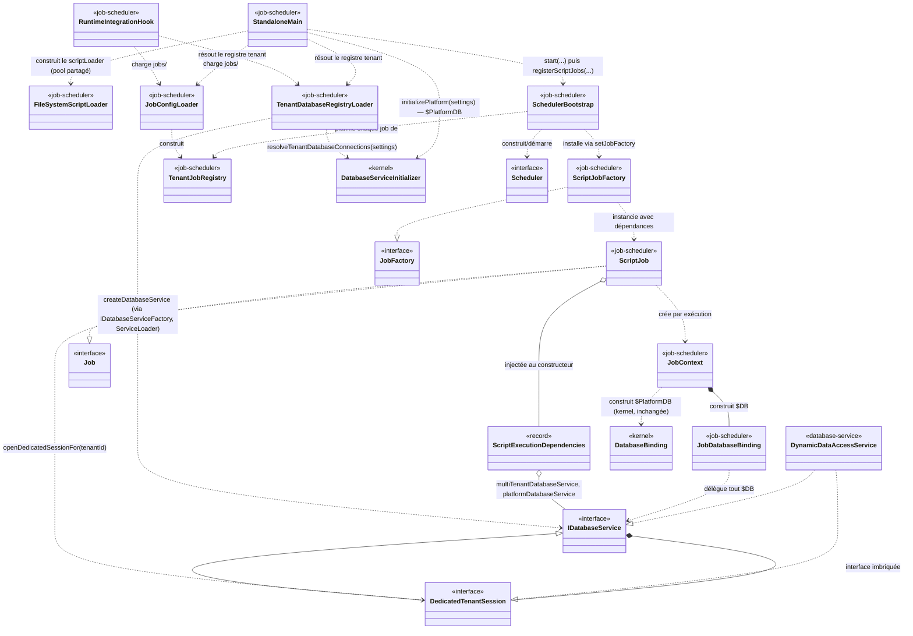
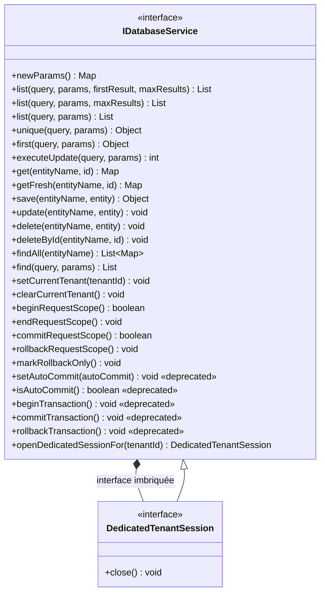
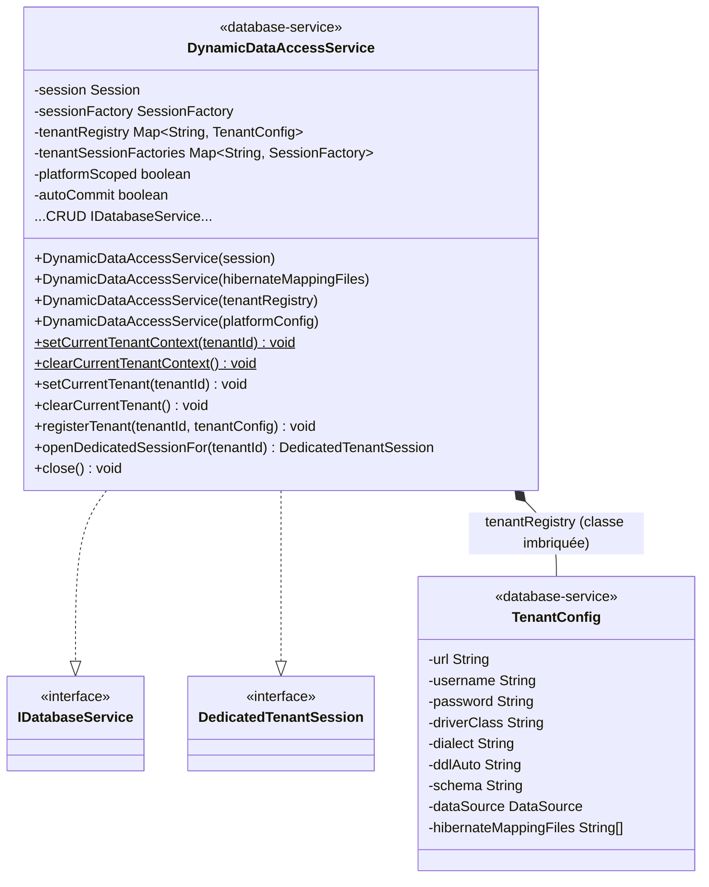
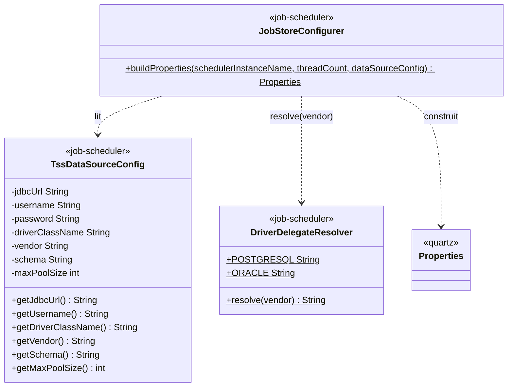
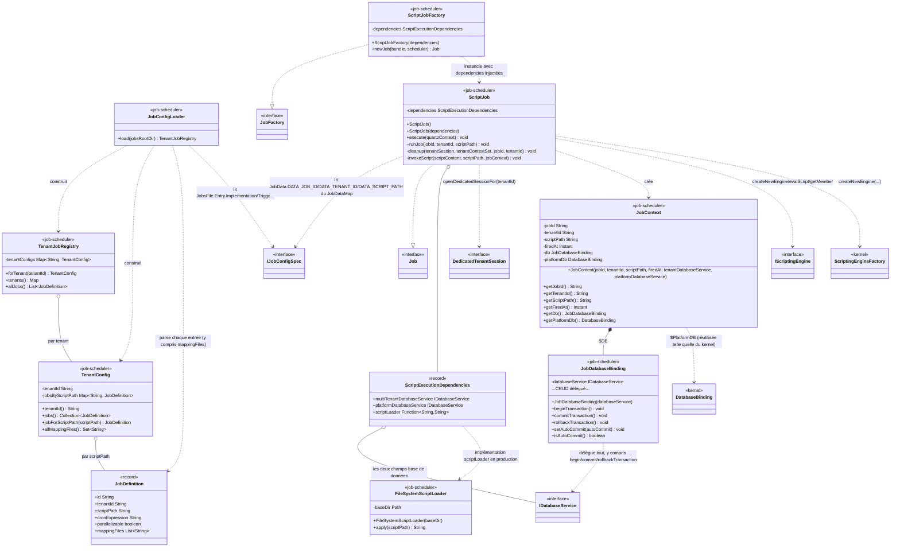

Created : 2026-09-30
Dernière mise à jour : 2026-10-02
Version : v12

# Diagramme de classes — Task Scheduling System (`payos-job-scheduler`)

**Audience :** architectes, tech leads, contributeurs à `payos-job-scheduler`, `database-service`, `payos-foundation` et `payos` (kernel)
**Périmètre :** toutes les classes de production créées jusqu'ici pour TSS (Stories 1.1 et 1.2, y compris la résolution du gap AC1), plus les classes d'appui touchées dans `database-service`, `payos-foundation` et `payos` (kernel)
**Document vivant :** ce diagramme sera mis à jour au fil des prochaines stories (1.3 à 1.5, puis Epic 2) — voir [§9](#9-état-davancement--ce-qui-nest-pas-encore-construit) pour ce qui manque encore.

---

## Table des matières

1. [Objectif et méthodologie](#1-objectif-et-méthodologie)
2. [Légende](#2-légende)
3. [Vue d'ensemble](#3-vue-densemble)
4. [`payos-foundation` — le contrat `IDatabaseService`](#4-payos-foundation--le-contrat-idatabaseservice)
5. [`database-service` — l'implémentation Hibernate](#5-database-service--limplémentation-hibernate)
6. [`payos-job-scheduler/jobstore` — configuration du `JobStore` Quartz](#6-payos-job-schedulerjobstore--configuration-du-jobstore-quartz)
7. [`payos-job-scheduler/bootstrap` — points d'entrée et cycle de vie](#7-payos-job-schedulerbootstrap--points-dentrée-et-cycle-de-vie)
8. [`payos-job-scheduler/registration` et `execution` — chargement et exécution des jobs](#8-payos-job-schedulerregistration-et-execution--chargement-et-exécution-des-jobs)
9. [État d'avancement — ce qui n'est pas encore construit](#9-état-davancement--ce-qui-nest-pas-encore-construit)
10. [Flux d'exécution complet, pas à pas](#10-flux-dexécution-complet-pas-à-pas)
11. [Un piège de nommage à connaître](#11-un-piège-de-nommage-à-connaître)
12. [Références](#12-références)

---

## 1. Objectif et méthodologie

Ce document complète [ADR-0009](adr/0009-task-scheduling-system.md) (la décision) et `payos-job-scheduler/_bmad-output/planning-artifacts/architecture.md` (l'architecture narrative propre au module, tenue par le workflow BMad). Là où ces deux documents expliquent *pourquoi* TSS est structuré ainsi, celui-ci répond à une question différente — *quelles classes existent, où vivent-elles, et comment se relient-elles* — au niveau du code réellement écrit, pas du plan.

Chaque classe listée a été localisée par lecture directe du code source (pas d'inférence à partir des noms), dans les répertoires suivants :
- `payos-job-scheduler/src/main/java/ma/s2m/payos/scheduler/{jobstore,bootstrap,registration,execution}/`
- `database-service/src/main/java/ma/s2m/` (`DynamicDataAccessService` et sa classe imbriquée `TenantConfig`)
- `payos-foundation/src/main/java/ma/s2m/payos/database/IDatabaseService.java`
- `payos/src/main/java/ma/s2m/payos/database/DatabaseServiceInitializer.java` (kernel — nouveau dans ce périmètre depuis la résolution du gap AC1, voir §7)

Les classes de test (`*Test.java`) sont exclues du périmètre. Les classes `payos` (kernel) et Quartz apparaissent comme dépendances de contexte (TSS les appelle) mais ne sont pas elles-mêmes détaillées membre par membre — seules leurs méthodes effectivement utilisées par TSS sont montrées. `DatabaseServiceInitializer` suit la même règle : seule sa méthode `resolveTenantDatabaseConnections` (ajoutée pour TSS, voir §7) est montrée, pas le reste de sa surface (`initialize`, `initializePlatform`, etc.), qui reste un détail interne du kernel sans lien avec TSS.

À ce stade (fin Story 1.2, résolution du gap AC1 incluse), le périmètre compte **23 classes/interfaces/records de production** portées par TSS et ses dépendances directement modifiées pour lui (`IDatabaseService`, `DynamicDataAccessService`, `DatabaseServiceInitializer`) :

| Module | Classes |
| --- | --- |
| `payos-foundation` | `IDatabaseService`, `IDatabaseService.DedicatedTenantSession` (interface imbriquée) |
| `database-service` | `DynamicDataAccessService`, `DynamicDataAccessService.TenantConfig` (classe imbriquée) |
| `payos-job-scheduler` / `config` | `IJobConfigSpec` |
| `payos-job-scheduler` / `jobstore` | `DriverDelegateResolver`, `TssDataSourceConfig`, `JobStoreConfigurer` |
| `payos-job-scheduler` / `bootstrap` | `SchedulerBootstrap`, `StandaloneMain`, `RuntimeIntegrationHook`, `StandaloneConfigLoader`, `TenantDatabaseRegistryLoader` |
| `payos-job-scheduler` / `registration` | `JobDefinition`, `TenantConfig`, `TenantJobRegistry`, `JobConfigLoader` |
| `payos-job-scheduler` / `execution` | `JobDatabaseBinding`, `JobContext`, `ScriptExecutionDependencies`, `ScriptJob`, `ScriptJobFactory`, `FileSystemScriptLoader` |

`payos` (kernel) n'apparaît volontairement pas dans ce tableau : `DatabaseServiceInitializer` existait déjà avant TSS et reste une classe kernel ordinaire — seule sa nouvelle méthode `resolveTenantDatabaseConnections` (et le petit `record TenantDatabaseDescriptor` qu'elle retourne — renommé depuis `TenantDatabaseConnection` le 2026-10-02, le nom initial prêtant à confusion avec une connexion ouverte ou un `DataSource`) a été ajoutée pour TSS, et elle est montrée comme dépendance de contexte au même titre que `DatabaseBinding`/`ScriptingEngineFactory`.

---

## 2. Légende

| Stéréotype de module | Repository |
| --- | --- |
| `<<foundation>>` | `payos-foundation` |
| `<<kernel>>` | `payos` (référencé pour contexte — non restructuré par TSS, une méthode y a été ajoutée pour TSS) |
| `<<database-service>>` | `database-service` |
| `<<job-scheduler>>` | `payos-job-scheduler` |
| `<<quartz>>` | Bibliothèque externe `org.quartz-scheduler:quartz` (pas du code PayOS) |

Chaque classe porte aussi un stéréotype de nature (`<<interface>>`, `<<record>>`, aucun pour une classe concrète ordinaire).

| Notation mermaid | Signification |
| --- | --- |
| `A --|> B` | `A` hérite de `B` (extends) |
| `A ..|> B` | `A` implémente l'interface `B` |
| `A ..> B : label` | `A` utilise/instancie/dépend de `B` |
| `A *-- B` | `A` possède `B` en composition |
| `A o-- B` | `A` possède `B` en agrégation (référence à un objet qui existe indépendamment) |

---

## 3. Vue d'ensemble

Ce diagramme relie les classes pivots ; le détail complet de chacune est dans les sections suivantes.

---

## 4. `payos-foundation` — le contrat `IDatabaseService`

**`IDatabaseService`** est le contrat unique derrière `$DB`/`$PlatformDB` côté kernel, et maintenant aussi derrière TSS — délibérément dépourvu de tout import Hibernate (ou de tout autre framework de persistance) dans ses signatures, pour qu'une implémentation puisse exister sans dépendre d'Hibernate.

**`openDedicatedSessionFor(String tenantId)`** (ajoutée pour Story 1.2) ouvre une session dédiée, manuellement transactionnable, pour un tenant donné — sans jamais exposer de type Hibernate à l'appelant. Implémentation par défaut : lève `UnsupportedOperationException` — seules les implémentations capables de router vers la base d'un tenant précis (comme `DynamicDataAccessService` en mode registre multi-tenant) la surchargent.

**`DedicatedTenantSession`** est une interface imbriquée : `IDatabaseService` + `close()`. C'est la seule différence avec l'interface parente — un appelant qui a ouvert une session dédiée doit pouvoir la refermer, et rien d'autre. `close()` doit annuler (rollback) toute transaction encore active avant de libérer la ressource — l'appelant n'a jamais besoin de sortir de cette interface pour s'en assurer.

*Historique de correction :* une première version de cet ajout exposait `openSessionForTenant(String): org.hibernate.Session` directement sur la classe concrète `DynamicDataAccessService`, puis sur une interface dédiée `TenantSessionSource` — deux approches qui couplaient structurellement `payos-job-scheduler` à une implémentation Hibernate. Voir `architecture.md` de `payos-job-scheduler` (section « Long-Running Job Execution & Manual Transaction Control ») pour le détail de cette correction en deux temps.

---

## 5. `database-service` — l'implémentation Hibernate

**`DynamicDataAccessService`** a quatre modes de construction, tous déjà existants avant TSS (Story 1.1/1.2 n'en ajoutent aucun) :
1. **Session-backed** (`Session` explicite) — contrôle transactionnel manuel disponible.
2. **Fichiers de mapping Hibernate** — construit sa propre `SessionFactory`, aussi session-backed.
3. **Registre multi-tenant** (`Map<String, TenantConfig>`) — mode utilisé derrière `$DB` en requête API, et désormais aussi par TSS (`TenantDatabaseRegistryLoader` en construit un, voir §7) ; transaction possédée automatiquement par le runtime pour la durée de la requête.
4. **Config plateforme** (`TenantConfig` unique) — utilisé derrière `$PlatformDB`, filtrage tenant désactivé.

**`openDedicatedSessionFor(tenantId)`** (implémentation de l'interface, ajoutée pour TSS) ouvre une `Session` via le mécanisme interne déjà existant `openTenantSession`/`resolveTenantSessionFactory` (utilisés en interne par le mode 3), puis l'enveloppe dans **une nouvelle instance** de `DynamicDataAccessService` construite en mode 1 (session-backed) — c'est cette nouvelle instance, pas la `Session` brute, qui est retournée comme `DedicatedTenantSession`.

**`close()`** (implémentation de l'interface) n'a de sens que pour une instance session-backed — lève `IllegalStateException` sinon. Elle annule d'abord toute transaction encore active, puis ferme la `Session`.

**Découverte notable (Story 1.2) :** `CURRENT_TENANT` est un `ThreadLocal` **statique**, partagé par *toutes* les instances de `DynamicDataAccessService` sur un même thread — y compris une instance session-backed retournée par `openDedicatedSessionFor`. Appeler `save`/`get`/etc. sans avoir d'abord appelé `setCurrentTenant(tenantId)` sur cette instance échoue avec `IllegalStateException`, même en mode session-backed. C'est exactement pourquoi `ScriptJob` (§8) appelle `tenantSession.setCurrentTenant(tenantId)` avant toute opération `$DB`.

---

## 6. `payos-job-scheduler/jobstore` — configuration du `JobStore` Quartz

**`TssDataSourceConfig`** est la configuration de connexion propre à TSS, pour son propre schéma isolé (tables `QRTZ_*` + `tss_job_execution` à venir) — délibérément **pas** le `TenantConfig` de `DynamicDataAccessService` (voir [§11](#11-un-piège-de-nommage-à-connaître)), car ce schéma n'appartient ni à un tenant ni à la config plateforme.

**`DriverDelegateResolver`** décide seulement quel `DriverDelegate` Quartz utiliser (`StdJDBCDelegate` par défaut, `OracleDelegate` pour Oracle) — Quartz embarque déjà tous ses délégués, cette classe ne fait que choisir.

**`JobStoreConfigurer`** assemble les `java.util.Properties` pour un `JobStoreTX` clustered, en pointant Quartz vers le `DataSource` autonome de TSS (via le `HikariCpPoolingConnectionProvider` déjà embarqué dans Quartz — aucun `ConnectionProvider` custom nécessaire) — jamais via `DynamicDataAccessService` (voir architecture.md « Why not reuse DynamicDataAccessService directly »).

---

## 7. `payos-job-scheduler/bootstrap` — points d'entrée et cycle de vie

```mermaid
classDiagram
    class SchedulerBootstrap {
        <<job-scheduler>>
        -scheduler Scheduler
        +start(schedulerInstanceName, threadCount, dataSourceConfig) SchedulerBootstrap$
        +isStarted() boolean
        +scheduler() Scheduler
        +registerScriptJobs(registry, dependencies) void
        +shutdown(waitForJobsToComplete) void
    }
    class StandaloneMain {
        <<job-scheduler>>
        -SCHEDULER_BASE_DIR_ARG String$
        +main(args) void$
        -registerJobs(bootstrap, jobsRootDir, payosConfigFile, schedulerBaseDir) void$
        -resolveSchedulerBaseDir(args) Path$
    }
    class RuntimeIntegrationHook {
        <<job-scheduler>>
        -bootstrap SchedulerBootstrap
        +start(schedulerInstanceName, threadCount, dataSourceConfig) void
        +isStarted() boolean
        +stop(waitForJobsToComplete) void
        -registerJobs() void
    }
    class StandaloneConfigLoader {
        <<job-scheduler>>
        -envLookup Function~String,String~
        -propertyLookup Function~String,String~
        -configFileContents JsonNode
        +load() StandaloneConfigLoader$
        +load(envLookup, propertyLookup) StandaloneConfigLoader$
        +resolve(key, jsonBlockName, jsonFieldName) String
    }
    class TenantDatabaseRegistryLoader {
        <<job-scheduler>>
        +loadPayOSSettings(payosConfigFile) Map$
        +resolveForTenants(payosSettings, jobRegistry) Map~String, DatabaseTenantDefinition~$
        +createDatabaseService(tenantRegistry) IDatabaseService$
    }
    class IJobConfigSpec {
        <<interface>>
        <<job-scheduler>>
        +CONFIG_FILE_KEY String$
        +DEFAULT_CONFIG_FILE String$
    }
    class TenantJobRegistry {
        <<job-scheduler>>
    }
    class JobConfigLoader {
        <<job-scheduler>>
    }
    class ScriptExecutionDependencies {
        <<record>>
        <<job-scheduler>>
    }
    class FileSystemScriptLoader {
        <<job-scheduler>>
    }
    class DatabaseTenantDefinition {
        <<foundation>>
        +getUrl() String
        +getUsername() String
        +getPassword() String
        +getDriverClass() String
        +getDialect() String
        +getDdlAuto() String
        +getSchema() String
        +getMaxRequestsPerMinute() int
        +getDataSource() DataSource
        +getHibernateMappingFiles() String[]
    }
    class IDatabaseServiceFactory {
        <<interface>>
        <<foundation>>
        +create(tenantDefinitions) IDatabaseService
        +createPlatform(platformDefinition) IDatabaseService
    }
    class IDatabaseService {
        <<interface>>
        <<foundation>>
    }
    class DatabaseServiceInitializer {
        <<kernel>>
        +resolveTenantDatabaseConnections(settings) Map~String, TenantDatabaseDescriptor~$
        +initializePlatform(settings) IDatabaseService$
    }
    class TenantDatabaseDescriptor {
        <<record>>
        <<kernel>>
        +tenantId String
        +effectiveDatabaseName String
        +url String
        +username String
        +password String
        +driverClass String
        +dialect String
        +ddlAuto String
        +schema String
    }
    class PayOSConfig {
        <<kernel>>
        +settings Map$
        +getRuntimeBaseDirectory() Path$
        +getPlatformDatabaseService() IDatabaseService$
    }
    class Scheduler {
        <<interface>>
        <<quartz>>
        +setJobFactory(factory) void
        +scheduleJob(jobDetail, trigger) Date
        +start() void
        +shutdown(waitForJobsToComplete) void
    }
    class StdSchedulerFactory {
        <<quartz>>
    }
    class JobFactory {
        <<interface>>
        <<quartz>>
        +newJob(bundle, scheduler) Job
    }
    class JobRunShell {
        <<quartz>>
        +initialize(qs) void
        +run() void
    }
    class Job {
        <<interface>>
        <<quartz>>
        +execute(context) void
    }

    StandaloneMain ..> StandaloneConfigLoader : résout la config (3 niveaux)
    StandaloneMain ..> IJobConfigSpec : lit les clés (Database.*, Scheduler.*, Jobs.*)
    StandaloneConfigLoader ..> IJobConfigSpec : CONFIG_FILE_KEY, DEFAULT_CONFIG_FILE
    StandaloneMain ..> SchedulerBootstrap : start(...)
    StandaloneMain ..> JobConfigLoader : load(jobsRootDir)
    StandaloneMain ..> TenantDatabaseRegistryLoader : loadPayOSSettings + resolveForTenants + createDatabaseService
    StandaloneMain ..> DatabaseServiceInitializer : initializePlatform(payosSettings) — $PlatformDB
    StandaloneMain ..> FileSystemScriptLoader : construit (scriptLoader)
    StandaloneMain ..> ScriptExecutionDependencies : construit
    RuntimeIntegrationHook o-- SchedulerBootstrap : possède (0..1, une seule fois)
    RuntimeIntegrationHook ..> JobConfigLoader : load(jobsRootDir)
    RuntimeIntegrationHook ..> TenantDatabaseRegistryLoader : resolveForTenants(PayOSConfig.settings, ...) + createDatabaseService
    RuntimeIntegrationHook ..> PayOSConfig : settings, getRuntimeBaseDirectory(), getPlatformDatabaseService()
    RuntimeIntegrationHook ..> FileSystemScriptLoader : construit (scriptLoader)
    RuntimeIntegrationHook ..> ScriptExecutionDependencies : construit
    TenantDatabaseRegistryLoader ..> DatabaseServiceInitializer : resolveTenantDatabaseConnections(settings)
    DatabaseServiceInitializer ..> TenantDatabaseDescriptor : retourne, un par tenant
    TenantDatabaseRegistryLoader ..> DatabaseTenantDefinition : construit, un par tenant (resolveForTenants)
    TenantDatabaseRegistryLoader ..> IDatabaseServiceFactory : createDatabaseService — ServiceLoader
    IDatabaseServiceFactory ..> IDatabaseService : create(tenantDefinitions)
    SchedulerBootstrap ..> StdSchedulerFactory : construit
    SchedulerBootstrap *-- Scheduler
    SchedulerBootstrap ..> IJobConfigSpec : usingJobData(JobData.DATA_JOB_ID, ...)
    SchedulerBootstrap ..> TenantJobRegistry : registerScriptJobs(registry, ...)
    SchedulerBootstrap ..> ScriptExecutionDependencies : registerScriptJobs(..., dependencies)
    Scheduler o-- JobFactory : setJobFactory(...) — stockée sur QuartzScheduler, rien ne s'exécute encore
    JobRunShell ..> JobFactory : qs.getJobFactory().newJob(bundle, scheduler) au déclenchement d'un trigger
    JobRunShell ..> Job : run() appelle execute(context)
```

**`SchedulerBootstrap`** est le point de construction unique du scheduler Quartz — `StandaloneMain` et `RuntimeIntegrationHook` délèguent tous deux ici, pour que les deux modes de déploiement (processus autonome vs. embarqué dans `payos-runtime`) ne puissent jamais diverger.

**Le lien entre `Scheduler` et `JobFactory` (vérifié par désassemblage du jar Quartz 2.3.2, pas supposé) :** `scheduler.setJobFactory(factory)` (appelé par `SchedulerBootstrap.registerScriptJobs`) ne fait que stocker la référence dans un champ privé `jobFactory` sur `QuartzScheduler` (le moteur interne — `Scheduler` est l'interface publique, `StdScheduler` délègue) ; rien ne s'exécute à cet instant. Le lien s'active seulement plus tard, à chaque déclenchement d'un trigger : le thread interne du scheduler acquiert le trigger dû via le `JobStore`, construit un `TriggerFiredBundle`, et obtient un `JobRunShell` — un simple conteneur `(scheduler, bundle)`, sans `Job` instancié pour l'instant. C'est `JobRunShell.initialize(qs)` qui instancie réellement le job, en appelant exactement `qs.getJobFactory().newJob(firedTriggerBundle, scheduler)` — c'est **ce point précis** où `ScriptJobFactory.newJob(...)` s'exécute et construit le `ScriptJob` avec ses dépendances déjà injectées. Le `JobRunShell` (qui implémente `Runnable`) est ensuite soumis au pool de threads ; son `run()` construit le `JobExecutionContext` puis appelle `job.execute(jec)`, refermant la boucle vers `ScriptJob.execute(...)`.

**`registerScriptJobs(registry, dependencies)`** (ajoutée Story 1.2) installe d'abord un `ScriptJobFactory` (§8) sur le scheduler, puis planifie un couple `JobDetail`/`Trigger` par entrée de `registry`, avec pour `JobKey` le tuple `(scriptPath, tenantId)` — le même couple que le PRD a déjà établi comme identité unique d'un job, donc le modèle d'identité de Quartz l'impose gratuitement.

**`StandaloneMain`** est le point d'entrée du processus autonome — ne dépend que de ce module et de Quartz, aucune classe `payos-runtime` n'est référencée. La configuration passe par `StandaloneConfigLoader`. **Depuis la résolution du gap AC1 (2026-10-01), `main(...)` câble le pipeline complet :** résout le répertoire de base du scheduler (`--scheduler-base-dir`, argument CLI, par défaut le répertoire de travail du processus), démarre `SchedulerBootstrap`, charge `jobs/` via `JobConfigLoader`, puis — s'il existe au moins un job — charge le fichier de config PayOS (`TenantDatabaseRegistryLoader.loadPayOSSettings`), résout le registre tenant (`resolveForTenants`), résout `$PlatformDB` (`DatabaseServiceInitializer.initializePlatform(payosSettings)`, réutilisée telle quelle du kernel — corrigé 2026-10-02, le besoin existant aussi en mode standalone, pas seulement embarqué ; retourne `null`, pas une erreur, si `platform-database-service` n'est pas déclaré), construit `ScriptExecutionDependencies` et appelle `registerScriptJobs(...)`. Une erreur de câblage à cette étape **propage** (fail-fast) — TSS est l'unique responsabilité de ce processus.

**`RuntimeIntegrationHook`** est le point d'intégration pour un déploiement embarqué dans `payos-runtime` — mêmes garanties de construction que `StandaloneMain`, via `SchedulerBootstrap`. **Diffère de `StandaloneMain` sur un point clé :** il réutilise directement la configuration déjà chargée par l'hôte — `PayOSConfig.getRuntimeBaseDirectory()` (le `--bundle-path` de `payos-runtime`) pour `jobs/`/les scripts, et `PayOSConfig.settings`/`getPlatformDatabaseService()` pour le registre tenant — sans jamais relire de fichier lui-même. Une erreur de câblage ici est **journalisée, pas propagée** : TSS est un sous-système secondaire dans `payos-runtime`, une mauvaise configuration qui ne concerne que TSS ne doit jamais faire échouer le démarrage de tout le runtime.

**`TenantDatabaseRegistryLoader`** (nouvelle classe, résolution du gap AC1) construit ce qui alimente `$DB` côté TSS — **entièrement program-to-interfaces** (correction utilisateur, 2026-10-01 : la première version instanciait directement `ma.s2m.DynamicDataAccessService`, une classe concrète de `database-service`) :
- **`loadPayOSSettings(File)`** reproduit le comportement réel de `ConfigLoader.loadServerConfig` du kernel : le fichier passé (`payos.json`/`bootstrap.json`) n'est lu que pour sa clé `configDir` (défaut `"."`) — les vrais réglages (`database-service`, `multitenancy`, `applications`, ...) vivent dans les fichiers `*.json` de ce répertoire, pas forcément dans `payos.json` lui-même. Délègue le scan/fusion du répertoire à `ConfigLoader.loadConfigByDirectory` (la même méthode que le kernel, pas une réimplémentation), sans jamais appeler `ConfigLoader.loadServerConfig` lui-même — cette méthode déclenche aussi des effets de bord propres au boot du kernel (chargement des service adapters, initialisation du secret service/de la clé de chiffrement, chargement des `applications`) que TSS ne doit pas reproduire. *Limite connue, documentée plutôt que silencieuse :* les URL `jdbc:h2:file:...` relatives ne sont pas renormalisées par rapport au répertoire de base du runtime (mécanisme privé du kernel, non réutilisable ici) — ne concerne que les déploiements H2 fichier avec chemin relatif, pas les bases réseau (PostgreSQL/Oracle/...) des déploiements multi-tenant réels.
- **`resolveForTenants(payosSettings, jobRegistry)`** appelle `DatabaseServiceInitializer.resolveTenantDatabaseConnections` (voir ci-dessous) pour **tous** les tenants déclarés dans `payosSettings`, puis ne conserve que ceux présents dans `jobRegistry` (les tenants qui ont réellement des jobs sous `jobs/`) — construisant pour chacun un `DatabaseTenantDefinition` (**type `payos-foundation`, neutre vis-à-vis du framework** — pas `DynamicDataAccessService.TenantConfig`), avec pour `hibernateMappingFiles` l'union des `mappingFiles` déclarés par les jobs de ce tenant (`TenantConfig.allMappingFiles()`, §8) et `maxRequestsPerMinute = -1` (« pas de limite » — un champ que `DynamicDataAccessService` ne lit de toute façon jamais lui-même, le quota étant un concern au niveau requête API, pas exécution de job). Lève `IllegalStateException` si un tenant de `jobRegistry` n'a pas d'entrée correspondante sous `multitenancy.tenants`.
- **`createDatabaseService(tenantRegistry)`** construit l'`IDatabaseService` réel à partir de ce `Map<String, DatabaseTenantDefinition>`, via `ServiceLoader<IDatabaseServiceFactory>` — **exactement le même mécanisme SPI, et le même fournisseur** (`DynamicDatabaseServiceFactory` de `dynamic-database-service`, déjà déclaré dans son `META-INF/services`), que `DatabaseServiceInitializer.createDatabaseService` utilise côté kernel. `payos-job-scheduler` ne nomme ainsi **plus jamais** l'implémentation concrète `database-service` nulle part dans son code de production — vérifié par grep (seuls des commentaires Javadoc expliquant cette absence mentionnent encore `DynamicDataAccessService`).

**`DatabaseServiceInitializer.resolveTenantDatabaseConnections(settings)`** (kernel, `payos` — méthode ajoutée pour TSS, 2026-10-01) est une extraction **pure, sans effet de bord**, de la logique de résolution tenant→base de données que `initialize()` exécutait déjà en interne, tenant par tenant : résolution d'une référence explicite par nom (`database-service.name`), repli sur la base par défaut si absente, puis lecture des champs de connexion (`url`/`username`/`password`/`driverClass`/`dialect`/`ddlAuto`/`schema`). Aucune construction de `DataSource`, aucune écriture dans `PayOSConfig`, aucun `ServiceLoader` — c'est pour cela qu'elle est sûre à appeler depuis `payos-job-scheduler`. `initialize()` a été refactorée pour appeler cette même logique extraite en interne (`resolveOneTenantConnection`) — comportement observable inchangé, vérifié par 11 nouveaux tests de régression (`DatabaseServiceInitializerTest`, cette classe n'avait aucune couverture avant). Ne résout **pas** les fichiers de mapping Hibernate — ce sous-système (`applications`/`authorized-tenants`) reste délibérément hors périmètre pour TSS (voir le choix hybride ci-dessous).

**`StandaloneConfigLoader`** résout chaque clé de config à travers trois niveaux, dans l'ordre : variable d'environnement → propriété système → fichier JSON. Les lookups sont injectés (`Function<String,String>`) plutôt que d'appeler `System.getenv`/`System.getProperty` directement, pour rester testable.

**`IJobConfigSpec`** (`config/`, ajoutée post-Story 1.2 ; renommée depuis `ITSSConfigSpec` à la demande de l'utilisateur, le nom initial ne reflétant plus bien son périmètre une fois `JobsFile` ajoutée) centralise **tous** les noms de clés utilisés par TSS, de trois natures distinctes volontairement regroupées dans une seule interface :
- **Configuration externe** (`tss-config.json`, via `StandaloneConfigLoader`) — `Database` (`name = "database"`, puis `URL`/`USER`/`PASSWORD`/`DRIVER`/`VENDOR`/`SCHEMA`/`MAX_POOL_SIZE`, chacune avec son couple clé-env-ou-propriété + nom de champ JSON correspondant, ex. `URL = "TSS_DB_URL"` / `URL_JSON_FIELD = "dbUrl"`), `Scheduler` (`name = "scheduler"`, puis `INSTANCE_NAME`, `THREAD_COUNT`, avec leurs valeurs par défaut), et **`Jobs`** (`name = "jobs"`, ajoutée avec la résolution du gap AC1 — `ROOT_DIR`/`ROOT_DIR_JSON_FIELD`/`DEFAULT_ROOT_DIR` pour l'emplacement de `jobs/`, `PAYOS_CONFIG_FILE`/`PAYOS_CONFIG_FILE_JSON_FIELD`/`DEFAULT_PAYOS_CONFIG_FILE` pour le fichier de config PayOS — les deux résolus relativement au répertoire de base du scheduler, uniquement en mode standalone), plus `CONFIG_FILE_KEY`/`DEFAULT_CONFIG_FILE` au niveau racine.
- **Schéma de `jobs.json`** (via `JobConfigLoader`, §8, document totalement différent de `tss-config.json`, jamais lu via `StandaloneConfigLoader`) — `JobsFile` (`name = "jobs"`, la clé du tableau racine), avec `JobsFile.Entry` (`ID`, `PARALLELIZABLE`) puis deux blocs imbriqués `JobsFile.Entry.Implementation` (`name = "implementation"`, `TYPE`, `TYPE_SCRIPT`, `SCRIPT`, et **`MAPPING_FILES`** — `"mappingFiles"`, ajoutée avec la résolution du gap AC1, tableau optionnel de fichiers de mapping Hibernate pour ce job) et `JobsFile.Entry.Trigger` (`name = "trigger"`, `TYPE`, `TYPE_CRON`, `EXPRESSION`). Seules les valeurs MVP (`"script"`/`"cron"`) sont déclarées — les valeurs Growth-phase (`"java"`/`"queue"`) ne sont volontairement pas ajoutées tant qu'aucun code ne les lit, pour ne pas introduire de constantes mortes.
- **Clés internes** `JobData` — `jobId`/`tenantId`/`scriptPath` du `JobDataMap` Quartz (posées par `SchedulerBootstrap.registerScriptJobs` à la planification, relues par `ScriptJob.execute` à l'exécution — jamais sourcées d'une variable d'env/propriété/fichier, donc sans champ `name` : il n'y a pas de bloc JSON à nommer).

Modélisée sur le style de `IConfigSpec` du kernel (`payos-foundation`) — **y compris la convention `name` = clé du bloc JSON imbriqué** pour toute interface qui en représente un — mais **délibérément pas ajoutée à `IConfigSpec` lui-même** : ce dernier est le contrat du modèle `PayOSConfig`/`bootstrap.json` du kernel, un mécanisme de résolution complètement différent du modèle à trois niveaux propre à TSS en mode standalone, qui ne lit jamais `bootstrap.json` lui-même pour **sa propre** configuration (il le lit séparément, via `TenantDatabaseRegistryLoader`, uniquement pour le registre tenant). Coupler les clés de TSS à `payos-foundation` aurait entamé l'indépendance de déploiement de ce module.

**Le choix hybride (résolution du gap AC1) :** les identifiants de connexion de chaque tenant viennent de la config PayOS (`bootstrap.json`/fichiers du `configDir`, via `TenantDatabaseRegistryLoader`), mais les fichiers de mapping Hibernate viennent de `jobs.json`, déclarés par job (`JobsFile.Entry.Implementation.MAPPING_FILES`) — pas du sous-système `applications`/`authorized-tenants` du kernel, volontairement non reconstruit ici. Ce choix a été fait par l'utilisateur après que la vraie complexité du modèle de config tenant de PayOS (déclarations de bases nommées au niveau racine, référence par tenant, repli par défaut — pas un simple bloc inline par tenant comme supposé initialement) a été mise au jour.

---

## 8. `payos-job-scheduler/registration` et `execution` — chargement et exécution des jobs

### `registration/` — charger `jobs.json`

**`JobDefinition`** (record) : une entrée `jobs.json` supportée (`implementation.type: "script"` + `trigger.type: "cron"` uniquement — les autres combinaisons sont ignorées, pas rejetées, pour rester compatible avec un fichier qui mélange du contenu MVP et Growth-phase). **`mappingFiles`** (ajouté avec la résolution du gap AC1) : la liste, possiblement vide, des fichiers de mapping Hibernate que ce job déclare sous `implementation.mappingFiles` — un second constructeur à 5 arguments (sans `mappingFiles`) reste disponible pour la compatibilité ascendante, par défaut liste vide.

**`TenantConfig`** (`registration`, **à ne pas confondre** avec celle de `database-service` — [§11](#11-un-piège-de-nommage-à-connaître)) : la carte chemin-de-script → `JobDefinition` d'**un seul** tenant — un tenant déclare couramment plusieurs jobs. **`allMappingFiles()`** (ajoutée avec la résolution du gap AC1) retourne l'union, dédupliquée et dans l'ordre de première apparition, des `mappingFiles` de tous les jobs de ce tenant — c'est cette union que `TenantDatabaseRegistryLoader` (§7) passe au `DynamicDataAccessService.TenantConfig` du tenant.

**`TenantJobRegistry`** : le registre à travers **tous** les tenants — un `TenantConfig` par répertoire de tenant trouvé sous `jobs/`.

**`JobConfigLoader`** : parcourt `jobs/<tenantId>/jobs.json` (pas `custom-jobs.json` — Story 1.4). Le tenant est dérivé du nom de répertoire, littéralement — aucune vérification croisée avec un champ `tenant` déclaré dans le JSON pour l'instant. Tous les noms de clés qu'il lit (`jobs`, `id`, `parallelizable`, `implementation`/`type`/`script`/`mappingFiles`, `trigger`/`type`/`expression`, plus les valeurs `"script"`/`"cron"`) viennent de `IJobConfigSpec.JobsFile` — plus aucun littéral dispersé dans cette classe.

### `execution/` — exécuter un job

**`JobDatabaseBinding`** : le binding `$DB` propre à TSS (distinct du `DatabaseBinding` du kernel) — délègue toute la surface CRUD **plus** le contrôle transactionnel manuel (`beginTransaction`/`commitTransaction`/`rollbackTransaction`/`setAutoCommit`/`isAutoCommit`), volontairement exclu du `DatabaseBinding` du kernel pour les scripts API mais sûr ici puisqu'une exécution de job ne partage jamais sa transaction avec un autre script.

**`JobContext`** : l'objet de contexte passé à la fonction `execute(context)` du script — construit `$DB` (`JobDatabaseBinding`) et `$PlatformDB` (`DatabaseBinding` du kernel, réutilisée sans modification, `null`-safe si aucune base plateforme n'est configurée).

**`ScriptExecutionDependencies`** (record) : les dépendances partagées entre toutes les exécutions — `multiTenantDatabaseService`, `platformDatabaseService` (tous deux `IDatabaseService`, jamais un type Hibernate), et `scriptLoader` (chemin de script → contenu, injecté pour rester testable ; en production, `FileSystemScriptLoader`).

**`ScriptJob`** : l'adaptateur Quartz `Job`. `execute(JobExecutionContext)` est un adaptateur mince qui lit le `JobDataMap` puis délègue à `runJob(jobId, tenantId, scriptPath)` (package-visible, testable sans vrai `JobExecutionContext`). `runJob` ouvre une session dédiée (`openDedicatedSessionFor`), positionne le tenant ambiant, construit le `JobContext`, invoque le script, puis — **inconditionnellement**, dans un seul bloc `finally` sans chemin de sortie anticipée — ferme la session (ce qui annule toute transaction encore active) et efface le contexte tenant. C'est le point le plus critique en sécurité de Story 1.2 : Quartz réutilise ses threads de travail entre exécutions de tenants différents ; sauter ce nettoyage sur un chemin quelconque est une fuite de données inter-tenant, pas un bug mineur.

**`ScriptJobFactory`** : une `JobFactory` Quartz qui construit `ScriptJob` avec ses dépendances injectées par constructeur — nécessaire car la `JobFactory` par défaut de Quartz n'instancie les jobs que par réflexion sans argument. Installée une fois par `SchedulerBootstrap.registerScriptJobs(...)`.

**`FileSystemScriptLoader`** (nouvelle classe, résolution du gap AC1) : implémentation de production de `scriptLoader` — un pool de scripts **partagé**, résolu depuis un seul répertoire de base (`baseDir.resolve(scriptPath)`). Choix explicite de l'utilisateur : `scriptLoader` est typé `Function<String,String>`, sans paramètre `tenantId` — un répertoire de scripts par tenant n'était donc structurellement pas possible sans changer cette signature. Plusieurs tenants planifiant le même `scriptPath` lisent exactement le même fichier ; c'est le `JobKey` `(scriptPath, tenantId)` de `SchedulerBootstrap` (§7) qui permet malgré tout à ce script de s'exécuter selon des horaires différents, et contre le `$DB` d'un tenant différent, par tenant. Retourne `null` pour un fichier absent (pas une exception) — `ScriptJob` transforme déjà ce `null` en diagnostic explicite.

---

## 9. État d'avancement — ce qui n'est pas encore construit

Ce diagramme couvre les Stories 1.1 (infrastructure de clustering) et 1.2 (enregistrement + exécution d'un job script sur planification cron), y compris la résolution du gap AC1. Restent, dans l'Epic 1 :

- ~~**Câblage `registerScriptJobs` en production.**~~ **Résolu 2026-10-01.** `StandaloneMain`/`RuntimeIntegrationHook` chargent désormais `jobs/`, résolvent le registre tenant (`TenantDatabaseRegistryLoader` + `DatabaseServiceInitializer.resolveTenantDatabaseConnections`, kernel) et appellent `registerScriptJobs(...)` — voir §7 pour le détail complet et la Story 1.2 (note de résolution de la Task 5) pour l'historique de la décision (options considérées, choix hybride de l'utilisateur).
- **Story 1.3** — enregistrement de niveau plateforme (jobs sans tenant) et accès cross-tenant en lecture seule.
- **Story 1.4** — `custom-jobs.json`, logique de surcharge tenant-scopée, `RegistrationValidationException` (mentionnée dans architecture.md mais pas encore créée).
- **Story 1.5** — application réelle du flag `parallelizable` via une deuxième classe de job (`ExclusiveScriptJob`, avec `@DisallowConcurrentExecution`) — `ScriptJob` planifie aujourd'hui **tous** les jobs comme parallélisables, quel que soit ce que dit `jobs.json`.

Et dans l'Epic 2 (observabilité) : `history/` (table `tss_job_execution`, `JobExecutionRepository`), émission `PayOSMetrics`, masquage des données sensibles dans les logs/métriques d'exécution.

Ce document sera mis à jour à chaque nouvelle story qui ajoute ou modifie des classes de production.

---

## 10. Flux d'exécution complet, pas à pas

1. **Démarrage** — `StandaloneMain.main(args)` résout le répertoire de base du scheduler (`--scheduler-base-dir`, défaut : répertoire de travail du processus — ou, en mode embarqué, `RuntimeIntegrationHook.start(...)` utilise `PayOSConfig.getRuntimeBaseDirectory()`), résout la config (`StandaloneConfigLoader`), appelle `SchedulerBootstrap.start(...)`, qui construit les `Properties` via `JobStoreConfigurer` (lui-même appelant `DriverDelegateResolver`) et démarre un `Scheduler` Quartz clustered (`JobStoreTX`).
2. **Chargement des jobs** — `TenantJobRegistry jobRegistry = new JobConfigLoader().load(jobsRootDir)` (`jobsRootDir` résolu relativement au répertoire de base). Si aucun job n'est trouvé, rien d'autre ne se passe — pas une erreur (environnement standalone/dev sans `jobs/` encore).
3. **Résolution du registre tenant** — mode standalone : `TenantDatabaseRegistryLoader.loadPayOSSettings(payosConfigFile)` charge la config PayOS (fichier pointeur `payos.json` + fichiers du `configDir`, voir §7), puis `resolveForTenants(settings, jobRegistry)` appelle `DatabaseServiceInitializer.resolveTenantDatabaseConnections` (kernel) pour chaque tenant et construit un `DynamicDataAccessService.TenantConfig` (identifiants de connexion + union des `mappingFiles` déclarés dans `jobs.json`, via `TenantConfig.allMappingFiles()`). Mode embarqué : mêmes appels, mais directement sur `PayOSConfig.settings` déjà chargé par l'hôte — aucune relecture de fichier.
4. **Construction des dépendances** — `new DynamicDataAccessService(tenantRegistry)` (le `IDatabaseService` multi-tenant), `new FileSystemScriptLoader(baseDir)`, assemblés en `ScriptExecutionDependencies`.
5. **Planification** — `bootstrap.registerScriptJobs(jobRegistry, dependencies)` installe `ScriptJobFactory` puis, pour chaque `JobDefinition` de `jobRegistry.allJobs()`, planifie un `JobDetail`(`ScriptJob`) + `Trigger` cron, avec pour `JobKey` `(scriptPath, tenantId)`.
6. **Déclenchement** — à l'heure du cron, le thread interne du scheduler acquiert le trigger dû et obtient un `JobRunShell` ; `JobRunShell.initialize(qs)` appelle `qs.getJobFactory().newJob(bundle, scheduler)` — c'est-à-dire `ScriptJobFactory.newJob(...)` (construit `new ScriptJob(dependencies)`, les dépendances installées à l'étape 5) — puis `JobRunShell.run()` appelle `ScriptJob.execute(quartzContext)` (détail complet et vérifié : [§7](#7-payos-job-schedulerbootstrap--points-dentrée-et-cycle-de-vie)).
7. **Résolution** — `execute` lit `jobId`/`tenantId`/`scriptPath` du `JobDataMap` et appelle `runJob(...)`.
8. **Ouverture de session** — `runJob` appelle `dependencies.multiTenantDatabaseService().openDedicatedSessionFor(tenantId)`, obtenant un `IDatabaseService.DedicatedTenantSession` dédié à cette seule exécution, puis `tenantSession.setCurrentTenant(tenantId)`.
9. **Construction du contexte** — `new JobContext(jobId, tenantId, scriptPath, Instant.now(), tenantSession, platformDatabaseService)`, qui construit en interne `$DB` (`JobDatabaseBinding`) et `$PlatformDB` (`DatabaseBinding`, si configurée).
10. **Chargement du script** — `dependencies.scriptLoader().apply(scriptPath)` résout le contenu du script depuis le pool partagé (`FileSystemScriptLoader`, étape 4).
11. **Exécution** — `invokeScript` crée un moteur (`ScriptingEngineFactory.createNewEngine(ENGINE_GRAALVM_POLYGLOT)`), injecte `$DB`/`$PlatformDB` via `putMember`, appelle `evalScript(scriptContent, scriptPath)`, récupère la fonction `execute` via `getMember("execute")`, vérifie `canExecute()`, puis appelle `.execute(jobContext)` — jamais `executeScript()`, propre aux scripts API.
12. **Nettoyage (AC4, inconditionnel)** — que l'étape 11 réussisse, lève une exception du script (`PolyglotException`), ou que `$DB` n'ait jamais été touché : le bloc `finally` de `runJob` appelle `tenantSession.close()` (qui annule toute transaction encore active) puis `tenantSession.clearCurrentTenant()`.

---

## 11. Un piège de nommage à connaître

Deux classes distinctes, nommées `TenantConfig`, coexistent dans des packages différents — **ne pas les confondre à l'import** :

| Classe | Package | Rôle |
| --- | --- | --- |
| `ma.s2m.DynamicDataAccessService.TenantConfig` | `database-service` (classe imbriquée) | Descripteur de **connexion base de données** pour un tenant (URL, identifiants, dialecte, mappings Hibernate) |
| `ma.s2m.payos.scheduler.registration.TenantConfig` | `payos-job-scheduler` | Carte **chemin de script → `JobDefinition`** pour un tenant (rien à voir avec une connexion base de données) |

De même, `TssDataSourceConfig` (`payos-job-scheduler/jobstore`) ressemble par sa forme (URL/identifiants/pilote/dialecte/schéma) au `TenantConfig` de `database-service`, mais configure la base **propre à TSS** (schéma `QRTZ_*`), jamais une base tenant ou plateforme — les deux structures sont volontairement similaires pour la familiarité, sans lien de code entre elles.

Une troisième source de confusion possible, apparue avec la résolution du gap AC1 : `DatabaseServiceInitializer.TenantDatabaseDescriptor` (kernel, `payos` — renommé depuis `TenantDatabaseConnection` le 2026-10-02, précisément pour éviter cette confusion) n'est **ni** l'un ni l'autre des deux `TenantConfig` ci-dessus — c'est un simple porteur de données de connexion (url/username/.../schema), sans fichiers de mapping ni `DataSource`, que `TenantDatabaseRegistryLoader` (§7) convertit en `DatabaseTenantDefinition` (`payos-foundation`, en y ajoutant l'union des `mappingFiles` de `jobs.json`) — **jamais** directement en `DynamicDataAccessService.TenantConfig` : c'est `IDatabaseServiceFactory` (SPI, implémentée par `database-service`) qui fait cette dernière conversion, en interne, hors de la vue de `payos-job-scheduler`. Trois représentations distinctes d'une même « connexion tenant », chacune au bon niveau d'abstraction pour son appelant.

---

## 12. Références

- [ADR-0009 — Task Scheduling System](adr/0009-task-scheduling-system.md)
- [Operations: Task Scheduling System](../operations/task-scheduling-system-v3-2026-10-02.md) — le pendant opérationnel de ce document : comment configurer et démarrer TSS (standalone ou embarqué), tss-config.json, jobs.json, résolution tenant/plateforme, limitations connues
- `payos-job-scheduler/_bmad-output/planning-artifacts/architecture.md` — architecture narrative complète du module, tenue par le workflow BMad (décisions, corrections, séquence d'implémentation)
- `payos-job-scheduler/_bmad-output/implementation-artifacts/1-1-resilient-clustered-scheduling-infrastructure.md` — Story 1.1 (infrastructure de clustering)
- `payos-job-scheduler/_bmad-output/implementation-artifacts/1-2-register-and-run-a-script-job-on-a-cron-schedule.md` — Story 1.2 (enregistrement + exécution), y compris le journal de correction architecturale (Debug Log) menant à `IDatabaseService.openDedicatedSessionFor`, et la note de résolution de la Task 5 (gap AC1 — choix hybride, extraction kernel, câblage complet)
- [Data architecture](data-architecture.md) — pour le fonctionnement complet de `DynamicDataAccessService` au-delà de ce que TSS en utilise
- [Connector framework class diagram](connector-framework-class-diagram-v1-2026-09-02.md) — document frère, même méthodologie, pour un autre sous-système
