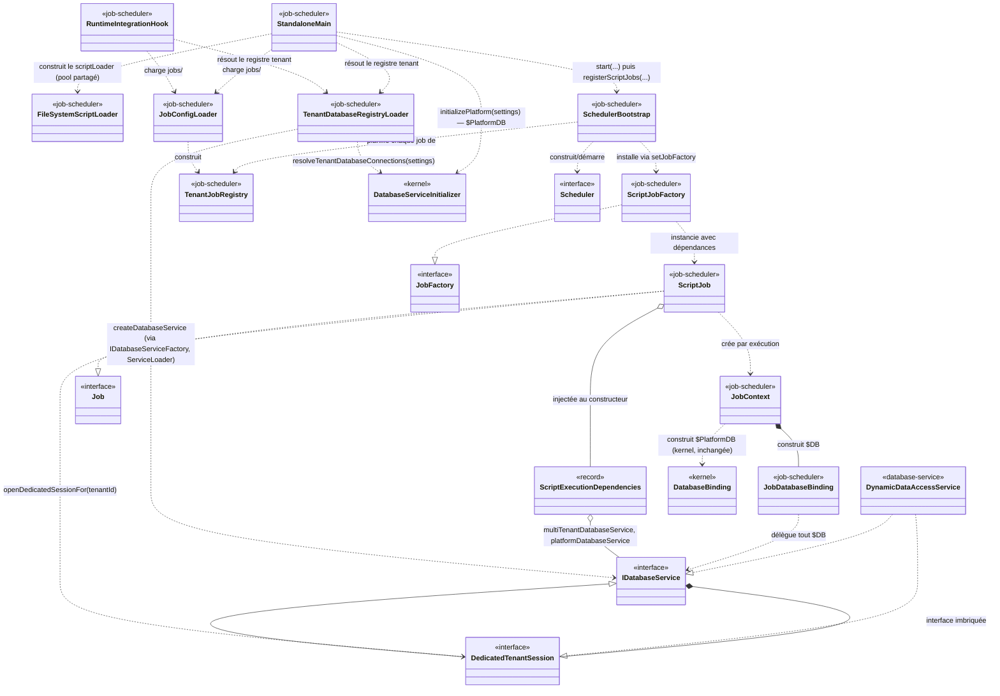
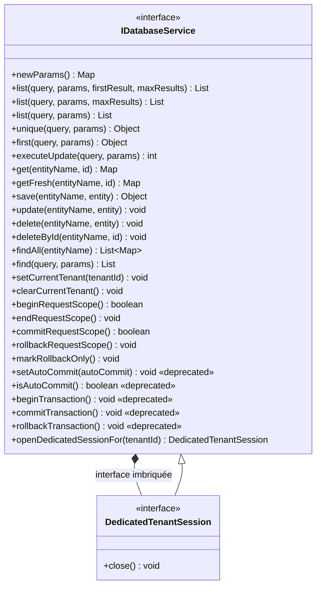
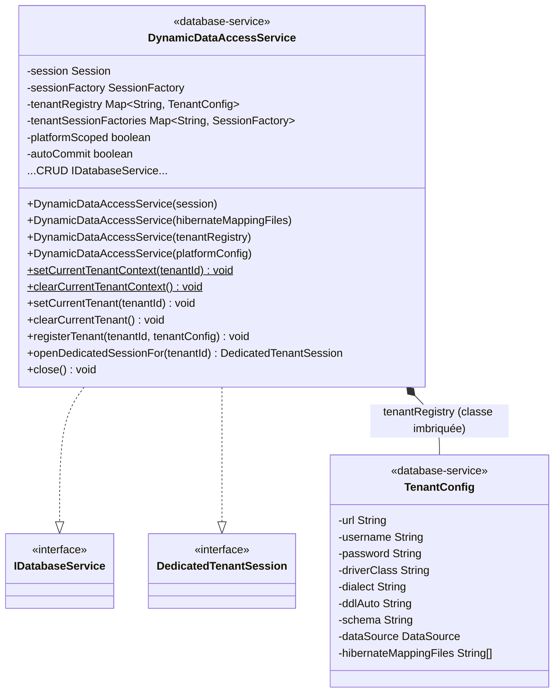
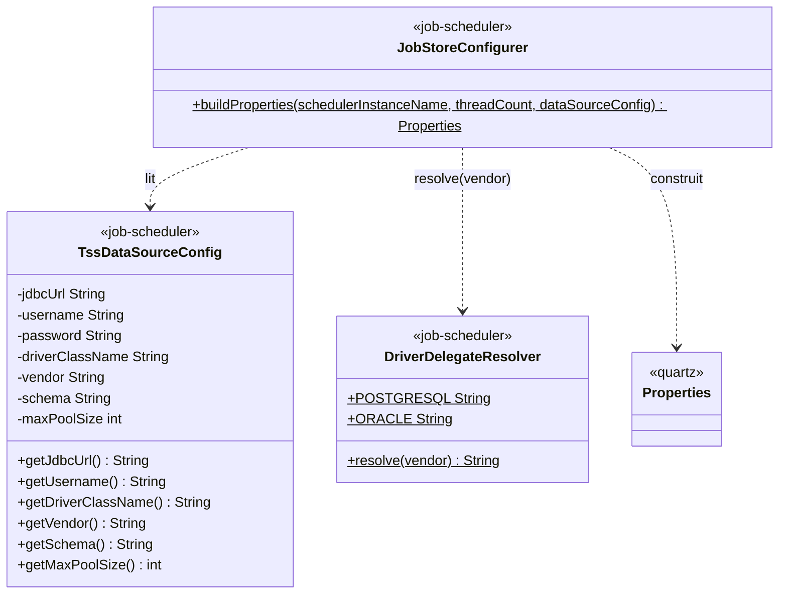
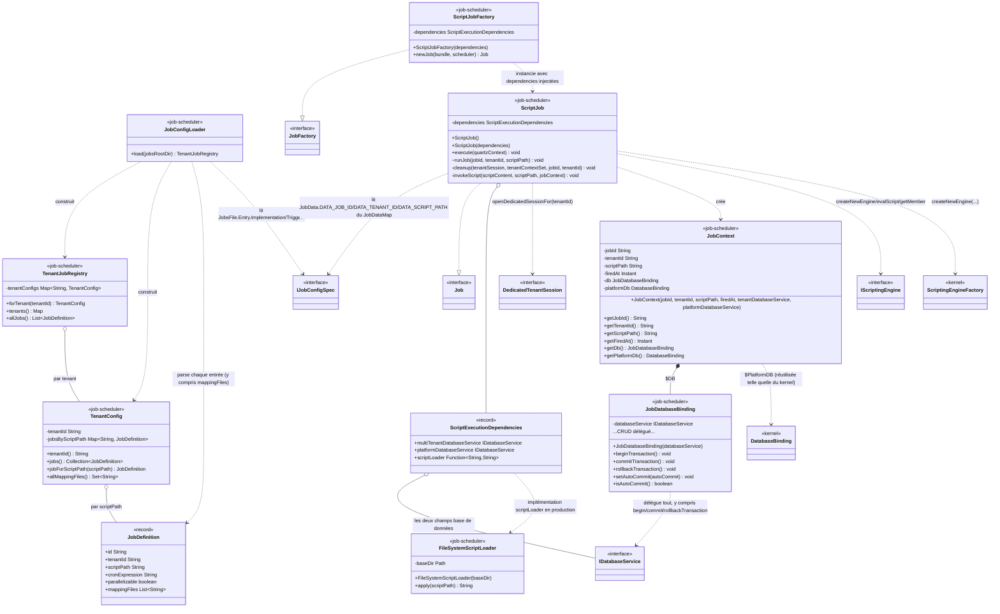

Created : 2026-09-30
Dernière mise à jour : 2026-10-07
Version : v18

# Diagramme de classes — Task Scheduling System (`payos-job-scheduler`)

**Audience :** architectes, tech leads, contributeurs à `payos-job-scheduler`, `database-service`, `payos-foundation`, `payos` (kernel), `payos-server-http` et `payos-connector-api`
**Périmètre :** les Stories 1.1 et 1.2 (§4-8, 10-11, y compris la résolution du gap AC1), **plus les Stories 2.1 et 2.2 de l'Epic 2** (§13 — package `history/`, détection de misfire, quota de concurrence par tenant, requêtes d'historique), **plus la Story 2.3** (§14 — package `metrics/`, émission `PayOSMetrics`, exposition HTTP Prometheus en mode standalone), **plus la Story 2.4** (§15 — masquage des données sensibles via `history/SensitiveDataScrubber`, réutilisation de `SensitiveFieldMasker`), plus les classes d'appui touchées dans `database-service`, `payos-foundation`, `payos` (kernel), `payos-server-http` et `payos-connector-api`.
**Trou connu, assumé, pas caché :** les Stories 1.3, 1.4 et 1.5 de l'Epic 1 (jobs de niveau plateforme, `custom-jobs.json`, `ExclusiveScriptJob`/`@DisallowConcurrentExecution`) ne sont **pas encore** couvertes par ce diagramme malgré leur statut `done` — ce document n'a pas été tenu à jour entre la Story 1.2 et la Story 2.1/2.2. Voir [§9](#9-état-davancement--ce-qui-nest-pas-encore-construit) pour le détail exact de ce qui manque. Les classes citées au §13 qui dépendent de mécanismes introduits par ces stories manquantes (ex. `ExclusiveScriptJob`) sont signalées comme telles plutôt que silencieusement supposées déjà connues.
**Document vivant :** ce diagramme sera mis à jour au fil des prochaines stories — voir [§9](#9-état-davancement--ce-qui-nest-pas-encore-construit) pour ce qui manque encore.

---

## Table des matières

1. [Objectif et méthodologie](#1-objectif-et-méthodologie)
2. [Légende](#2-légende)
3. [Vue d'ensemble](#3-vue-densemble)
4. [`payos-foundation` — le contrat `IDatabaseService`](#4-payos-foundation--le-contrat-idatabaseservice)
5. [`database-service` — l'implémentation Hibernate](#5-database-service--limplémentation-hibernate)
6. [`payos-job-scheduler/jobstore` — configuration du `JobStore` Quartz](#6-payos-job-schedulerjobstore--configuration-du-jobstore-quartz)
7. [`payos-job-scheduler/bootstrap` — points d'entrée et cycle de vie](#7-payos-job-schedulerbootstrap--points-dentrée-et-cycle-de-vie)
8. [`payos-job-scheduler/registration` et `execution` — chargement et exécution des jobs](#8-payos-job-schedulerregistration-et-execution--chargement-et-exécution-des-jobs)
9. [État d'avancement — ce qui n'est pas encore construit](#9-état-davancement--ce-qui-nest-pas-encore-construit)
10. [Flux d'exécution complet, pas à pas](#10-flux-dexécution-complet-pas-à-pas)
11. [Un piège de nommage à connaître](#11-un-piège-de-nommage-à-connaître)
12. [Références](#12-références)
13. [Stories 2.1 et 2.2 — le package `history/`, misfire, quota de concurrence](#13-stories-21-et-22--le-package-history-misfire-quota-de-concurrence)
14. [Story 2.3 — métriques (`metrics/`) et exposition HTTP standalone](#14-story-23--métriques-metrics-et-exposition-http-standalone)
15. [Story 2.4 — masquage des données sensibles (`history/SensitiveDataScrubber`)](#15-story-24--masquage-des-données-sensibles-historysensitivedatascrubber)

---

## 1. Objectif et méthodologie

Ce document complète [ADR-0009](adr/0009-task-scheduling-system.md) (la décision) et `payos-job-scheduler/_bmad-output/planning-artifacts/architecture.md` (l'architecture narrative propre au module, tenue par le workflow BMad). Là où ces deux documents expliquent *pourquoi* TSS est structuré ainsi, celui-ci répond à une question différente — *quelles classes existent, où vivent-elles, et comment se relient-elles* — au niveau du code réellement écrit, pas du plan.

Chaque classe listée a été localisée par lecture directe du code source (pas d'inférence à partir des noms), dans les répertoires suivants :
- `payos-job-scheduler/src/main/java/ma/s2m/payos/scheduler/{jobstore,bootstrap,registration,execution}/`
- `database-service/src/main/java/ma/s2m/` (`DynamicDataAccessService` et sa classe imbriquée `TenantConfig`)
- `payos-foundation/src/main/java/ma/s2m/payos/database/IDatabaseService.java`
- `payos/src/main/java/ma/s2m/payos/database/DatabaseServiceInitializer.java` (kernel — nouveau dans ce périmètre depuis la résolution du gap AC1, voir §7)

Les classes de test (`*Test.java`) sont exclues du périmètre. Les classes `payos` (kernel) et Quartz apparaissent comme dépendances de contexte (TSS les appelle) mais ne sont pas elles-mêmes détaillées membre par membre — seules leurs méthodes effectivement utilisées par TSS sont montrées. `DatabaseServiceInitializer` suit la même règle : seule sa méthode `resolveTenantDatabaseConnections` (ajoutée pour TSS, voir §7) est montrée, pas le reste de sa surface (`initialize`, `initializePlatform`, etc.), qui reste un détail interne du kernel sans lien avec TSS.

À ce stade (fin Story 1.2, résolution du gap AC1 incluse), le périmètre compte **23 classes/interfaces/records de production** portées par TSS et ses dépendances directement modifiées pour lui (`IDatabaseService`, `DynamicDataAccessService`, `DatabaseServiceInitializer`) :

| Module | Classes |
| --- | --- |
| `payos-foundation` | `IDatabaseService`, `IDatabaseService.DedicatedTenantSession` (interface imbriquée) |
| `database-service` | `DynamicDataAccessService`, `DynamicDataAccessService.TenantConfig` (classe imbriquée) |
| `payos-job-scheduler` / `config` | `IJobConfigSpec` |
| `payos-job-scheduler` / `jobstore` | `DriverDelegateResolver`, `TssDataSourceConfig`, `JobStoreConfigurer` |
| `payos-job-scheduler` / `bootstrap` | `SchedulerBootstrap`, `StandaloneMain`, `RuntimeIntegrationHook`, `StandaloneConfigLoader`, `TenantDatabaseRegistryLoader` |
| `payos-job-scheduler` / `registration` | `JobDefinition`, `TenantConfig`, `TenantJobRegistry`, `JobConfigLoader` |
| `payos-job-scheduler` / `execution` | `JobDatabaseBinding`, `JobContext`, `ScriptExecutionDependencies`, `ScriptJob`, `ScriptJobFactory`, `FileSystemScriptLoader` |

`payos` (kernel) n'apparaît volontairement pas dans ce tableau : `DatabaseServiceInitializer` existait déjà avant TSS et reste une classe kernel ordinaire — seule sa nouvelle méthode `resolveTenantDatabaseConnections` (et le petit `record TenantDatabaseDescriptor` qu'elle retourne — renommé depuis `TenantDatabaseConnection` le 2026-10-02, le nom initial prêtant à confusion avec une connexion ouverte ou un `DataSource`) a été ajoutée pour TSS, et elle est montrée comme dépendance de contexte au même titre que `DatabaseBinding`/`ScriptingEngineFactory`.

---

## 2. Légende

| Stéréotype de module | Repository |
| --- | --- |
| `<<foundation>>` | `payos-foundation` |
| `<<kernel>>` | `payos` (référencé pour contexte — non restructuré par TSS, une méthode y a été ajoutée pour TSS) |
| `<<database-service>>` | `database-service` |
| `<<job-scheduler>>` | `payos-job-scheduler` |
| `<<quartz>>` | Bibliothèque externe `org.quartz-scheduler:quartz` (pas du code PayOS) |

Chaque classe porte aussi un stéréotype de nature (`<<interface>>`, `<<record>>`, aucun pour une classe concrète ordinaire).

| Notation mermaid | Signification |
| --- | --- |
| `A --|> B` | `A` hérite de `B` (extends) |
| `A ..|> B` | `A` implémente l'interface `B` |
| `A ..> B : label` | `A` utilise/instancie/dépend de `B` |
| `A *-- B` | `A` possède `B` en composition |
| `A o-- B` | `A` possède `B` en agrégation (référence à un objet qui existe indépendamment) |

---

## 3. Vue d'ensemble



Ce diagramme relie les classes pivots ; le détail complet de chacune est dans les sections suivantes.

---

## 4. `payos-foundation` — le contrat `IDatabaseService`



**`IDatabaseService`** est le contrat unique derrière `$DB`/`$PlatformDB` côté kernel, et maintenant aussi derrière TSS — délibérément dépourvu de tout import Hibernate (ou de tout autre framework de persistance) dans ses signatures, pour qu'une implémentation puisse exister sans dépendre d'Hibernate.

**`openDedicatedSessionFor(String tenantId)`** (ajoutée pour Story 1.2) ouvre une session dédiée, manuellement transactionnable, pour un tenant donné — sans jamais exposer de type Hibernate à l'appelant. Implémentation par défaut : lève `UnsupportedOperationException` — seules les implémentations capables de router vers la base d'un tenant précis (comme `DynamicDataAccessService` en mode registre multi-tenant) la surchargent.

**`DedicatedTenantSession`** est une interface imbriquée : `IDatabaseService` + `close()`. C'est la seule différence avec l'interface parente — un appelant qui a ouvert une session dédiée doit pouvoir la refermer, et rien d'autre. `close()` doit annuler (rollback) toute transaction encore active avant de libérer la ressource — l'appelant n'a jamais besoin de sortir de cette interface pour s'en assurer.

*Historique de correction :* une première version de cet ajout exposait `openSessionForTenant(String): org.hibernate.Session` directement sur la classe concrète `DynamicDataAccessService`, puis sur une interface dédiée `TenantSessionSource` — deux approches qui couplaient structurellement `payos-job-scheduler` à une implémentation Hibernate. Voir `architecture.md` de `payos-job-scheduler` (section « Long-Running Job Execution & Manual Transaction Control ») pour le détail de cette correction en deux temps.

---

## 5. `database-service` — l'implémentation Hibernate



**`DynamicDataAccessService`** a quatre modes de construction, tous déjà existants avant TSS (Story 1.1/1.2 n'en ajoutent aucun) :
1. **Session-backed** (`Session` explicite) — contrôle transactionnel manuel disponible.
2. **Fichiers de mapping Hibernate** — construit sa propre `SessionFactory`, aussi session-backed.
3. **Registre multi-tenant** (`Map<String, TenantConfig>`) — mode utilisé derrière `$DB` en requête API, et désormais aussi par TSS (`TenantDatabaseRegistryLoader` en construit un, voir §7) ; transaction possédée automatiquement par le runtime pour la durée de la requête.
4. **Config plateforme** (`TenantConfig` unique) — utilisé derrière `$PlatformDB`, filtrage tenant désactivé.

**`openDedicatedSessionFor(tenantId)`** (implémentation de l'interface, ajoutée pour TSS) ouvre une `Session` via le mécanisme interne déjà existant `openTenantSession`/`resolveTenantSessionFactory` (utilisés en interne par le mode 3), puis l'enveloppe dans **une nouvelle instance** de `DynamicDataAccessService` construite en mode 1 (session-backed) — c'est cette nouvelle instance, pas la `Session` brute, qui est retournée comme `DedicatedTenantSession`.

**`close()`** (implémentation de l'interface) n'a de sens que pour une instance session-backed — lève `IllegalStateException` sinon. Elle annule d'abord toute transaction encore active, puis ferme la `Session`.

**Découverte notable (Story 1.2) :** `CURRENT_TENANT` est un `ThreadLocal` **statique**, partagé par *toutes* les instances de `DynamicDataAccessService` sur un même thread — y compris une instance session-backed retournée par `openDedicatedSessionFor`. Appeler `save`/`get`/etc. sans avoir d'abord appelé `setCurrentTenant(tenantId)` sur cette instance échoue avec `IllegalStateException`, même en mode session-backed. C'est exactement pourquoi `ScriptJob` (§8) appelle `tenantSession.setCurrentTenant(tenantId)` avant toute opération `$DB`.

---

## 6. `payos-job-scheduler/jobstore` — configuration du `JobStore` Quartz



**`TssDataSourceConfig`** est la configuration de connexion propre à TSS, pour son propre schéma isolé (tables `QRTZ_*` + `tss_job_execution` à venir) — délibérément **pas** le `TenantConfig` de `DynamicDataAccessService` (voir [§11](#11-un-piège-de-nommage-à-connaître)), car ce schéma n'appartient ni à un tenant ni à la config plateforme.

**`DriverDelegateResolver`** décide seulement quel `DriverDelegate` Quartz utiliser (`StdJDBCDelegate` par défaut, `OracleDelegate` pour Oracle) — Quartz embarque déjà tous ses délégués, cette classe ne fait que choisir.

**`JobStoreConfigurer`** assemble les `java.util.Properties` pour un `JobStoreTX` clustered, en pointant Quartz vers le `DataSource` autonome de TSS (via le `HikariCpPoolingConnectionProvider` déjà embarqué dans Quartz — aucun `ConnectionProvider` custom nécessaire) — jamais via `DynamicDataAccessService` (voir architecture.md « Why not reuse DynamicDataAccessService directly »).

---

## 7. `payos-job-scheduler/bootstrap` — points d'entrée et cycle de vie

```mermaid
classDiagram
    class SchedulerBootstrap {
        <<job-scheduler>>
        -scheduler Scheduler
        +start(schedulerInstanceName, threadCount, dataSourceConfig) SchedulerBootstrap$
        +isStarted() boolean
        +scheduler() Scheduler
        +registerScriptJobs(registry, dependencies) void
        +shutdown(waitForJobsToComplete) void
    }
    class StandaloneMain {
        <<job-scheduler>>
        -SCHEDULER_BASE_DIR_ARG String$
        +main(args) void$
        -registerJobs(bootstrap, jobsRootDir, payosConfigFile, schedulerBaseDir) void$
        -resolveSchedulerBaseDir(args) Path$
    }
    class RuntimeIntegrationHook {
        <<job-scheduler>>
        -bootstrap SchedulerBootstrap
        +start(schedulerInstanceName, threadCount, dataSourceConfig) void
        +isStarted() boolean
        +stop(waitForJobsToComplete) void
        -registerJobs() void
    }
    class StandaloneConfigLoader {
        <<job-scheduler>>
        -envLookup Function~String,String~
        -propertyLookup Function~String,String~
        -configFileContents JsonNode
        +load() StandaloneConfigLoader$
        +load(envLookup, propertyLookup) StandaloneConfigLoader$
        +resolve(key, jsonBlockName, jsonFieldName) String
    }
    class TenantDatabaseRegistryLoader {
        <<job-scheduler>>
        +loadPayOSSettings(payosConfigFile) Map$
        +resolveForTenants(payosSettings, jobRegistry) Map~String, DatabaseTenantDefinition~$
        +createDatabaseService(tenantRegistry) IDatabaseService$
    }
    class IJobConfigSpec {
        <<interface>>
        <<job-scheduler>>
        +CONFIG_FILE_KEY String$
        +DEFAULT_CONFIG_FILE String$
    }
    class TenantJobRegistry {
        <<job-scheduler>>
    }
    class JobConfigLoader {
        <<job-scheduler>>
    }
    class ScriptExecutionDependencies {
        <<record>>
        <<job-scheduler>>
    }
    class FileSystemScriptLoader {
        <<job-scheduler>>
    }
    class DatabaseTenantDefinition {
        <<foundation>>
        +getUrl() String
        +getUsername() String
        +getPassword() String
        +getDriverClass() String
        +getDialect() String
        +getDdlAuto() String
        +getSchema() String
        +getMaxRequestsPerMinute() int
        +getDataSource() DataSource
        +getHibernateMappingFiles() String[]
    }
    class IDatabaseServiceFactory {
        <<interface>>
        <<foundation>>
        +create(tenantDefinitions) IDatabaseService
        +createPlatform(platformDefinition) IDatabaseService
    }
    class IDatabaseService {
        <<interface>>
        <<foundation>>
    }
    class DatabaseServiceInitializer {
        <<kernel>>
        +resolveTenantDatabaseConnections(settings) Map~String, TenantDatabaseDescriptor~$
        +initializePlatform(settings) IDatabaseService$
    }
    class TenantDatabaseDescriptor {
        <<record>>
        <<kernel>>
        +tenantId String
        +effectiveDatabaseName String
        +url String
        +username String
        +password String
        +driverClass String
        +dialect String
        +ddlAuto String
        +schema String
    }
    class PayOSConfig {
        <<kernel>>
        +settings Map$
        +getRuntimeBaseDirectory() Path$
        +getPlatformDatabaseService() IDatabaseService$
    }
    class Scheduler {
        <<interface>>
        <<quartz>>
        +setJobFactory(factory) void
        +scheduleJob(jobDetail, trigger) Date
        +start() void
        +shutdown(waitForJobsToComplete) void
    }
    class StdSchedulerFactory {
        <<quartz>>
    }
    class JobFactory {
        <<interface>>
        <<quartz>>
        +newJob(bundle, scheduler) Job
    }
    class JobRunShell {
        <<quartz>>
        +initialize(qs) void
        +run() void
    }
    class Job {
        <<interface>>
        <<quartz>>
        +execute(context) void
    }

    StandaloneMain ..> StandaloneConfigLoader : résout la config (3 niveaux)
    StandaloneMain ..> IJobConfigSpec : lit les clés (Database.*, Scheduler.*, Jobs.*)
    StandaloneConfigLoader ..> IJobConfigSpec : CONFIG_FILE_KEY, DEFAULT_CONFIG_FILE
    StandaloneMain ..> SchedulerBootstrap : start(...)
    StandaloneMain ..> JobConfigLoader : load(jobsRootDir)
    StandaloneMain ..> TenantDatabaseRegistryLoader : loadPayOSSettings + resolveForTenants + createDatabaseService
    StandaloneMain ..> DatabaseServiceInitializer : initializePlatform(payosSettings) — $PlatformDB
    StandaloneMain ..> FileSystemScriptLoader : construit (scriptLoader)
    StandaloneMain ..> ScriptExecutionDependencies : construit
    RuntimeIntegrationHook o-- SchedulerBootstrap : possède (0..1, une seule fois)
    RuntimeIntegrationHook ..> JobConfigLoader : load(jobsRootDir)
    RuntimeIntegrationHook ..> TenantDatabaseRegistryLoader : resolveForTenants(PayOSConfig.settings, ...) + createDatabaseService
    RuntimeIntegrationHook ..> PayOSConfig : settings, getRuntimeBaseDirectory(), getPlatformDatabaseService()
    RuntimeIntegrationHook ..> FileSystemScriptLoader : construit (scriptLoader)
    RuntimeIntegrationHook ..> ScriptExecutionDependencies : construit
    TenantDatabaseRegistryLoader ..> DatabaseServiceInitializer : resolveTenantDatabaseConnections(settings)
    DatabaseServiceInitializer ..> TenantDatabaseDescriptor : retourne, un par tenant
    TenantDatabaseRegistryLoader ..> DatabaseTenantDefinition : construit, un par tenant (resolveForTenants)
    TenantDatabaseRegistryLoader ..> IDatabaseServiceFactory : createDatabaseService — ServiceLoader
    IDatabaseServiceFactory ..> IDatabaseService : create(tenantDefinitions)
    SchedulerBootstrap ..> StdSchedulerFactory : construit
    SchedulerBootstrap *-- Scheduler
    SchedulerBootstrap ..> IJobConfigSpec : usingJobData(JobData.DATA_JOB_ID, ...)
    SchedulerBootstrap ..> TenantJobRegistry : registerScriptJobs(registry, ...)
    SchedulerBootstrap ..> ScriptExecutionDependencies : registerScriptJobs(..., dependencies)
    Scheduler o-- JobFactory : setJobFactory(...) — stockée sur QuartzScheduler, rien ne s'exécute encore
    JobRunShell ..> JobFactory : qs.getJobFactory().newJob(bundle, scheduler) au déclenchement d'un trigger
    JobRunShell ..> Job : run() appelle execute(context)
```



**`SchedulerBootstrap`** est le point de construction unique du scheduler Quartz — `StandaloneMain` et `RuntimeIntegrationHook` délèguent tous deux ici, pour que les deux modes de déploiement (processus autonome vs. embarqué dans `payos-runtime`) ne puissent jamais diverger.

**Le lien entre `Scheduler` et `JobFactory` (vérifié par désassemblage du jar Quartz 2.3.2, pas supposé) :** `scheduler.setJobFactory(factory)` (appelé par `SchedulerBootstrap.registerScriptJobs`) ne fait que stocker la référence dans un champ privé `jobFactory` sur `QuartzScheduler` (le moteur interne — `Scheduler` est l'interface publique, `StdScheduler` délègue) ; rien ne s'exécute à cet instant. Le lien s'active seulement plus tard, à chaque déclenchement d'un trigger : le thread interne du scheduler acquiert le trigger dû via le `JobStore`, construit un `TriggerFiredBundle`, et obtient un `JobRunShell` — un simple conteneur `(scheduler, bundle)`, sans `Job` instancié pour l'instant. C'est `JobRunShell.initialize(qs)` qui instancie réellement le job, en appelant exactement `qs.getJobFactory().newJob(firedTriggerBundle, scheduler)` — c'est **ce point précis** où `ScriptJobFactory.newJob(...)` s'exécute et construit le `ScriptJob` avec ses dépendances déjà injectées. Le `JobRunShell` (qui implémente `Runnable`) est ensuite soumis au pool de threads ; son `run()` construit le `JobExecutionContext` puis appelle `job.execute(jec)`, refermant la boucle vers `ScriptJob.execute(...)`.

**`registerScriptJobs(registry, dependencies)`** (ajoutée Story 1.2) installe d'abord un `ScriptJobFactory` (§8) sur le scheduler, puis planifie un couple `JobDetail`/`Trigger` par entrée de `registry`, avec pour `JobKey` le tuple `(scriptPath, tenantId)` — le même couple que le PRD a déjà établi comme identité unique d'un job, donc le modèle d'identité de Quartz l'impose gratuitement.

**`StandaloneMain`** est le point d'entrée du processus autonome — ne dépend que de ce module et de Quartz, aucune classe `payos-runtime` n'est référencée. La configuration passe par `StandaloneConfigLoader`. **Depuis la résolution du gap AC1 (2026-10-01), `main(...)` câble le pipeline complet :** résout le répertoire de base du scheduler (`--scheduler-base-dir`, argument CLI, par défaut le répertoire de travail du processus), démarre `SchedulerBootstrap`, charge `jobs/` via `JobConfigLoader`, puis — s'il existe au moins un job — charge le fichier de config PayOS (`TenantDatabaseRegistryLoader.loadPayOSSettings`), résout le registre tenant (`resolveForTenants`), résout `$PlatformDB` (`DatabaseServiceInitializer.initializePlatform(payosSettings)`, réutilisée telle quelle du kernel — corrigé 2026-10-02, le besoin existant aussi en mode standalone, pas seulement embarqué ; retourne `null`, pas une erreur, si `platform-database-service` n'est pas déclaré), construit `ScriptExecutionDependencies` et appelle `registerScriptJobs(...)`. Une erreur de câblage à cette étape **propage** (fail-fast) — TSS est l'unique responsabilité de ce processus.

**`RuntimeIntegrationHook`** est le point d'intégration pour un déploiement embarqué dans `payos-runtime` — mêmes garanties de construction que `StandaloneMain`, via `SchedulerBootstrap`. **Diffère de `StandaloneMain` sur un point clé :** il réutilise directement la configuration déjà chargée par l'hôte — `PayOSConfig.getRuntimeBaseDirectory()` (le `--bundle-path` de `payos-runtime`) pour `jobs/`/les scripts, et `PayOSConfig.settings`/`getPlatformDatabaseService()` pour le registre tenant — sans jamais relire de fichier lui-même. Une erreur de câblage ici est **journalisée, pas propagée** : TSS est un sous-système secondaire dans `payos-runtime`, une mauvaise configuration qui ne concerne que TSS ne doit jamais faire échouer le démarrage de tout le runtime.

**`TenantDatabaseRegistryLoader`** (nouvelle classe, résolution du gap AC1) construit ce qui alimente `$DB` côté TSS — **entièrement program-to-interfaces** (correction utilisateur, 2026-10-01 : la première version instanciait directement `ma.s2m.DynamicDataAccessService`, une classe concrète de `database-service`) :
- **`loadPayOSSettings(File)`** reproduit le comportement réel de `ConfigLoader.loadServerConfig` du kernel : le fichier passé (`payos.json`/`bootstrap.json`) n'est lu que pour sa clé `configDir` (défaut `"."`) — les vrais réglages (`database-service`, `multitenancy`, `applications`, ...) vivent dans les fichiers `*.json` de ce répertoire, pas forcément dans `payos.json` lui-même. Délègue le scan/fusion du répertoire à `ConfigLoader.loadConfigByDirectory` (la même méthode que le kernel, pas une réimplémentation), sans jamais appeler `ConfigLoader.loadServerConfig` lui-même — cette méthode déclenche aussi des effets de bord propres au boot du kernel (chargement des service adapters, initialisation du secret service/de la clé de chiffrement, chargement des `applications`) que TSS ne doit pas reproduire. *Limite connue, documentée plutôt que silencieuse :* les URL `jdbc:h2:file:...` relatives ne sont pas renormalisées par rapport au répertoire de base du runtime (mécanisme privé du kernel, non réutilisable ici) — ne concerne que les déploiements H2 fichier avec chemin relatif, pas les bases réseau (PostgreSQL/Oracle/...) des déploiements multi-tenant réels.
- **`resolveForTenants(payosSettings, jobRegistry)`** appelle `DatabaseServiceInitializer.resolveTenantDatabaseConnections` (voir ci-dessous) pour **tous** les tenants déclarés dans `payosSettings`, puis ne conserve que ceux présents dans `jobRegistry` (les tenants qui ont réellement des jobs sous `jobs/`) — construisant pour chacun un `DatabaseTenantDefinition` (**type `payos-foundation`, neutre vis-à-vis du framework** — pas `DynamicDataAccessService.TenantConfig`), avec pour `hibernateMappingFiles` l'union des `mappingFiles` déclarés par les jobs de ce tenant (`TenantConfig.allMappingFiles()`, §8) et `maxRequestsPerMinute = -1` (« pas de limite » — un champ que `DynamicDataAccessService` ne lit de toute façon jamais lui-même, le quota étant un concern au niveau requête API, pas exécution de job). Lève `IllegalStateException` si un tenant de `jobRegistry` n'a pas d'entrée correspondante sous `multitenancy.tenants`.
- **`createDatabaseService(tenantRegistry)`** construit l'`IDatabaseService` réel à partir de ce `Map<String, DatabaseTenantDefinition>`, via `ServiceLoader<IDatabaseServiceFactory>` — **exactement le même mécanisme SPI, et le même fournisseur** (`DynamicDatabaseServiceFactory` de `dynamic-database-service`, déjà déclaré dans son `META-INF/services`), que `DatabaseServiceInitializer.createDatabaseService` utilise côté kernel. `payos-job-scheduler` ne nomme ainsi **plus jamais** l'implémentation concrète `database-service` nulle part dans son code de production — vérifié par grep (seuls des commentaires Javadoc expliquant cette absence mentionnent encore `DynamicDataAccessService`).

**`DatabaseServiceInitializer.resolveTenantDatabaseConnections(settings)`** (kernel, `payos` — méthode ajoutée pour TSS, 2026-10-01) est une extraction **pure, sans effet de bord**, de la logique de résolution tenant→base de données que `initialize()` exécutait déjà en interne, tenant par tenant : résolution d'une référence explicite par nom (`database-service.name`), repli sur la base par défaut si absente, puis lecture des champs de connexion (`url`/`username`/`password`/`driverClass`/`dialect`/`ddlAuto`/`schema`). Aucune construction de `DataSource`, aucune écriture dans `PayOSConfig`, aucun `ServiceLoader` — c'est pour cela qu'elle est sûre à appeler depuis `payos-job-scheduler`. `initialize()` a été refactorée pour appeler cette même logique extraite en interne (`resolveOneTenantConnection`) — comportement observable inchangé, vérifié par 11 nouveaux tests de régression (`DatabaseServiceInitializerTest`, cette classe n'avait aucune couverture avant). Ne résout **pas** les fichiers de mapping Hibernate — ce sous-système (`applications`/`authorized-tenants`) reste délibérément hors périmètre pour TSS (voir le choix hybride ci-dessous).

**`StandaloneConfigLoader`** résout chaque clé de config à travers trois niveaux, dans l'ordre : variable d'environnement → propriété système → fichier JSON. Les lookups sont injectés (`Function<String,String>`) plutôt que d'appeler `System.getenv`/`System.getProperty` directement, pour rester testable.

**`IJobConfigSpec`** (`config/`, ajoutée post-Story 1.2 ; renommée depuis `ITSSConfigSpec` à la demande de l'utilisateur, le nom initial ne reflétant plus bien son périmètre une fois `JobsFile` ajoutée) centralise **tous** les noms de clés utilisés par TSS, de trois natures distinctes volontairement regroupées dans une seule interface :
- **Configuration externe** (`tss-config.json`, via `StandaloneConfigLoader`) — `Database` (`name = "database"`, puis `URL`/`USER`/`PASSWORD`/`DRIVER`/`VENDOR`/`SCHEMA`/`MAX_POOL_SIZE`, chacune avec son couple clé-env-ou-propriété + nom de champ JSON correspondant, ex. `URL = "TSS_DB_URL"` / `URL_JSON_FIELD = "dbUrl"`), `Scheduler` (`name = "scheduler"`, puis `INSTANCE_NAME`, `THREAD_COUNT`, avec leurs valeurs par défaut), et **`Jobs`** (`name = "jobs"`, ajoutée avec la résolution du gap AC1 — `ROOT_DIR`/`ROOT_DIR_JSON_FIELD`/`DEFAULT_ROOT_DIR` pour l'emplacement de `jobs/`, `PAYOS_CONFIG_FILE`/`PAYOS_CONFIG_FILE_JSON_FIELD`/`DEFAULT_PAYOS_CONFIG_FILE` pour le fichier de config PayOS — les deux résolus relativement au répertoire de base du scheduler, uniquement en mode standalone), plus `CONFIG_FILE_KEY`/`DEFAULT_CONFIG_FILE` au niveau racine.
- **Schéma de `jobs.json`** (via `JobConfigLoader`, §8, document totalement différent de `tss-config.json`, jamais lu via `StandaloneConfigLoader`) — `JobsFile` (`name = "jobs"`, la clé du tableau racine), avec `JobsFile.Entry` (`ID`, `PARALLELIZABLE`) puis deux blocs imbriqués `JobsFile.Entry.Implementation` (`name = "implementation"`, `TYPE`, `TYPE_SCRIPT`, `SCRIPT`, et **`MAPPING_FILES`** — `"mappingFiles"`, ajoutée avec la résolution du gap AC1, tableau optionnel de fichiers de mapping Hibernate pour ce job) et `JobsFile.Entry.Trigger` (`name = "trigger"`, `TYPE`, `TYPE_CRON`, `EXPRESSION`). Seules les valeurs MVP (`"script"`/`"cron"`) sont déclarées — les valeurs Growth-phase (`"java"`/`"queue"`) ne sont volontairement pas ajoutées tant qu'aucun code ne les lit, pour ne pas introduire de constantes mortes.
- **Clés internes** `JobData` — `jobId`/`tenantId`/`scriptPath` du `JobDataMap` Quartz (posées par `SchedulerBootstrap.registerScriptJobs` à la planification, relues par `ScriptJob.execute` à l'exécution — jamais sourcées d'une variable d'env/propriété/fichier, donc sans champ `name` : il n'y a pas de bloc JSON à nommer).

Modélisée sur le style de `IConfigSpec` du kernel (`payos-foundation`) — **y compris la convention `name` = clé du bloc JSON imbriqué** pour toute interface qui en représente un — mais **délibérément pas ajoutée à `IConfigSpec` lui-même** : ce dernier est le contrat du modèle `PayOSConfig`/`bootstrap.json` du kernel, un mécanisme de résolution complètement différent du modèle à trois niveaux propre à TSS en mode standalone, qui ne lit jamais `bootstrap.json` lui-même pour **sa propre** configuration (il le lit séparément, via `TenantDatabaseRegistryLoader`, uniquement pour le registre tenant). Coupler les clés de TSS à `payos-foundation` aurait entamé l'indépendance de déploiement de ce module.

**Le choix hybride (résolution du gap AC1) :** les identifiants de connexion de chaque tenant viennent de la config PayOS (`bootstrap.json`/fichiers du `configDir`, via `TenantDatabaseRegistryLoader`), mais les fichiers de mapping Hibernate viennent de `jobs.json`, déclarés par job (`JobsFile.Entry.Implementation.MAPPING_FILES`) — pas du sous-système `applications`/`authorized-tenants` du kernel, volontairement non reconstruit ici. Ce choix a été fait par l'utilisateur après que la vraie complexité du modèle de config tenant de PayOS (déclarations de bases nommées au niveau racine, référence par tenant, repli par défaut — pas un simple bloc inline par tenant comme supposé initialement) a été mise au jour.

---

## 8. `payos-job-scheduler/registration` et `execution` — chargement et exécution des jobs



### `registration/` — charger `jobs.json`

**`JobDefinition`** (record) : une entrée `jobs.json` supportée (`implementation.type: "script"` + `trigger.type: "cron"` uniquement — les autres combinaisons sont ignorées, pas rejetées, pour rester compatible avec un fichier qui mélange du contenu MVP et Growth-phase). **`mappingFiles`** (ajouté avec la résolution du gap AC1) : la liste, possiblement vide, des fichiers de mapping Hibernate que ce job déclare sous `implementation.mappingFiles` — un second constructeur à 5 arguments (sans `mappingFiles`) reste disponible pour la compatibilité ascendante, par défaut liste vide.

**`TenantConfig`** (`registration`, **à ne pas confondre** avec celle de `database-service` — [§11](#11-un-piège-de-nommage-à-connaître)) : la carte chemin-de-script → `JobDefinition` d'**un seul** tenant — un tenant déclare couramment plusieurs jobs. **`allMappingFiles()`** (ajoutée avec la résolution du gap AC1) retourne l'union, dédupliquée et dans l'ordre de première apparition, des `mappingFiles` de tous les jobs de ce tenant — c'est cette union que `TenantDatabaseRegistryLoader` (§7) passe au `DynamicDataAccessService.TenantConfig` du tenant.

**`TenantJobRegistry`** : le registre à travers **tous** les tenants — un `TenantConfig` par répertoire de tenant trouvé sous `jobs/`.

**`JobConfigLoader`** : parcourt `jobs/<tenantId>/jobs.json` (pas `custom-jobs.json` — Story 1.4). Le tenant est dérivé du nom de répertoire, littéralement — aucune vérification croisée avec un champ `tenant` déclaré dans le JSON pour l'instant. Tous les noms de clés qu'il lit (`jobs`, `id`, `parallelizable`, `implementation`/`type`/`script`/`mappingFiles`, `trigger`/`type`/`expression`, plus les valeurs `"script"`/`"cron"`) viennent de `IJobConfigSpec.JobsFile` — plus aucun littéral dispersé dans cette classe.

### `execution/` — exécuter un job

**`JobDatabaseBinding`** : le binding `$DB` propre à TSS (distinct du `DatabaseBinding` du kernel) — délègue toute la surface CRUD **plus** le contrôle transactionnel manuel (`beginTransaction`/`commitTransaction`/`rollbackTransaction`/`setAutoCommit`/`isAutoCommit`), volontairement exclu du `DatabaseBinding` du kernel pour les scripts API mais sûr ici puisqu'une exécution de job ne partage jamais sa transaction avec un autre script.

**`JobContext`** : l'objet de contexte passé à la fonction `execute(context)` du script — construit `$DB` (`JobDatabaseBinding`) et `$PlatformDB` (`DatabaseBinding` du kernel, réutilisée sans modification, `null`-safe si aucune base plateforme n'est configurée).

**`ScriptExecutionDependencies`** (record) : les dépendances partagées entre toutes les exécutions — `multiTenantDatabaseService`, `platformDatabaseService` (tous deux `IDatabaseService`, jamais un type Hibernate), et `scriptLoader` (chemin de script → contenu, injecté pour rester testable ; en production, `FileSystemScriptLoader`).

**`ScriptJob`** : l'adaptateur Quartz `Job`. `execute(JobExecutionContext)` est un adaptateur mince qui lit le `JobDataMap` puis délègue à `runJob(jobId, tenantId, scriptPath)` (package-visible, testable sans vrai `JobExecutionContext`). `runJob` ouvre une session dédiée (`openDedicatedSessionFor`), positionne le tenant ambiant, construit le `JobContext`, invoque le script, puis — **inconditionnellement**, dans un seul bloc `finally` sans chemin de sortie anticipée — ferme la session (ce qui annule toute transaction encore active) et efface le contexte tenant. C'est le point le plus critique en sécurité de Story 1.2 : Quartz réutilise ses threads de travail entre exécutions de tenants différents ; sauter ce nettoyage sur un chemin quelconque est une fuite de données inter-tenant, pas un bug mineur.

**`ScriptJobFactory`** : une `JobFactory` Quartz qui construit `ScriptJob` avec ses dépendances injectées par constructeur — nécessaire car la `JobFactory` par défaut de Quartz n'instancie les jobs que par réflexion sans argument. Installée une fois par `SchedulerBootstrap.registerScriptJobs(...)`.

**`FileSystemScriptLoader`** (nouvelle classe, résolution du gap AC1) : implémentation de production de `scriptLoader` — un pool de scripts **partagé**, résolu depuis un seul répertoire de base (`baseDir.resolve(scriptPath)`). Choix explicite de l'utilisateur : `scriptLoader` est typé `Function<String,String>`, sans paramètre `tenantId` — un répertoire de scripts par tenant n'était donc structurellement pas possible sans changer cette signature. Plusieurs tenants planifiant le même `scriptPath` lisent exactement le même fichier ; c'est le `JobKey` `(scriptPath, tenantId)` de `SchedulerBootstrap` (§7) qui permet malgré tout à ce script de s'exécuter selon des horaires différents, et contre le `$DB` d'un tenant différent, par tenant. Retourne `null` pour un fichier absent (pas une exception) — `ScriptJob` transforme déjà ce `null` en diagnostic explicite.

---

## 9. État d'avancement — ce qui n'est pas encore construit

Les §4-8 et 10-11 couvrent les Stories 1.1 (infrastructure de clustering) et 1.2 (enregistrement + exécution d'un job script sur planification cron), y compris la résolution du gap AC1. Le §13 couvre les Stories 2.1 et 2.2 de l'Epic 2 (ajouté 2026-10-06). **Restent non documentées ici, malgré un statut `done`** — un vrai trou, pas une omission mineure :

- ~~**Câblage `registerScriptJobs` en production.**~~ **Résolu 2026-10-01.** `StandaloneMain`/`RuntimeIntegrationHook` chargent désormais `jobs/`, résolvent le registre tenant (`TenantDatabaseRegistryLoader` + `DatabaseServiceInitializer.resolveTenantDatabaseConnections`, kernel) et appellent `registerScriptJobs(...)` — voir §7 pour le détail complet et la Story 1.2 (note de résolution de la Task 5) pour l'historique de la décision (options considérées, choix hybride de l'utilisateur).
- **Story 1.3** — enregistrement de niveau plateforme (jobs sans tenant) et accès cross-tenant en lecture seule (`PlatformDatabaseBinding`/`PlatformJobDatabaseBinding`).
- **Story 1.4** — `custom-jobs.json`, logique de surcharge tenant-scopée.
- **Story 1.5** — application réelle du flag `parallelizable` via une deuxième classe de job (`ExclusiveScriptJob`, avec `@DisallowConcurrentExecution`) — **le §13 ci-dessous l'utilise déjà** (`SchedulerBootstrap.registerOne` choisit entre `ScriptJob`/`ExclusiveScriptJob`) sans que cette story elle-même soit détaillée dans ce document ; voir plutôt `payos-job-scheduler/_bmad-output/implementation-artifacts/1-5-concurrency-control-for-non-parallelizable-jobs.md`.

Restent aussi, dans l'Epic 2 : émission `PayOSMetrics` (Story 2.3), masquage des données sensibles dans les logs/historique/métriques (Story 2.4).

Ce document sera mis à jour à chaque nouvelle story qui ajoute ou modifie des classes de production — mais ce trou (1.3-1.5) montre que cette intention n'a pas été suivie de façon fiable entre le 2026-10-02 et le 2026-10-06 ; à garder à l'esprit avant de faire confiance à ce document comme source unique de vérité.

---

## 10. Flux d'exécution complet, pas à pas

1. **Démarrage** — `StandaloneMain.main(args)` résout le répertoire de base du scheduler (`--scheduler-base-dir`, défaut : répertoire de travail du processus — ou, en mode embarqué, `RuntimeIntegrationHook.start(...)` utilise `PayOSConfig.getRuntimeBaseDirectory()`), résout la config (`StandaloneConfigLoader`), appelle `SchedulerBootstrap.start(...)`, qui construit les `Properties` via `JobStoreConfigurer` (lui-même appelant `DriverDelegateResolver`) et démarre un `Scheduler` Quartz clustered (`JobStoreTX`).
2. **Chargement des jobs** — `TenantJobRegistry jobRegistry = new JobConfigLoader().load(jobsRootDir)` (`jobsRootDir` résolu relativement au répertoire de base). Si aucun job n'est trouvé, rien d'autre ne se passe — pas une erreur (environnement standalone/dev sans `jobs/` encore).
3. **Résolution du registre tenant** — mode standalone : `TenantDatabaseRegistryLoader.loadPayOSSettings(payosConfigFile)` charge la config PayOS (fichier pointeur `payos.json` + fichiers du `configDir`, voir §7), puis `resolveForTenants(settings, jobRegistry)` appelle `DatabaseServiceInitializer.resolveTenantDatabaseConnections` (kernel) pour chaque tenant et construit un `DynamicDataAccessService.TenantConfig` (identifiants de connexion + union des `mappingFiles` déclarés dans `jobs.json`, via `TenantConfig.allMappingFiles()`). Mode embarqué : mêmes appels, mais directement sur `PayOSConfig.settings` déjà chargé par l'hôte — aucune relecture de fichier.
4. **Construction des dépendances** — `new DynamicDataAccessService(tenantRegistry)` (le `IDatabaseService` multi-tenant), `new FileSystemScriptLoader(baseDir)`, assemblés en `ScriptExecutionDependencies`.
5. **Planification** — `bootstrap.registerScriptJobs(jobRegistry, dependencies)` installe `ScriptJobFactory` puis, pour chaque `JobDefinition` de `jobRegistry.allJobs()`, planifie un `JobDetail`(`ScriptJob`) + `Trigger` cron, avec pour `JobKey` `(scriptPath, tenantId)`.
6. **Déclenchement** — à l'heure du cron, le thread interne du scheduler acquiert le trigger dû et obtient un `JobRunShell` ; `JobRunShell.initialize(qs)` appelle `qs.getJobFactory().newJob(bundle, scheduler)` — c'est-à-dire `ScriptJobFactory.newJob(...)` (construit `new ScriptJob(dependencies)`, les dépendances installées à l'étape 5) — puis `JobRunShell.run()` appelle `ScriptJob.execute(quartzContext)` (détail complet et vérifié : [§7](#7-payos-job-schedulerbootstrap--points-dentrée-et-cycle-de-vie)).
7. **Résolution** — `execute` lit `jobId`/`tenantId`/`scriptPath` du `JobDataMap` et appelle `runJob(...)`.
8. **Ouverture de session** — `runJob` appelle `dependencies.multiTenantDatabaseService().openDedicatedSessionFor(tenantId)`, obtenant un `IDatabaseService.DedicatedTenantSession` dédié à cette seule exécution, puis `tenantSession.setCurrentTenant(tenantId)`.
9. **Construction du contexte** — `new JobContext(jobId, tenantId, scriptPath, Instant.now(), tenantSession, platformDatabaseService)`, qui construit en interne `$DB` (`JobDatabaseBinding`) et `$PlatformDB` (`DatabaseBinding`, si configurée).
10. **Chargement du script** — `dependencies.scriptLoader().apply(scriptPath)` résout le contenu du script depuis le pool partagé (`FileSystemScriptLoader`, étape 4).
11. **Exécution** — `invokeScript` crée un moteur (`ScriptingEngineFactory.createNewEngine(ENGINE_GRAALVM_POLYGLOT)`), injecte `$DB`/`$PlatformDB` via `putMember`, appelle `evalScript(scriptContent, scriptPath)`, récupère la fonction `execute` via `getMember("execute")`, vérifie `canExecute()`, puis appelle `.execute(jobContext)` — jamais `executeScript()`, propre aux scripts API.
12. **Nettoyage (AC4, inconditionnel)** — que l'étape 11 réussisse, lève une exception du script (`PolyglotException`), ou que `$DB` n'ait jamais été touché : le bloc `finally` de `runJob` appelle `tenantSession.close()` (qui annule toute transaction encore active) puis `tenantSession.clearCurrentTenant()`.

---

## 11. Un piège de nommage à connaître

Deux classes distinctes, nommées `TenantConfig`, coexistent dans des packages différents — **ne pas les confondre à l'import** :

| Classe | Package | Rôle |
| --- | --- | --- |
| `ma.s2m.DynamicDataAccessService.TenantConfig` | `database-service` (classe imbriquée) | Descripteur de **connexion base de données** pour un tenant (URL, identifiants, dialecte, mappings Hibernate) |
| `ma.s2m.payos.scheduler.registration.TenantConfig` | `payos-job-scheduler` | Carte **chemin de script → `JobDefinition`** pour un tenant (rien à voir avec une connexion base de données) |

De même, `TssDataSourceConfig` (`payos-job-scheduler/jobstore`) ressemble par sa forme (URL/identifiants/pilote/dialecte/schéma) au `TenantConfig` de `database-service`, mais configure la base **propre à TSS** (schéma `QRTZ_*`), jamais une base tenant ou plateforme — les deux structures sont volontairement similaires pour la familiarité, sans lien de code entre elles.

Une troisième source de confusion possible, apparue avec la résolution du gap AC1 : `DatabaseServiceInitializer.TenantDatabaseDescriptor` (kernel, `payos` — renommé depuis `TenantDatabaseConnection` le 2026-10-02, précisément pour éviter cette confusion) n'est **ni** l'un ni l'autre des deux `TenantConfig` ci-dessus — c'est un simple porteur de données de connexion (url/username/.../schema), sans fichiers de mapping ni `DataSource`, que `TenantDatabaseRegistryLoader` (§7) convertit en `DatabaseTenantDefinition` (`payos-foundation`, en y ajoutant l'union des `mappingFiles` de `jobs.json`) — **jamais** directement en `DynamicDataAccessService.TenantConfig` : c'est `IDatabaseServiceFactory` (SPI, implémentée par `database-service`) qui fait cette dernière conversion, en interne, hors de la vue de `payos-job-scheduler`. Trois représentations distinctes d'une même « connexion tenant », chacune au bon niveau d'abstraction pour son appelant.

---

## 12. Références

- [ADR-0009 — Task Scheduling System](adr/0009-task-scheduling-system.md)
- [Operations: Task Scheduling System](../operations/task-scheduling-system-v15-2026-10-07.md) — le pendant opérationnel de ce document : comment configurer et démarrer TSS (standalone ou embarqué), tss-config.json, jobs.json, résolution tenant/plateforme, limitations connues
- `payos-job-scheduler/_bmad-output/planning-artifacts/architecture.md` — architecture narrative complète du module, tenue par le workflow BMad (décisions, corrections, séquence d'implémentation)
- `payos-job-scheduler/_bmad-output/implementation-artifacts/1-1-resilient-clustered-scheduling-infrastructure.md` — Story 1.1 (infrastructure de clustering)
- `payos-job-scheduler/_bmad-output/implementation-artifacts/1-2-register-and-run-a-script-job-on-a-cron-schedule.md` — Story 1.2 (enregistrement + exécution), y compris le journal de correction architecturale (Debug Log) menant à `IDatabaseService.openDedicatedSessionFor`, et la note de résolution de la Task 5 (gap AC1 — choix hybride, extraction kernel, câblage complet)
- [Data architecture](data-architecture.md) — pour le fonctionnement complet de `DynamicDataAccessService` au-delà de ce que TSS en utilise
- [Connector framework class diagram](connector-framework-class-diagram-v1-2026-09-02.md) — document frère, même méthodologie, pour un autre sous-système

---

## 13. Stories 2.1 et 2.2 — le package `history/`, misfire, quota de concurrence

**Ajouté 2026-10-06.** Ce paragraphe couvre deux stories ensemble (2.1 puis 2.2, étroitement liées — 2.2 étend directement les classes que 2.1 introduit) plus un suivi same-day sur 2.2 (surcharge par tenant du quota de concurrence, demandée par l'utilisateur après la fin de la story elle-même). **Dépendance non documentée ailleurs dans ce diagramme :** ce paragraphe utilise `ExclusiveScriptJob` (Story 1.5) sans le détailler — voir le trou signalé en [§9](#9-état-davancement--ce-qui-nest-pas-encore-construit).

### 13.1 Vue d'ensemble — le package `history/`

Nouveau package, `ma.s2m.payos.scheduler.history` :

- `JobExecutionEvent` — enregistrement (record) immuable publié par `ScriptJob` à chaque étape d'une exécution.
- `ExecutionOutcome` — énumération : `SUCCESS`, `SCRIPT_ERROR` (Story 2.1), `MISFIRE`, `QUOTA_REJECTED` (Story 2.2).
- `JobExecutionListener` — interface d'abonnement (`onEvent(JobExecutionEvent)`), implémentée par `JobExecutionRepository`.
- `ConnectionSource` — interface fonctionnelle (`Connection getConnection()`), découplant `JobExecutionRepository`/`TenantConcurrencyQuotaGuard` de la façon dont la connexion JDBC est obtenue.
- `JobExecutionRepository` — DAO JDBC pur pour `tss_job_execution`.
- `MisfireExecutionListener` — `TriggerListener` Quartz détectant les misfires (Story 2.2).
- `ExecutionQuotaGuard` / `TenantConcurrencyQuotaGuard` — interface + implémentation du quota de concurrence par tenant (Story 2.2).

**Pourquoi `history/` et pas `execution/` pour `JobExecutionListener`/`MisfireExecutionListener`, contrairement à l'intuition initiale de la story :** `JobExecutionEvent` vit dans `history/` ; si le listener vivait dans `execution/`, `history/` (qui implémente le listener) dépendrait de `execution/`, alors que `execution/` dépend déjà de `history/` pour le type d'événement — une dépendance circulaire entre packages, pour aucun bénéfice. Garder les deux dans `history/` rend la dépendance strictement unidirectionnelle (`execution`/`bootstrap` → `history`, jamais l'inverse) et laisse `JobExecutionRepository` implémenter directement l'interface, sans classe d'adaptation.

### 13.2 `JobExecutionEvent` et `ExecutionOutcome`

```java
public record JobExecutionEvent(
        Type type,              // STARTED | COMPLETED | REJECTED
        String fireInstanceId,  // clé de corrélation — voir plus bas
        String jobId,
        String tenantId,        // null pour un job de niveau plateforme
        String scriptPath,
        String node,            // Scheduler.getSchedulerInstanceId()
        Instant timestamp,
        ExecutionOutcome outcome,     // null sur STARTED
        String failureMessage         // seulement si outcome == SCRIPT_ERROR
) {
    enum Type { STARTED, COMPLETED, REJECTED }
}
```

`fireInstanceId` est la clé de corrélation entre l'événement `STARTED` et l'événement `COMPLETED` d'une même exécution — Quartz génère une valeur fraîche et unique à chaque déclenchement (`JobExecutionContext.getFireInstanceId()`), déjà utilisée pour exactement ce besoin par `ConcurrencyControlEndToEndTest` (Story 1.5, non documentée ailleurs dans ce diagramme — voir §9). Deux déclenchements différents du même job ne collisionnent jamais ; les deux événements d'une même exécution partagent toujours la même valeur.

**Pourquoi un troisième type, `REJECTED`, et pas seulement `STARTED`/`COMPLETED` :** un misfire ou un rejet de quota signifie que le script **n'a jamais démarré du tout** — il n'y a ni session à ouvrir, ni paire `fireInstanceId` à corréler. Forcer l'un ou l'autre cas à passer par `recordStarted`+`recordCompleted` aurait soit inséré une ligne que rien ne complète jamais, soit (pire) déclenché la garde anti-perte-silencieuse ajoutée en revue de code de la Story 2.1 elle-même (`recordCompleted` lève désormais une exception si l'`UPDATE` ne touche aucune ligne), puisqu'aucune ligne `STARTED` n'existerait à mettre à jour. `REJECTED` est donc un écrit en un seul coup, déjà terminal (`recordRejected` — §13.4).

### 13.3 `ScriptJob` — extraction de `fireInstanceId`/`node`, publication en deux ou trois phases

`ScriptJob.execute(JobExecutionContext)` extrait désormais deux informations que le `JobDataMap` ne porte jamais (il ne contient que les données de déclaration — `jobId`/`tenantId`/`scriptPath`, posées une fois pour toutes à l'enregistrement) : `fireInstanceId` (ci-dessus) et `node` = `quartzContext.getScheduler().getSchedulerInstanceId()` (l'identité **du nœud**, pas `instanceName`, qui est partagé par tout le cluster — voir §7). Les deux sont transmis à `runJob`, dont la signature gagne donc deux nouveaux paramètres.

Déroulement complet de `runJob` (Story 2.2) :

1. **Garde `dependencies == null`** — inchangée (Story 1.2).
2. **Quota de concurrence** (Story 2.2, §13.5) — si `tenantId != null` et que le quota du tenant est dépassé : publie directement un événement `REJECTED`/`QUOTA_REJECTED` (avec le **vrai** `fireInstanceId` déjà reçu — contrairement au misfire, Quartz a bel et bien déclenché ce trigger ; TSS a simplement choisi de ne pas continuer, donc réutiliser l'id réel est exact, pas une approximation) puis lève `JobExecutionException`, **sans** jamais ouvrir de session tenant, charger le script, ni publier d'événement `STARTED`. Un job de niveau plateforme (`tenantId == null`) n'est jamais soumis à cette vérification — exemption par construction, pas un cas particulier codé en dur.
3. **Publication `STARTED`** (Story 2.1) — dès que possible, avant même l'ouverture de la session tenant.
4. Logique inchangée depuis la Story 1.2/2.1 : ouverture de session, construction du `JobContext`, chargement et exécution du script.
5. **`catch (Throwable t)`, pas seulement `Exception`** (correctif de revue de code, Story 2.1 round 1) — une `Error` (ex. `StackOverflowError` du moteur GraalVM) est désormais capturée pour que le `finally` calcule le bon `outcome` (`SCRIPT_ERROR`, pas `SUCCESS` par défaut), puis relancée telle quelle (jamais enveloppée) — Quartz gère déjà nativement une `Error` s'échappant d'un thread de travail.
6. **`finally`** (inconditionnel, AC4 — Story 1.2) : `cleanup(...)` puis publication `COMPLETED` (`SUCCESS` ou `SCRIPT_ERROR`).

Une publication qui échoue (`publishEvent`, interne à `ScriptJob`) est capturée et seulement journalisée — jamais propagée, jamais une cause de régression sur l'exécution elle-même ou sur `cleanup()`, par le même raisonnement que l'échec de fermeture de session (§10, étape 12) est déjà traité ainsi.

### 13.4 `JobExecutionRepository` — le DAO

```java
public final class JobExecutionRepository implements JobExecutionListener {
    JobExecutionRepository(ConnectionSource connectionSource) { ... }
    void recordStarted(JobExecutionEvent event)    // INSERT, completed_at reste NULL
    void recordCompleted(JobExecutionEvent event)  // UPDATE ... WHERE fire_instance_id = ?
    void recordRejected(JobExecutionEvent event)   // INSERT en un coup, déjà terminal
    List<JobExecutionEvent> findCurrentlyExecuting()                      // WHERE completed_at IS NULL
    List<JobExecutionEvent> findHistory(String tenantId, String scriptPath)  // toutes les lignes, triées
}
```

**Correction faite avant d'écrire le moindre code, pas après (point notable de discipline) :** la première intention de la Story 2.1 était de construire un second pool de connexions indépendant (`HikariDataSource` dédié), faute d'avoir trouvé d'objet `DataSource` réutilisable. Une relecture d'`architecture.md` (« `JobExecutionRepository` réutilise le **même** `DataSource` dédié que celui du `JobStore` de Quartz ») a motivé une vérification par `javap` sur le vrai jar Quartz, qui a confirmé que c'est réellement possible : `JobStoreConfigurer` enregistre déjà le pool de Quartz sous le nom `"tssDS"` auprès d'`org.quartz.utils.DBConnectionManager` (registre interne de Quartz) ; `DBConnectionManager.getInstance().getConnection(String)` est `public` et rend une connexion issue de ce pool exact. En production, `ConnectionSource` vaut donc `() -> DBConnectionManager.getInstance().getConnection(JobStoreConfigurer.DATA_SOURCE_NAME)` — jamais un second pool. `JobStoreConfigurer.DATA_SOURCE_NAME` a été rendu `public` pour cette seule raison. **Invariant réel, pas hypothétique :** ce nom n'est enregistré dans `DBConnectionManager` qu'une fois `SchedulerBootstrap.start(...)` déjà exécuté — vérifié sans risque, puisque les deux points d'enregistrement en production (`StandaloneJobRegistration`/`RuntimeIntegrationHook`) appellent toujours `SchedulerBootstrap.start(...)` avant de construire quoi que ce soit côté `history/`.

`findHistory(tenantId, scriptPath)` interroge par `(tenantId, scriptPath)` — la même identité unique que le `JobKey` de Quartz (§7), pas le champ `jobId`, non unique (plusieurs tenants peuvent déclarer un job avec le même `id`).

### 13.5 `MisfireExecutionListener` — détection réelle d'un misfire

`org.quartz.TriggerListener.triggerMisfired(Trigger)` est le vrai point d'entrée Quartz (confirmé par `javap`) : appelé quand l'heure de déclenchement prévue d'un trigger est passée sans que le job démarre (tous les threads occupés, ou cluster brièvement indisponible). Aucun `JobExecutionContext` n'existe à ce stade — le job n'a jamais démarré — d'où la publication d'un événement `REJECTED`/`MISFIRE` directement depuis ce listener, jamais via `ScriptJob`.

`fireInstanceId` n'a ici aucune valeur assignée par Quartz (rien n'a été déclenché) — un UUID est généré, délibérément reconnaissable comme synthétique. Le tenant est retrouvé en inversant le label de groupe Quartz (`trigger.getJobKey().getGroup()` — `"platform"` redevient `null`, jamais l'inverse ; voir §7 `displayTenant`) ; `jobId`/`scriptPath` sont relus depuis le `JobDataMap` du `JobDetail` (`scheduler.getJobDetail(trigger.getJobKey())`), puisque `triggerMisfired` ne reçoit que le `Trigger`, pas le `JobDetail`. Enregistré une fois par bootstrap dans `SchedulerBootstrap.registerScriptJobs`, à côté de `scheduler.setJobFactory(...)`.

### 13.6 Quota de concurrence par tenant — `ExecutionQuotaGuard`/`TenantConcurrencyQuotaGuard`

**Décision explicite de l'utilisateur, pas la recommandation par défaut :** FR21 (« quota rejection ») n'avait aucune conception nulle part — ni dans `architecture.md`, ni dans aucune story antérieure. PayOS dispose déjà d'un mécanisme de quota par tenant pour les requêtes HTTP (`ma.s2m.payos.multitenancy.TenantPolicyService`, bâti sur `ISlidingWindowCounter`, `payos-foundation`) — candidat naturel de réutilisation, présenté à l'utilisateur avec deux alternatives. L'utilisateur a explicitement choisi la plus simple : un plafond global de **concurrence** (combien d'exécutions en cours à la fois pour un tenant), pas une limite de **fréquence**, sans nouvelle dépendance ni modification du kernel partagé.

```java
public interface ExecutionQuotaGuard {
    boolean tryAcquire(String tenantId);  // true = dans le quota ; false = rejeté
}

public final class TenantConcurrencyQuotaGuard implements ExecutionQuotaGuard {
    TenantConcurrencyQuotaGuard(ConnectionSource cs, int globalDefault, Map<String, Integer> tenantOverrides) { ... }
    // tryAcquire : SELECT COUNT(*) FROM tss_job_execution WHERE tenant_id = ? AND completed_at IS NULL
    //              compare au plafond effectif = override du tenant (si > 0), sinon globalDefault
}
```

**Suivi same-day, après la fin de la story elle-même, à la demande explicite de l'utilisateur :** une surcharge par tenant, en plus du plafond global. Ajoutée comme nouveau champ racine de `jobs.json` (`maxConcurrentExecutions`, frère de `jobs`) — **jamais** `custom-jobs.json` (politique de niveau tenant, déclarée une seule fois, pas une préoccupation par job), **jamais** centralisée dans `tss-config.json` (lu uniquement en mode standalone — le mode embarqué ne le lit jamais du tout ; `jobs.json`, lui, est chargé de façon identique par les deux modes via `JobConfigLoader`, donc c'est le seul endroit où une surcharge fonctionne pareil dans les deux modes). `TenantConfig` gagne un champ `Integer maxConcurrentExecutionsOverride` nullable (constructeur à 3 arguments, celui à 2 arguments conservé) ; `JobConfigLoader` le lit et normalise absent/non-numérique/`<= 0` en `null` (« pas de surcharge ») ; `TenantJobRegistry.maxConcurrentExecutionsOverrides()` collecte la map `tenantId → surcharge`, partagée par `StandaloneJobRegistration` et `RuntimeIntegrationHook`. Le constructeur de `TenantConcurrencyQuotaGuard` a été changé directement, sans variante rétrocompatible — introduit le même jour, dans la même story, sans appelant externe à préserver.

### 13.7 `SchedulerBootstrap` — récupération après crash

**Trou vérifié dans le code, pas supposé :** `registerOne` n'appelait jamais `.requestRecovery(true)` — la récupération après crash en cluster de Quartz (`JobStoreSupport.recoverJobs()`) ne s'applique qu'aux jobs qui l'ont explicitement demandé ; aucun ne le faisait, donc le scénario même de l'AC3 de la Story 2.2 (« après un crash de nœud et une récupération de cluster ») ne pouvait pas se produire. Ajout d'une ligne : `.requestRecovery(true)` dans la chaîne `JobBuilder` de `registerOne`, pour `ScriptJob` et `ExclusiveScriptJob` (Story 1.5, non documentée ailleurs — §9) indifféremment.

Une fois activée, chaque re-déclenchement de récupération est un déclenchement Quartz authentiquement nouveau — son propre `fireInstanceId` frais, sa propre paire `STARTED`/`COMPLETED` — donc l'AC3 (« chaque tentative visible séparément, jamais fusionnée ») est satisfaite **par construction**, dans le même sens que l'AC2 de la Story 2.1 l'était déjà pour le caractère « cluster-wide » de la vue en direct. La ligne de la tentative qui a crashé reste pour toujours avec `completed_at IS NULL` — reflet exact, pas un bug, de ce qui s'est réellement passé.

**Constat empirique important, pas supposé :** deux tentatives réelles de simuler un crash de nœud via `Scheduler.shutdown(false)` (attentes réelles de 40 s puis 90 s, largement au-delà de la fenêtre de détection de nœud mort par défaut de Quartz, confirmée par `javap` : `clusterCheckinInterval` + 7500 ms, donc bien sous 20 s dans le pire cas) n'ont produit **aucune** récupération. Raison : `Scheduler.shutdown(...)`, quelle que soit la valeur de `waitForJobsToComplete`, reste un arrêt **ordonné** — Quartz nettoie sa propre ligne `SCHEDULER_STATE` en sortant, donc un nœud survivant ne le voit jamais comme mort. Un vrai crash sans nettoyage ne peut pas être simulé via l'API publique de `Scheduler` au sein d'une seule JVM — seules une manipulation SQL directe des tables internes de Quartz, ou un processus réellement séparé tué sans ménagement, le permettraient, toutes deux disproportionnées pour cette story. Le test retenu (`ClusterRecoveryEndToEndTest`) prouve donc honnêtement le mécanisme réel sur lequel repose la garantie de l'AC3 (unicité du `fireInstanceId` par déclenchement) plutôt que de simuler un scénario qu'il n'a pas pu reproduire.

### 13.8 Référence — table `tss_job_execution`

Comme pour les tables `QRTZ_*` de Quartz elles-mêmes, **TSS ne crée jamais cette table au démarrage** — un opérateur applique le DDL fourni (`src/main/resources/db/migration/tss_job_execution.sql`) une fois, avant de démarrer TSS contre un schéma neuf.

| Colonne | Signification |
| --- | --- |
| `fire_instance_id` | Clé primaire — id unique Quartz du déclenchement (synthétique pour un misfire). |
| `job_id`, `tenant_id`, `script_path`, `node` | Identité de l'exécution — `tenant_id` est `NULL` pour un job de niveau plateforme. |
| `started_at` / `completed_at` | Identiques pour un `MISFIRE`/`QUOTA_REJECTED` (rien n'a mesuré de durée réelle) ; `completed_at` reste `NULL` tant que l'exécution est en cours. |
| `outcome` | `SUCCESS`, `SCRIPT_ERROR`, `MISFIRE`, `QUOTA_REJECTED`, ou `ABANDONED` (ligne d'un nœud crashé, clôturée par l'exécution de récupération qui l'a remplacée — Story 2.2, suivi de revue round 1, `JobExecutionListener.onRecoveryStarted`). |
| `failure_message` | Tronqué en Java à 2000 caractères avant l'écriture (correctif de revue de code, Story 2.1 round 1) pour que jamais un message trop long ne fasse échouer l'écriture elle-même. |

Voir [configuration/task-scheduling-system-v4-2026-10-07.md](../configuration/task-scheduling-system-v4-2026-10-07.md) et [operations/task-scheduling-system-v15-2026-10-07.md](../operations/task-scheduling-system-v15-2026-10-07.md) pour les requêtes directes types.

### 13.9 Références (Stories 2.1/2.2)

- `payos-job-scheduler/_bmad-output/implementation-artifacts/2-1-live-and-point-in-time-view-of-job-executions.md` — Story 2.1, y compris la correction du design de pool de connexions et le déplacement de `JobExecutionListener`.
- `payos-job-scheduler/_bmad-output/implementation-artifacts/2-2-query-execution-history-and-failure-diagnosis.md` — Story 2.2, y compris la recherche sur le quota (`TenantPolicyService`/`ISlidingWindowCounter` écarté), le constat empirique sur la récupération après crash, et le suivi same-day sur la surcharge par tenant.
- [Developer guide: Task Scheduling System](../developer/task-scheduler-guide-v11-2026-10-08.md) — le guide développeur complet : configuration de TSS et des jobs par tenant, écriture de scripts de job, surface `context`/`$DB`/`$PlatformDB`, et le même sujet (outcomes & historique) du point de vue d'un auteur de script.
- [Configuration: Task Scheduling System](../configuration/task-scheduling-system-v4-2026-10-07.md) — référence de configuration (quota global/par tenant, récupération après crash).

## 14. Story 2.3 — métriques (`metrics/`) et exposition HTTP standalone

**Ajouté 2026-10-07.** Couvre la Story 2.3 (FR23, émission de métriques) et son suivi same-day (Task 7, demandé par l'utilisateur après avoir fait remarquer que TSS n'a aucun serveur HTTP) — les deux ensemble, comme pour §13.

### 14.1 Vue d'ensemble — nouveau package `metrics/`

Nouveau package, `ma.s2m.payos.scheduler.metrics` : une seule classe, `JobMetricsEmitter implements JobExecutionListener`. Second abonné au même flux `JobExecutionEvent` que `JobExecutionRepository` (`history/`) consomme déjà — exactement ce que le Javadoc de `JobExecutionListener` anticipait depuis la Story 2.1 (« a future `metrics.JobMetricsEmitter` »).

**Aucune nouvelle abstraction.** `JobMetricsEmitter` appelle directement la façade déjà existante de `payos-kernel`/`payos-foundation` : `ma.s2m.payos.events.metrics.MetricsRecorder.record(MetricSample)`, résolue statiquement vers `MicrometerMetricsRecorder` (backend Micrometer/Prometheus par défaut, remplaçable via SPI). Ni nouvelle interface, ni nouvelle dépendance pour cette seule partie — réutilisation pure, conforme au principe déjà énoncé dans `architecture.md` (« Reuses PayOS's existing... `PayOSMetrics`... no parallel implementations »).

### 14.2 `JobExecutionEvent` — nouveau champ `durationMillis`

```java
public record JobExecutionEvent(
        Type type, String fireInstanceId, String jobId, String tenantId, String scriptPath,
        String node, Instant timestamp, ExecutionOutcome outcome, String failureMessage,
        long durationMillis   // nouveau — toujours 0 sur STARTED/REJECTED
) { ... }
```

**Rétrocompatible, même précédent que chaque ajout antérieur à cet enregistrement** (Stories 2.1/2.2) : les usines `started(...)`/`rejected(...)` fixent toujours `0` ; l'ancienne surcharge `completed(...)` à 8 arguments garde `0` par défaut (tous les sites d'appel préexistants compilent sans changement) ; une nouvelle surcharge à 9 arguments porte la vraie valeur.

**Calculée une seule fois, par le publieur (`ScriptJob`), jamais par une corrélation d'événements séparée.** `runJob` capture désormais son `Instant` de départ dans une variable locale avant de publier `STARTED`, puis calcule `Duration.between(startedAt, Instant.now())` juste avant de publier `COMPLETED` — les deux instants sont déjà dans la même pile d'appel, le même thread. **Rejet délibéré de l'alternative plus évidente** (une map `fireInstanceId → startInstant` tenue par `JobMetricsEmitter` lui-même, à l'image de ce qu'un DAO peut faire via ses propres lignes de base) : une telle map fuirait une entrée par exécution crashée, puisque `onRecoveryStarted` (§13, le seul point d'entrée notifié pour un prédécesseur crashé) ne reçoit jamais le `fireInstanceId` de ce prédécesseur — seulement celui, nouveau, de la récupération. Calculer la durée une seule fois, avec les deux horodatages déjà en main, élimine ce risque sans aucun état supplémentaire.

`JobExecutionRepository.mapHistoryRow` (§13.4) calcule aussi désormais une vraie `durationMillis` à partir de ses propres colonnes `started_at`/`completed_at` lors de la reconstruction d'un événement `COMPLETED` pour `findHistory` — complétude directement dans le périmètre (le champ existe maintenant sur l'enregistrement ; toute reconstruction d'un événement `COMPLETED` doit le renseigner correctement), pas une extension de périmètre.

### 14.3 `JobMetricsEmitter` — forme des échantillons émis

Deux échantillons par événement terminal, jamais un seul :

| Échantillon | Type | Valeur/unité | Émis pour | Tags/champs |
| --- | --- | --- | --- | --- |
| `tss.job.execution.count` | `COUNTER` | `1.0` / `count` | `COMPLETED` et `REJECTED` (y compris `MISFIRE`/`QUOTA_REJECTED`) | `tenantId` (champ propre de `MetricSample`), `correlationId` = `fireInstanceId`, tags : `outcome`, `scriptPath`, `triggerType` |
| `tss.job.execution.duration` | `HISTOGRAM` | `durationMillis` / `ms` | `COMPLETED` seulement — un `REJECTED` n'a jamais démarré, rien à chronométrer | mêmes tags |

`onRecoveryStarted` (§13.6) est aussi surchargé — émet un `COUNTER` seul, `outcome=ABANDONED`, `correlationId` = le **nouveau** `fireInstanceId` de la récupération (celui du prédécesseur crashé n'est jamais connu à ce point d'entrée, même contrainte que `JobExecutionRepository`) — pour que les métriques restent symétriques avec la table d'historique, y compris pour la récupération après crash.

`triggerType` est une **constante littérale `"cron"`**, pas une valeur lue nulle part — `JobConfigLoader` ne charge aujourd'hui que `trigger.type: "cron"` (§8), et `JobDefinition` n'a aucun champ `triggerType` du tout (seulement `cronExpression`, puisque cron est la seule valeur jamais chargée). Une vraie consultation par job serait de la tuyauterie inventée pour une fonctionnalité qui n'existe pas encore — à remplacer par un vrai champ le jour où un second type de trigger existera.

**Correction, vérifiée par un vrai scrape et pas supposée : `tenantId`/`correlationId` sont portés par chaque `MetricSample`, mais aucun des deux n'atteint le texte Prometheus exposé par défaut.** Lecture directe de `MicrometerMetricsRecorder.record`/`MeterKey.from` (`payos` kernel) :

```java
private static final boolean TENANT_TAGS_ENABLED = Boolean.getBoolean("payos.metrics.tenant-tags-enabled");  // false par défaut
...
static MeterKey from(MetricSample sample) {
    if (TENANT_TAGS_ENABLED && sample.tenantId() != null) {
        tags.add(Tag.of("tenant_id", sample.tenantId()));   // jamais ajouté par défaut
    }
    sample.tags().entrySet()... // correlationId n'est lu nulle part dans cette méthode
}
```

`tenant_id` ne devient un tag que si la propriété système JVM `-Dpayos.metrics.tenant-tags-enabled=true` est positionnée — un réglage PayOS global, pas spécifique à TSS, désactivé par défaut. `correlationId` (`fireInstanceId`) n'est tout simplement jamais lu par cette implémentation — il reste disponible pour toute autre implémentation `IMetricsRecorder` enregistrée via SPI (ex. un transfert vers un backend de tracing), mais absent du texte Prometheus. Un vrai scrape (`JobMetricsEmitter` + `MicrometerMetricsRecorder` réels, pas un faux d'enregistrement) après une réussite et un rejet de quota sur `jobs/reconciliation.js` (tenant `acme-corp`, tags de tenant désactivés — le défaut) :

```
# TYPE payos_tss_job_execution_count_total counter
payos_tss_job_execution_count_total{outcome="QUOTA_REJECTED",scriptPath="jobs/reconciliation.js",triggerType="cron"} 1.0
payos_tss_job_execution_count_total{outcome="SUCCESS",scriptPath="jobs/reconciliation.js",triggerType="cron"} 1.0
# TYPE payos_tss_job_execution_duration_seconds summary
payos_tss_job_execution_duration_seconds_count{outcome="SUCCESS",scriptPath="jobs/reconciliation.js",triggerType="cron"} 1
payos_tss_job_execution_duration_seconds_sum{outcome="SUCCESS",scriptPath="jobs/reconciliation.js",triggerType="cron"} 3.421
# TYPE payos_tss_job_execution_duration_seconds_max gauge
payos_tss_job_execution_duration_seconds_max{outcome="SUCCESS",scriptPath="jobs/reconciliation.js",triggerType="cron"} 3.421
```

Aucun `tenant_id`, aucun `acme-corp`, aucun `fire-inspect-*` nulle part — confirme les deux points ci-dessus empiriquement. Note au passage, également visible ci-dessus : les noms logiques `tss.job.execution.count`/`tss.job.execution.duration` ne sont pas les noms littéralement exposés — préfixe `payos_`, points remplacés par des underscores, suffixe `_total` pour un `COUNTER`, et un `HISTOGRAM` à unité de durée (`ms`) devient un `Timer` Micrometer toujours exposé en **secondes**, en trois séries (`_seconds_count`, `_seconds_sum`, `_seconds_max`), jamais une série unique en millisecondes.

**Mise à jour (revue de code round 1, Story 2.3, 2026-10-07) : `tenant_id` est désormais présent par défaut — mais en mode standalone seulement.** La trouvaille ci-dessus était exacte au moment où elle a été écrite. Une décision prise plus tard dans la même revue (voir le fichier de la Story 2.3, section Review Findings) a d'abord fait positionner `System.setProperty("payos.metrics.tenant-tags-enabled", "true")` au démarrage dans **les deux** points d'entrée, `StandaloneMain` **et** `RuntimeIntegrationHook` — puis une seconde correction (discutée directement par l'utilisateur, hors cycle de revue formel, le même jour) a retiré cet appel de `RuntimeIntegrationHook` : en mode embarqué, cette classe est invitée dans la JVM de `payos-runtime`, partagée avec les métriques du kernel, des connecteurs et de l'audit trail — décider de la politique de cardinalité de métriques de tout l'hôte n'est pas de son ressort. Le flag ne reste positionné automatiquement qu'en mode standalone (`StandaloneMain`), où TSS possède 100% de sa propre JVM. En mode embarqué, `tenant_id` n'apparaît que si l'hôte (`payos-runtime`) a lui-même déjà activé ce flag. Un vrai scrape refait après ce correctif, en mode standalone, avec le flag ainsi activé :

```
payos_tss_job_execution_count_total{outcome="SUCCESS",scriptPath="jobs/reconciliation.js",tenant_id="acme-corp",triggerType="cron"} 1.0
```

`correlationId`/`fireInstanceId` reste, lui, absent du texte Prometheus dans tous les cas — ce point-là n'a pas changé, `MicrometerMetricsRecorder` ne lit toujours jamais ce champ.

### 14.4 `CompositeJobExecutionListener` — diffusion vers plusieurs abonnés

**Le vrai problème que cette classe résout :** `ScriptExecutionDependencies` n'a qu'un seul emplacement `executionListener`, et `MisfireExecutionListener` (§13.5) reçoit ce même listener directement à la construction. La Story 2.3 a besoin d'un second abonné (`JobMetricsEmitter`) sans ajouter un second paramètre à faire traverser `ScriptJob`, `MisfireExecutionListener` et chaque site de bootstrap.

Nouvelle classe, `history/CompositeJobExecutionListener implements JobExecutionListener`, construite à partir d'une `List<JobExecutionListener>` ordonnée. `onEvent`/`onRecoveryStarted` appellent chaque délégué dans un `try`/`catch` **propre à chaque délégué** — un délégué qui échoue n'empêche jamais les suivants d'être appelés (garantie plus forte que le `catch` déjà existant de `ScriptJob` autour de l'appel au listener composite dans son ensemble).

`StandaloneJobRegistration.registerJobs` et `RuntimeIntegrationHook.registerJobs` construisent désormais chacun un `JobMetricsEmitter` à côté du `JobExecutionRepository` existant, les enveloppent dans un seul `CompositeJobExecutionListener`, et passent celui-ci comme unique `executionListener` de `ScriptExecutionDependencies`. Aucun changement dans `MisfireExecutionListener`/`SchedulerBootstrap` — ils lisent déjà `dependencies.executionListener()`, qui atteint désormais les deux abonnés de façon transparente.

### 14.5 Task 7 — exposition HTTP en mode standalone

**Question posée par l'utilisateur après la fin des Tasks 1-6 : « comment les métriques sortent-elles, puisque TSS n'a aucun serveur HTTP ? » — un vrai trou a été trouvé, pas supposé.**

Enregistrer un échantillon et l'exposer en HTTP sont deux choses distinctes. `MetricsRecorder.record(...)` écrit dans un registre `PrometheusMeterRegistry` **statique, en mémoire du processus** (`MicrometerMetricsRecorder`) — rien dans cet appel ne démarre de serveur ni ne pousse quoi que ce soit.

- **Mode embarqué** (TSS dans `payos-runtime`) : rien à faire. `payos-server-http`'s own `HttpServer.handleMetrics()` (confirmé en lisant directement cette classe) scrute déjà exactement ce même registre statique — TSS partage la JVM de l'hôte, donc ses échantillons apparaissent automatiquement sur le même `/metrics`.
- **Mode standalone** : **vérifié, pas supposé** — `payos-job-scheduler` n'a aucune dépendance vers `payos-server-http`, et `StandaloneMain` ne démarre aucun serveur HTTP. Les échantillons de ce processus restaient donc enregistrés mais réellement inatteignables depuis l'extérieur. L'AC2 de la Story 2.3 (« apparaît aux côtés des autres métriques PayOS, pas dans un système séparé ») ne tenait donc pas réellement pour ce mode de déploiement tel que les Tasks 1-6 l'avaient laissé.

**Décision explicite de l'utilisateur, parmi trois options présentées** (documenter comme limitation ; ajouter un petit point de collecte HTTP ; reporter à une story séparée) : ajouter un petit serveur HTTP Prometheus en mode standalone uniquement, en gardant `PayOSMetrics`/`MetricsRecorder`/`MicrometerMetricsRecorder` entièrement inchangés.

**Changement cross-repo dans `payos` (kernel), confirmé nécessaire par `javap` :** le constructeur à un argument de `PrometheusMeterRegistry` crée son **propre** `PrometheusRegistry` privé (`new PrometheusRegistry()`), jamais le singleton global `PrometheusRegistry.defaultRegistry` — un vrai nouvel accesseur était donc indispensable, pas une simplification de confort :

```java
// payos-kernel, MicrometerMetricsRecorder — nouvelle méthode
public static PrometheusRegistry prometheusRegistry() {
    return PROMETHEUS_REGISTRY.getPrometheusRegistry();  // exactement le registre que scrapePrometheus() lit déjà
}
```

`payos-kernel` passé de `2.3.0-RELEASE` à `2.4.0-RELEASE`, installé localement (pas publié) — suite complète du kernel 583/583 verte après l'ajout.

**Nouvelle classe, `bootstrap.StandaloneMetricsServer` (ce module), `Closeable` :**

```java
public final class StandaloneMetricsServer implements Closeable {
    public static StandaloneMetricsServer start(int port) throws IOException {
        HTTPServer httpServer = HTTPServer.builder()
                .port(port)
                .registry(MicrometerMetricsRecorder.prometheusRegistry())
                .buildAndStart();
        return new StandaloneMetricsServer(httpServer);
    }
    public int port() { ... }     // le port réel, même si start(0) a laissé l'OS choisir
    public void close() { ... }   // arrête le serveur
}
```

`HTTPServer` vient d'une **nouvelle dépendance**, `io.prometheus:prometheus-metrics-exporter-httpserver:1.2.1` (le module d'export seul — pas une seconde copie de `micrometer-registry-prometheus`, déjà présent transitivement via `payos-kernel`). Nouvelle clé de configuration, `IJobConfigSpec.Scheduler.METRICS_HTTP_PORT` (`TSS_METRICS_HTTP_PORT`/`metricsHttpPort`, défaut `0` = désactivé — opt-in, même précédent que `MAX_CONCURRENT_EXECUTIONS_PER_TENANT`). Câblée **uniquement** dans `StandaloneMain` : démarrée si `metricsHttpPort > 0`, fermée dans le hook d'arrêt existant à côté de `bootstrap.shutdown(true)`. **`RuntimeIntegrationHook` n'est jamais touché** — garantie structurelle, pas une simple convention, que le mode embarqué ne peut jamais démarrer un second serveur redondant dans un processus hôte déjà servant.

**Correctif de revue de code (round 1) : un échec de bind n'arrête plus tout le processus.** La première version laissait l'`IOException` de `StandaloneMetricsServer.start(...)` se propager hors de `main()` sans aucun `try`/`catch` — un simple port déjà utilisé pour cette fonctionnalité secondaire et opt-in aurait fait planter la planification de jobs tout entière, et pire : si l'échec survenait *après* que `SchedulerBootstrap.start(...)` ait déjà réussi, le scheduler déjà démarré et ses connexions BD fuyaient, puisqu'aucun hook d'arrêt n'avait encore été enregistré. Corrigé en encadrant l'appel d'un `try`/`catch` qui journalise un `WARN` et continue sans exposition de métriques — même philosophie "fail-open" déjà appliquée partout ailleurs dans ce module (un `JobExecutionListener` qui échoue, un contrôle de quota qui échoue). Le hook d'arrêt lui-même enveloppe désormais aussi `metricsServerForShutdown.close()` dans son propre `try`/`catch`, au même titre que l'appel `bootstrap.shutdown(true)` juste à côté.

### 14.6 Référence

Voir [configuration/task-scheduling-system-v4-2026-10-07.md](../configuration/task-scheduling-system-v4-2026-10-07.md), [developer guide §11](../developer/task-scheduler-guide-v11-2026-10-08.md#11-metrics) et [operations guide](../operations/task-scheduling-system-v15-2026-10-07.md#metrics) pour la documentation orientée utilisateur/opérateur des mêmes mécanismes.

### 14.7 Références (Story 2.3)

- `payos-job-scheduler/_bmad-output/implementation-artifacts/2-3-metrics-emission-to-payosmetrics.md` — Story 2.3 complète, y compris Task 7 (suivi same-day sur l'exposition standalone) et la recherche sur `IMetricsRecorder`/`MetricSample`/`MetricsRecorder`.
- `payos/src/main/java/ma/s2m/payos/events/metrics/MicrometerMetricsRecorder.java` — façade Micrometer/Prometheus réutilisée directement ; nouvel accesseur `prometheusRegistry()` (Task 7).
- `payos-server-http/src/main/java/ma/s2m/payos/servers/impl/HttpServer.java` — confirme l'existence et le fonctionnement réel de `/metrics` en mode embarqué (`handleMetrics`, `isMetricsEnabled`, `isMetricsLocalOnly`).

## 15. Story 2.4 — masquage des données sensibles (`history/SensitiveDataScrubber`)

**Ajouté 2026-10-07.** FR24 : empêcher toute donnée tenant sensible d'atteindre `tss_job_execution.failure_message`, les lignes de log d'exécution, ou `PayOSMetrics`.

### 15.1 La tension centrale : `SensitiveFieldMasker` ne masque que des données structurées

**Recherche effectuée avant d'écrire la moindre Task — la convention standing « `SensitiveFieldMasker` est canonique » entre en collision avec un vrai décalage de forme.** Lecture complète de `SensitiveFieldMasker` (`payos-connector-api`) et de ses quatre sites d'appel existants (`AuditEvent`, `ApiProxy`, `ConnectorScriptHandle`, `ConnectorConfigurationEntry`) : les deux méthodes publiques, `mask(Map<String,Object>)` et `isSensitiveKey(String)`, sont **entièrement pilotées par le nom de clé** d'une structure `Map` — aucun scan du *contenu* d'une valeur, aucune regex, aucune heuristique. Cela fonctionne directement pour une donnée déjà structurée (ex. la map de tags de `JobMetricsEmitter`), mais pas du tout pour une chaîne libre sans aucune structure clé/valeur — exactement la forme de `tss_job_execution.failure_message` (un `Throwable#getMessage()` brut). Aucun précédent PayOS pour le scrubbing de texte libre n'existe ailleurs dans le code (confirmé : le masquage d'`AuditEvent` porte uniquement sur sa map `extra`, jamais sur le contenu de texte libre).

**Trois options présentées à l'utilisateur, décision explicite, pas la plus simple :** tronquer/généraliser les erreurs de script plutôt qu'une rédaction au niveau du contenu ; masquer uniquement les données structurées et documenter l'écart texte-libre comme une limitation acceptée ; un hybride — masquer intégralement les données structurées via `SensitiveFieldMasker` directement, et scruter le texte libre au mieux via un nouveau scanner réutilisant `isSensitiveKey` comme unique liste. L'utilisateur a choisi l'hybride.

### 15.2 `history/SensitiveDataScrubber` — scanner de texte libre, best-effort, assumé comme tel

```java
public final class SensitiveDataScrubber {
    // Réutilise SensitiveFieldMasker.isSensitiveKey(...) comme unique liste — jamais une seconde
    // liste parallèle, conformément à la convention standing.
    public static String scrub(String text) { ... }
}
```

Repère les fragments `key: value`/`key=value` dont la clé correspond à `SensitiveFieldMasker.isSensitiveKey(...)` ; seule la *valeur* est remplacée par `SensitiveFieldMasker.MASK`, jamais la clé ni le reste du message. Un message sans forme `key:`/`key=` du tout traverse inchangé, octet pour octet.

**Détail d'implémentation non trivial, découvert empiriquement, pas en théorie :** une première version de la regex (quantificateur glouton `+` suivi d'un lookahead négatif `(?![:=])` pour éviter qu'une « fausse » clé non sensible — par ex. le préfixe `"Error: "` que GraalVM ajoute systématiquement à tout message d'erreur de script, exactement le cas le plus fréquent que cette classe doit traiter — n'avale la vraie paire `key=value` qui la suit) a échoué silencieusement : le moteur de regex Java fait du *backtracking* sur un `+` glouton pour trouver une correspondance plus courte satisfaisant le lookahead (ex. `"passwor"` au lieu de `"password"`), produisant une correspondance tronquée et absurde plutôt que de rejeter la position entièrement. Corrigé en remplaçant le quantificateur glouton par un quantificateur **possessif** (`++`), qui interdit ce backtracking — une valeur candidate qui échoue au lookahead fait échouer tout le match à cette position, ce qui permet au scan de reprendre et de réussir sur la vraie clé un token plus loin. Vérifié par test : `scrub("Error: password=hunter2 invalid")` → `"Error: password=*** invalid"`.

**Limite assumée, documentée, jamais présentée comme une garantie :** un secret brut sans étiquette (`cardNumber:` ou équivalent absent) ne peut pas être détecté — limite inhérente à toute approche par motif sur texte libre, pas un bug à corriger plus tard.

**Écart résiduel assumé, découvert et documenté, pas corrigé :** masquer l'argument `{}` formaté d'un `logger.warn("...{}", ..., scrub(e.getMessage()), e)` ne masque pas la stack trace que SLF4J imprime à partir de l'argument `Throwable` brut final — cette stack trace affiche toujours le `getMessage()` original non masqué en première ligne. Les 6 sites d'appel concernés (`ScriptJob` ×4, `MisfireExecutionListener`, `CompositeJobExecutionListener`) journalisent tous des exceptions de la couche infrastructure/BD, pas du contenu auteuré par un script — le seul chemin vraiment à risque (une erreur levée par le script lui-même) est traité séparément, au point de capture unique de la §15.3, qui ne re-journalise jamais le `Throwable` original ensuite.

### 15.3 Masquage à la source — un seul point de capture, pas un par destination

**« Masqué avant persistance, pas après » (AC1) signifie un seul masquage, pas un recalcul indépendant à chaque consommateur.** `ScriptJob.runJob` capturait auparavant `t.getMessage()` deux fois indépendamment : une fois en ligne pour le message de la `JobExecutionException` levée, une fois dans le bloc `finally` pour `failureMessage`. Refactorisé pour calculer `String maskedFailureMessage = SensitiveDataScrubber.scrub(t.getMessage())` une seule fois dans le bloc `catch` (après `failure = t`, avant le court-circuit `Error` — une `Error` n'est jamais masquée ni persistée du tout, puisqu'elle est relancée telle quelle et n'atteint jamais le `finally`), réutilisé dans les deux endroits. Chemin le plus à risque, confirmé par les numéros de ligne exacts : `invokeScript`'s `PolyglotException` (lignes 275-280) enveloppe le texte d'erreur du script lui-même — contenu auteuré par le tenant, pas par PayOS — avant de devenir `t` dans le catch externe, confirmant que ce point de capture unique le couvre bien.

`JobExecutionRepository.recordCompleted`/`recordRejected` n'ont nécessité **aucun changement** — ils écrivent déjà tel quel ce que `JobExecutionEvent.failureMessage()` leur donne (plus le plafonnement de longueur existant, Story 2.1) ; une fois le point de capture de la §15.3 masqué, chaque chemin d'écriture en aval est masqué par construction, sans logique de masquage dupliquée dans `history/`.

### 15.4 Masquage défensif dans `JobMetricsEmitter`

`JobMetricsEmitter.tags(...)` passe désormais sa map par une nouvelle méthode `static Map<String,String> maskTags(Map<String,String>)` (package-private, délibérément testable directement — aucun des trois tags réels d'aujourd'hui, `scriptPath`/`outcome`/`triggerType`, n'est jamais sensible, donc un test passant uniquement par `tags(...)` ne pourrait jamais prouver que ce filet de sécurité est réellement actif plutôt que du code mort). `maskTags` appelle `SensitiveFieldMasker.mask(Map<String,Object>)` directement — le même appel en masse que `ConnectorScriptHandle.recordAuditEvent` utilise déjà pour un payload connecteur — après une conversion de type triviale (`Map<String,String>` → `Map<String,Object>` → retour, sûre car `mask()` ne change jamais le type `String` d'une valeur, seulement son contenu). Avec le jeu de tags réel d'aujourd'hui, c'est un no-op prouvé par test — couverture défensive pour AC2, pas une correction de bug actuelle.

### 15.5 Référence

Voir [developer guide §12](../developer/task-scheduler-guide-v11-2026-10-08.md#12-sensitive-data-masking) et [configuration/operations](../operations/task-scheduling-system-v15-2026-10-07.md) pour la documentation orientée développeur/opérateur des mêmes mécanismes.

### 15.6 Références (Story 2.4)

- `payos-job-scheduler/_bmad-output/implementation-artifacts/2-4-sensitive-data-masking-in-execution-logs-history-and-metrics.md` — Story 2.4 complète, y compris les trois options présentées à l'utilisateur et la découverte empirique du bug de backtracking regex.
- `payos-connector-api/src/main/java/ma/s2m/payos/connector/util/SensitiveFieldMasker.java` — le masqueur canonique réutilisé ; confirmé piloté uniquement par nom de clé, sans scan de contenu.
- `payos-foundation/src/main/java/ma/s2m/payos/events/audit/AuditEvent.java` lignes 439-487 — précédent `isSensitiveKeyName`/`Builder.field(...)` pour un masquage par champ avec échappatoire.
- `payos/src/main/java/ma/s2m/payos/scripting/ConnectorScriptHandle.java` ligne 343 — précédent le plus proche pour l'appel `mask(Map)` en masse de `JobMetricsEmitter`.
