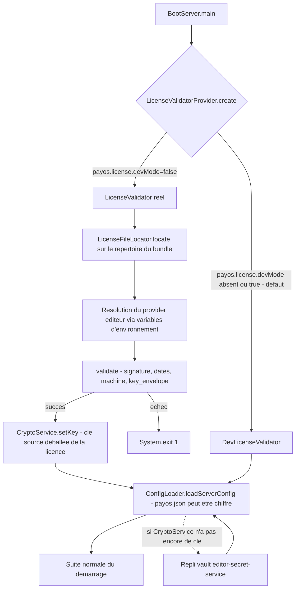
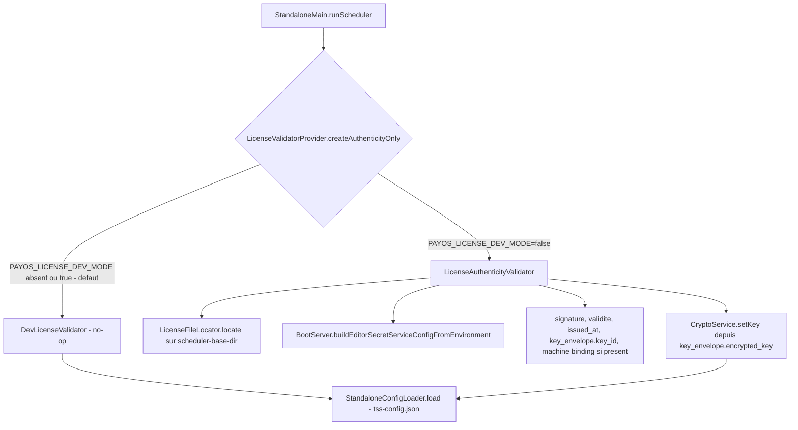

# Architecture — Validation de licence

**Créé le :** 2026-08-19
**Dernière mise à jour :** 2026-11-20
**Version :** v5
**Audience :** architectes, tech leads, contributeurs à `payos-kernel`, `payos-foundation`, `payosv2-packer`, `payos-license-generator`, `payos-pm`, `payos-job-scheduler`
**Périmètre :** `ma.s2m.payos.license` (kernel), `ma.s2m.payos.license.LicenseFileLocator` + `ma.s2m.payos.security.SplitKeyGuard`/`CryptoService` (foundation), `ma.s2m.Main`/`PayOSPacker` (packer), `ma.s2m.payos.license.core` (generator), `ma.s2m.payos.pm.cpm.CapabilityManager`/`Cpm` (pm), `ma.s2m.payos.scheduler.bootstrap.StandaloneMain` (job-scheduler)

> Remplace intégralement la version v0 (2026-08-19) de ce document, qui décrivait un `BootServer` câblant `DevLicenseValidator` en dur et un `LicenseValidator` ne vérifiant que l'existence du fichier. Le mécanisme décrit ci-dessous (sélection par variable d'environnement, validation cryptographique réelle, convention de localisation du fichier de licence, intégration avec `payosv2-packer`) est celui effectivement implémenté et testé (94 tests `payos-license-generator`, 649 tests `payos-kernel`, 22 tests `payosv2-packer`, tous verts).
>
> **v2 (2026-10-31)** : remplace le triplet matériel (`mac_address`/`cpu_id`/`motherboard_uuid`) de §11 par un identifiant unique fourni par l'OS (`MachineGuid` Windows, `/etc/machine-id` Linux) — découvert en préparant un test réel que l'ancien mécanisme ne fonctionne plus du tout sur un Windows moderne (`wmic` supprimé) et exige root sous Linux (`dmidecode`). Changement de contrat avec `payos-license-generator` (`machine_bindings.identifiers[]`), implémenté et testé des deux côtés.
>
> **v3 (2026-11-01)** : renomme `editor-tenant-id`/`PAYOS_EDITOR_TENANT_ID`/`--editor-tenant-id` en `editor-id`/`PAYOS_EDITOR_ID`/`--editor-id` partout (§3, §7, §10) — ce n'est pas un tenant PayOS (un client peut avoir plusieurs tenants ; il n'y a qu'un seul éditeur), juste le namespace de l'éditeur dans le secret provider, réutilisant par accident le paramètre générique `tenantId` du SPI `IAsymmetricCryptoSecretProvider`.
>
> **v4 (2026-11-16)** : §14 annonçait l'enforcement des entitlements/quotas comme hors scope — ce n'est plus le cas. Nouvelle §16 : `LicenseQuotaAuditor` (boot, kernel) compare la somme des quotas `requestsPerMinute` de tous les tenants déclarés à `entitlements.quotas.requests_per_minute` de la licence ; `cpm --install` (`payos-pm`, qui dépend déjà de `payos-kernel`) refuse d'installer une capability dont l'id de base n'est pas dans `entitlements.services[]` ; `ResourceLocator` (kernel) applique la même vérification à chaque résolution de ressource appartenant à une capability, au runtime. `LicenseContext` gagne `entitledCapabilityIds()` (§8), dérivé une fois de `entitlements.services[]` — `entitlements` entièrement absent du document (licence antérieure à ce concept) donne `null` (aucune restriction) ; `entitlements` présent mais sans `services[]` donne un ensemble vide (zéro capability entitlée), une distinction délibérée pour ne jamais casser silencieusement une licence existante qui n'a jamais eu ce champ.
>
> **v5 (2026-11-20)** : Nouvelle §17 — `payos-job-scheduler` (TSS) en mode standalone valide désormais lui aussi la licence, avant toute lecture de configuration, mais avec un validateur plus léger, `LicenseAuthenticityValidator` (signature, fenêtre de validité, `issued_at`, liaison `licensee.client_id`/`key_envelope.key_id`, et liaison machine seulement si le document la déclare) — jamais les entitlements/quotas, que TSS n'a pas à faire respecter. Il dévérouille quand même la clé AES du `key_envelope` et l'installe sur `CryptoService` (même protection `SplitKeyGuard` que le kernel), ce qui rend `tss-config.json`, `jobs.json`/`custom-jobs.json`/`platform-jobs.json` et les scripts de job déchiffrables exactement comme n'importe quel fichier de configuration du kernel.

---

## Table des matières

1. [Contexte et objectif](#1-contexte-et-objectif)
2. [Vue d'ensemble](#2-vue-densemble)
3. [Sélection du validateur actif](#3-sélection-du-validateur-actif)
4. [Format du document de licence](#4-format-du-document-de-licence)
5. [`LicenseValidator` — les dix vérifications](#5-licensevalidator--les-dix-vérifications)
6. [`LicenseFileLocator` — convention de localisation](#6-licensefilelocator--convention-de-localisation)
7. [Résoudre le secret provider éditeur avant de lire `payos.json`](#7-résoudre-le-secret-provider-éditeur-avant-de-lire-payosjson)
8. [`LicenseContext` et la protection en mémoire de la clé](#8-licensecontext-et-la-protection-en-mémoire-de-la-clé)
9. [Repli vault (`editor-secret-service`)](#9-repli-vault-editor-secret-service)
10. [Intégration côté `payosv2-packer`](#10-intégration-côté-payosv2-packer)
11. [Empreinte machine (`MachineFingerprinter`)](#11-empreinte-machine-machinefingerprinter)
12. [Bugs découverts et corrigés pendant l'implémentation](#12-bugs-découverts-et-corrigés-pendant-limplémentation)
13. [Ajouter un validateur custom](#13-ajouter-un-validateur-custom)
14. [Hors scope / limites connues](#14-hors-scope--limites-connues)
15. [Considérations de sécurité](#15-considérations-de-sécurité)
16. [Enforcement des entitlements et des quotas](#16-enforcement-des-entitlements-et-des-quotas)
17. [`payos-job-scheduler` (TSS) standalone — `LicenseAuthenticityValidator`](#17-payos-job-scheduler-tss-standalone--licenseauthenticityvalidator)

---

## 1. Contexte et objectif

PayOS doit pouvoir conditionner son démarrage à la présence et la validité d'une licence signée par l'éditeur, délivrée par `payos-license-generator`. Le mécanisme a trois propriétés structurantes.

**Fail-fast et prioritaire** — pour un déploiement réel, la licence est vérifiée avant toute autre chose au boot, y compris avant la lecture de `payos.json` : un problème de licence arrête le runtime avant qu'aucune ressource ne soit consommée et avant qu'aucun fichier de configuration ne soit même ouvert.

**La licence protège aussi le code source** — `payos.json` (et plus généralement tout ce que `CryptoService` déchiffre) est traité comme du code source au même titre que l'application elle-même. La clé qui le déchiffre est la clé AES enveloppée dans `key_envelope.encrypted_key` de la licence elle-même, pas un secret de coffre-fort indépendant. C'est ce choix qui a entraîné la plus grande partie de la complexité décrite dans ce document (ordre de boot, résolution du provider éditeur par variables d'environnement, convention fixe de localisation du fichier).

**Pluggable et non bloquant en dev** — le comportement reste derrière l'interface `ILicenseValidator` ; `DevLicenseValidator` (le défaut) est un no-op complet qui ne ralentit pas le développement local.

---

## 2. Vue d'ensemble



Deux parcours bien distincts, selon le validateur actif :

- **`DevLicenseValidator` (défaut)** : aucune vérification ; `BootServer` charge `payos.json` directement, exactement comme avant ce travail. La licence, si elle existe, n'est jamais lue.
- **`LicenseValidator` (production)** : la licence est localisée et validée *avant* `ConfigLoader.loadServerConfig()`. Si elle est valide, la clé de déchiffrement du code source qu'elle contient est injectée dans `CryptoService` avant que `payos.json` ne soit même ouvert — ce qui permet à `payos.json` d'être lui-même chiffré par cette même clé.

---

## 3. Sélection du validateur actif

Avant ce travail, le choix dev/prod passait par deux répertoires sources (`src/main/java-dev`/`src/main/java-prod`) et un profil Maven `-Pprod` — mécanisme jugé trop complexe et remplacé. Aujourd'hui, `payos-kernel` ne compile plus qu'une seule implémentation de chaque classe ; le choix se fait **au runtime**, dans `LicenseValidatorProvider` :

```java
public final class LicenseValidatorProvider {
    private static final String DEV_MODE_SYSTEM_PROPERTY = "payos.license.devMode";
    private static final String DEV_MODE_ENV_VAR = "PAYOS_LICENSE_DEV_MODE";

    public static ILicenseValidator create() {
        return isDevModeEnabled() ? new DevLicenseValidator() : new LicenseValidator();
    }

    private static boolean isDevModeEnabled() {
        String devMode = System.getProperty(DEV_MODE_SYSTEM_PROPERTY, System.getenv(DEV_MODE_ENV_VAR));
        return devMode == null || Boolean.parseBoolean(devMode);
    }
}
```

Priorité : propriété système `payos.license.devMode`, sinon variable d'environnement `PAYOS_LICENSE_DEV_MODE`. **Le mode dev est le défaut** si rien n'est positionné — seule une valeur explicite résolue à `false` (via `Boolean.parseBoolean`) active le vrai validateur. C'est l'inverse du comportement initial (qui démarrait avec `DevLicenseValidator` câblé en dur, sans bascule possible), et aussi l'inverse de ce qu'on pourrait attendre « par sécurité » — le choix a été fait explicitement par l'éditeur pour ne jamais bloquer un environnement de développement qui n'aurait pas positionné la variable. Documenté dans le détail dans [configuration/license-service-v2-2026-11-01.md](../configuration/license-service-v2-2026-11-01.md).

Pour les détails de ce qui a remplacé l'ancien mécanisme de profils Maven côté build, voir [build-and-release/license-validator-mode-v1-2026-10-31.md](../build-and-release/license-validator-mode-v1-2026-10-31.md).

---

## 4. Format du document de licence

Le fichier `.lic` est un document JSON produit par `payos-license-generator`. `LicenseValidator` lit les champs suivants (tout le reste du document — `issuer`, `product`, etc. — est ignoré par le validateur, mais peut exister) :

```json
{
  "license_id": "lic_2026_0001",
  "issued_at": "2026-10-01T00:00:00Z",
  "licensee": { "client_id": "client_12345", "name": "Example Client Ltd" },
  "validity": { "not_before": "2026-01-01T00:00:00Z", "expires_at": "2030-01-01T00:00:00Z" },
  "entitlements": {
    "services": ["payments", "webhooks"],
    "quotas": { "requests_per_minute": 1000, "transactions_per_month": 50000 }
  },
  "machine_bindings": {
    "algorithm": "SHA-256",
    "identifiers": [{ "machine_id": "machine_01", "machine_unique_id": "004dd758-e574-4e9c-ae3f-175a97b93899" }],
    "fingerprints": [{ "machine_id": "machine_01", "hash": "…" }]
  },
  "key_envelope": { "key_id": "client_12345-key", "encrypted_key": "<base64, chiffré RSA>" },
  "signature": { "algorithm": "SHA256withRSA", "rsa_key_id": "editor-signing-key", "value": "<base64>" }
}
```

Points notables : les `quotas` vivent **sous** `entitlements`, pas au même niveau ; `key_envelope.key_id` doit valoir exactement `<client_id>-key` ; `signature.rsa_key_id` est purement informatif et **n'est jamais utilisé** pour choisir la clé de vérification (voir §5 — faire confiance à un identifiant de signataire auto-déclaré dans le document qu'on vérifie annulerait l'intérêt de la vérification) ; `machine_bindings.identifiers` (la requête brute) reste présent **tel quel** dans le document final à côté de `fingerprints` (le calculé) — `payos-license-generator` ne le retire pas, donc l'identifiant machine unique en clair (`machine_unique_id`) est visible dans la licence délivrée, pas seulement son hash.

---

## 5. `LicenseValidator` — les dix vérifications

`validate(Map<String,Object> configuration, String|byte[] licenseFilePathOrData)` exécute, dans cet ordre, en échouant au premier problème rencontré (`LicenseValidationException`) :

1. **Lecture du fichier** — chemin résolu en absolu/normalisé ; erreur explicite si absent.
2. **Résolution du provider éditeur** — via `EditorEncryptionKeyInitializer.resolveProvider(configuration)`, casté en `IAsymmetricCryptoSecretProvider` (échec si le provider configuré ne supporte pas les opérations asymétriques).
3. **Vérification de la signature RSA** — le document est recopié sans le champ `signature`, sérialisé en JSON canonique (`CanonicalJson` : clés triées récursivement, compact, octet pour octet identique à l'implémentation de `payos-license-generator`), puis vérifié via `provider.verifyWithKeyPair(editorId, keyName, signedBytes, signatureBytes)` — `editorId`/`keyName` viennent de la **configuration du kernel** (`editor-id`/`editor-key-name`, défauts `editor`/`editor-signing-key`), jamais du document lui-même. `editorId` identifie le namespace propre de l'éditeur dans le secret provider — ce n'est **pas** un tenant PayOS (un client peut avoir plusieurs tenants ; il n'y a qu'un seul éditeur) ; le paramètre s'appelle `tenantId` côté SPI `IAsymmetricCryptoSecretProvider` uniquement parce que c'est le nom générique de ce paramètre dans l'interface, réutilisé ici pour un usage qui n'a rien à voir avec la multi-tenancy.
4. **Fenêtre de validité** — `validity.not_before` ≤ maintenant ≤ `validity.expires_at` (timestamps ISO-8601).
5. **`issued_at` dans le passé** — rejette une licence dont l'horodatage d'émission est dans le futur.
6. **Cohérence `licensee.client_id` / `key_envelope.key_id`** — `key_envelope.key_id` doit être exactement `<client_id>-key`.
7. **Empreinte machine** — voir §11 ; la machine locale doit apparaître dans `machine_bindings.fingerprints`.
8. **Déballage de la clé de déchiffrement du code source** — `provider.decryptWithPrivateKey(tenantId, keyName, key_envelope.encrypted_key)` (RSA-OAEP via la paire de clés de l'éditeur) → octets bruts de la clé AES.
9. **Lecture des entitlements/quotas** — `document.get("entitlements")` et `entitlements.get("quotas")`, conservés tels quels (`JsonNode`), aucune interprétation métier à ce stade (voir §14).
10. **Population de `LicenseContext`** — `clientId`, `licenseId`, `entitlements`, `quotas`, et la clé de déchiffrement (protégée immédiatement — voir §8).

Chaque étape a sa propre méthode privée statique (`verifySignature`, `verifyValidityWindow`, `verifyIssuedAt`, `verifyClientAndKeyEnvelope`, `verifyMachineBinding`, `unwrapSourceDecryptionKey`) — voir `LicenseValidator.java` pour le détail exact des messages d'erreur, chacun conçu pour être actionnable sans jamais révéler le contenu sensible du document.

---

## 6. `LicenseFileLocator` — convention de localisation

Problème résolu : `license-file-path` vivait auparavant *dans* `payos.json` — mais si `payos.json` est lui-même protégé par la clé que la licence contient, son propre chemin ne peut plus être lu depuis `payos.json`. La solution (dans `payos-foundation`, partagée par le kernel et `payosv2-packer`) est une **convention fixe**, indépendante de tout fichier de configuration :

- Le fichier de licence est **l'unique fichier `*.lic`** trouvé directement à la racine d'un répertoire donné (le répertoire du bundle pour le kernel, `--inputdir` pour `payosv2-packer`).
- Zéro correspondance, ou plusieurs correspondances, sans surcharge : échec explicite (jamais une résolution « au hasard »).
- Surchargeable via la variable d'environnement **`PAYOS_LICENSE_FILE_PATH`** — pointeur direct vers un fichier précis, qui doit exister (une surcharge invalide est toujours une erreur dure, même pour `tryLocate`) ; la même variable, le même nom, est utilisée par les deux modules, pour qu'ils ne puissent jamais diverger sur l'emplacement de la licence.

Deux méthodes : `locate(root)` (échec dur si rien n'est trouvé — utilisée par `payos-kernel`, où une licence est toujours requise pour le vrai validateur) et `tryLocate(root)` (retourne `Optional.empty()` si rien n'est trouvé sans surcharge — utilisée par `payosv2-packer`, où l'absence de licence doit silencieusement retomber sur l'ancien mécanisme de clé vault).

---

## 7. Résoudre le secret provider éditeur avant de lire `payos.json`

Pour le vrai `LicenseValidator`, `BootServer.main()` doit obtenir une connexion au secret provider de l'éditeur (pour la vérification de signature et le déballage RSA) **avant** d'avoir lu `payos.json` — donc sans jamais passer par le bloc JSON `editor-secret-service`. `BootServer.buildEditorSecretServiceConfigFromEnvironment()` reconstruit la même forme de configuration que lirait `EditorEncryptionKeyInitializer`, mais exclusivement à partir de variables d'environnement :

| Variable | Rôle |
| --- | --- |
| `PAYOS_EDITOR_SECRET_TYPE` | Type de provider (`filesystem`, `vault`, …) |
| `PAYOS_EDITOR_SECRET_ENABLED` | `false` désactive explicitement la résolution |
| `PAYOS_EDITOR_SECRET_CFG_<NOM>` | Config générique du provider (ex. `PAYOS_EDITOR_SECRET_CFG_KV_MOUNT` → `kv-mount`) |
| `PAYOS_EDITOR_ID` | Namespace/id de la paire de clés de l'éditeur dans le secret provider — pas un tenant PayOS (défaut `editor`) |
| `PAYOS_EDITOR_KEY_NAME` | Nom de la paire de clés éditeur (défaut `editor-signing-key`) |

Ces variables sont exactement celles déjà utilisées par `EditorEncryptionKeyInitializer.tryInitializeFromEnvironment()` (voir [configuration/editor-secret-service.md](../configuration/editor-secret-service.md)) — les deux chemins ne peuvent donc jamais diverger sur le sens d'une variable. Si aucune n'est positionnée, le boot échoue avec un message explicite plutôt que de tenter une connexion sans identifiants.

---

## 8. `LicenseContext` et la protection en mémoire de la clé

`LicenseContext` (singleton, `ma.s2m.payos.license`) est peuplé une seule fois, par `LicenseValidator`, après que toutes les vérifications ont réussi. Il expose `clientId()`, `licenseId()`, `entitlements()`, `quotas()`, et `reconstructSourceDecryptionKey()`.

La clé de déchiffrement du code source a **sa propre instance de `SplitKeyGuard`**, indépendante de celle de `CryptoService` — clé différente, calendrier de remasquage différent, aucun état partagé. `SplitKeyGuard` (extrait de `CryptoService` dans `payos-foundation` pour être réutilisable) XOR la clé contre un masque aléatoire de même taille dès `protect()`, zéroise le tableau appelant, et ne conserve que `mask`/`share` dans deux objets distincts, remasqués périodiquement (5 minutes par défaut) pour borner la durée de vie d'une moitié de clé fuitée.

`BootServer.main()` **consomme réellement** cette clé, immédiatement après une validation réussie :

```java
byte[] sourceDecryptionKey = LicenseContext.getInstance().reconstructSourceDecryptionKey();
if (sourceDecryptionKey != null) {
    CryptoService.getInstance().setKey(sourceDecryptionKey);
}
```

`CryptoService.setKey(...)` zéroise à son tour le tableau reçu avant de retourner (il protège la clé dans *son propre* `SplitKeyGuard`) — à aucun moment la clé ne traîne dans une variable locale non nettoyée. C'est cette clé, maintenant dans `CryptoService`, qui permettra à `ConfigLoader.loadServerConfig()` de déchiffrer `payos.json` s'il est chiffré.

`quotas()` est lu par `LicenseQuotaAuditor` au boot (§16). `entitlements()` lui-même reste un accès brut, mais `entitledCapabilityIds()` en dérive une fois, à la population, l'ensemble des ids de `entitlements.services[]` — lu par `cpm` à l'installation et par `ResourceLocator` à chaque résolution de ressource de capability (§16). La distinction `null`/ensemble vide est délibérée et porte un sens métier précis, pas juste « pas de licence » : `null` signifie « aucune restriction » — soit aucune licence validée pour ce process (mode dev), soit une licence valide dont le document n'a **pas du tout** de champ `entitlements` (licence antérieure à ce concept, ou éditeur qui ne le déclare pas) ; un ensemble vide (non-null) signifie l'inverse — la licence déclare bien `entitlements`, donc un `services[]` absent ou vide veut dire littéralement « zéro capability entitlée », et doit tout refuser. Les deux consommateurs (`cpm`, `ResourceLocator`) ignorent la vérification uniquement sur `null`, jamais sur un ensemble vide.

---

## 9. Repli vault (`editor-secret-service`)

L'ancien mécanisme (`EditorEncryptionKeyInitializer`, secret `encryptionKey` lu depuis un coffre-fort) est **conservé intentionnellement**, pas supprimé — décision explicite pour ne pas casser les bundles sans licence (mode dev) ou les sous-configurations applicatives indépendantes de la licence. `ConfigLoader.loadServerConfig()` ne l'invoque que si `CryptoService.getInstance().hasKey()` est encore `false` à ce stade :

```java
boolean editorKeyResolvedFromEnv = CryptoService.getInstance().hasKey()
        || EditorEncryptionKeyInitializer.tryInitializeFromEnvironment();
// … plus loin, après chargement de la configuration applicative :
if (!editorKeyResolvedFromEnv) {
    EditorEncryptionKeyInitializer.initialize(PayOSConfig.settings);
}
```

Autrement dit : dès qu'une licence valide a déjà fourni une clé, ce repli ne s'exécute jamais. Détails complets dans [configuration/editor-secret-service.md](../configuration/editor-secret-service.md).

---

## 10. Intégration côté `payosv2-packer`

`payosv2-packer` (`edc`) doit pouvoir emballer un bundle avec la même clé que celle que la licence débloquera au runtime. `Main.main()` : si `--key` est absent, `LicenseFileLocator.tryLocate(inputDir)` cherche un `.lic` à la racine de `--inputdir` ; s'il en trouve un, `resolveKeyFromLicense(...)` déballe `key_envelope.encrypted_key` via le même provider asymétrique (mêmes variables `--editor-id`/`PAYOS_EDITOR_ID` et `--editor-key-name`/`PAYOS_EDITOR_KEY_NAME`, mêmes défauts `editor`/`editor-signing-key`) — sinon, comportement préexistant inchangé (secret `encryptionKey` via le provider configuré).

`PayOSPacker` a gagné des surcharges `pack(String, byte[], String)`/`unpack(String, byte[], String)` acceptant une clé binaire de 16/24/32 octets (AES-128/192/256) — la clé déballée d'une licence est de l'AES-256 (32 octets), jamais représentable sans perte comme les anciennes clés `String` de 16 caractères ASCII. Les surcharges `String` existantes (`--key`, secret vault `encryptionKey`) restent inchangées, aucun appelant existant n'est affecté.

Détails CLI complets dans [operations/bundle-encryption.md](../operations/bundle-encryption.md) et [cli-tools/edc.md](../cli-tools/edc.md).

---

## 11. Empreinte machine (`MachineFingerprinter`)

Calcule `hash(uniqueId)` — un **seul** identifiant, fourni par l'OS lui-même — avec l'algorithme déclaré dans `machine_bindings.algorithm` du document (jamais un algorithme fixé en dur côté validateur), exactement comme `payos-license-generator` calcule l'empreinte au moment de l'émission.

**Historique** : la première version de ce mécanisme combinait trois identifiants matériels (`mac|cpuId|motherboardUuid`, via `wmic`/`getmac` sous Windows et `/sys/class/net`/`/sys/class/dmi`/`dmidecode` sous Linux). Abandonné après avoir constaté en préparant un test réel que `wmic` n'existe plus sur les builds Windows récents (supprimé à partir de Windows 11 24H2+) et que `dmidecode` exige systématiquement les droits root sous Linux pour le CPU id — rendant la validation de licence non fonctionnelle par défaut sur une bonne partie des déploiements modernes.

**Mécanisme actuel** : un identifiant unique maintenu par l'OS lui-même, pensé exactement pour cet usage :

| OS | Source | Commande/fichier |
| --- | --- | --- |
| Windows | `MachineGuid` (généré à l'installation de Windows) | `reg query HKLM\SOFTWARE\Microsoft\Cryptography /v MachineGuid` — lisible sans droits admin |
| Linux | identifiant machine systemd | `/etc/machine-id`, repli sur `/var/lib/dbus/machine-id` — lisible sans root |

Tout autre OS échoue explicitement plutôt que de produire une empreinte non fiable.

**Compromis à connaître** : ce sont des identifiants *logiciels*, liés à l'installation de l'OS, pas au matériel physique — un clone de VM/conteneur mal préparé qui ne régénère pas ces valeurs peut dupliquer un identifiant sur deux machines. Les outils de provisioning standards (`cloud-init`, `systemd-machine-id-setup`) le régénèrent au premier démarrage, ce qui couvre la majorité des déploiements réels. C'est un risque différent de l'ancien triplet matériel (qui avait ses propres failles sur VM — UUID/CPU id virtuels souvent génériques), pas clairement moins fiable.

Impact sur le contrat avec `payos-license-generator` : le schéma de requête `machine_bindings.identifiers[]` est passé de `{machine_id, mac_address, cpu_id, motherboard_uuid}` à `{machine_id, machine_unique_id}` — changement de contrat entre les deux projets (validé, implémenté et testé des deux côtés le même jour que cette section).

---

## 12. Bugs découverts et corrigés pendant l'implémentation

Deux bugs réels, non demandés explicitement mais bloquants pour atteindre l'objectif, ont été découverts et corrigés pendant ce travail.

**Jar shadé non classifié masquant une dépendance transitive.** `payos-license-generator` publiait son jar « fat » (shade plugin) comme artefact Maven principal, non classifié — l'utiliser comme dépendance de test dans `payos-kernel` embarquait une copie figée et obsolète des classes de `payos-foundation`, masquant la vraie dépendance et provoquant des `NoSuchMethodError` sporadiques (`CryptoService.hasKey()` introuvable malgré une compilation réussie). Corrigé en ajoutant `shadedArtifactAttached=true`/`shadedClassifierName=standalone` au plugin shade de `payos-license-generator` (même convention que `payos-kernel` utilisait déjà) : le jar principal reste une bibliothèque fine, le jar déployable devient `payos-license-generator-<version>-standalone.jar`. **Conséquence documentaire corrigée** : `operations/payos-license-generator-setup-guide-v8-2026-11-17.md` (v6, qui supersède la v4) reflète désormais le nom de jar `-standalone` correct.

**Les fichiers `.lic` étaient chiffrés par `edc pack`.** Un fichier de licence doit rester lisible en clair par le kernel avant même qu'il ait une clé de déchiffrement — `PayOSPacker` ne le savait pas et l'encryptait/décryptait comme n'importe quel autre fichier du bundle. Corrigé en ajoutant une vérification d'extension `.lic` (`isLicenseFile`) dans `encryptFile`/`decryptFile`, traitée comme un fichier « déjà protégé » (copie inchangée).

---

## 13. Ajouter un validateur custom

Voir [developer/license-validation-v2-2026-11-01.md](../developer/license-validation-v2-2026-11-01.md) pour le guide pas-à-pas (implémenter `ILicenseValidator`, lever `LicenseValidationException`, brancher dans `LicenseValidatorProvider.create()`).

---

## 14. Hors scope / limites connues

- **Le repli vault `editor-secret-service`/`encryptionKey`** n'a pas été retiré — décision explicite (voir §9).
- **Collecte manuelle de `machine_bindings.identifiers` à la génération** — contrairement à l'ancien triplet matériel, les commandes (`reg query .../MachineGuid`, `/etc/machine-id`) sont désormais standard et triviales à exécuter soi-même, mais rien n'automatise encore leur collecte ni leur envoi vers `payos-license-generator` (voir §11) — processus manuel aujourd'hui.
- **La validation de licence ne se re-déclenche jamais au hot-reload** — comme avant ce travail, le résultat vaut pour la durée de vie du process.

---

## 15. Considérations de sécurité

- Le fichier de licence ne doit pas être accessible en lecture à tous les utilisateurs système — restreindre les permissions OS (ex. `chmod 640`).
- Ne jamais logger le contenu du fichier de licence ni les bytes bruts d'une clé ; `LicenseValidator`/`PayOSPacker` ne le font jamais.
- L'identité du signataire (`tenantId`/`keyName`) vient toujours de la configuration du kernel vérificateur, jamais d'un champ du document sous vérification (§5, point 3).
- La clé de déchiffrement du code source n'existe jamais en clair plus longtemps qu'un appel de méthode : `SplitKeyGuard` la fragmente immédiatement, et chaque tableau d'octets intermédiaire est explicitement zéroisé (`Arrays.fill`) dès qu'il n'est plus nécessaire.
- Un jar shadé non classifié comme dépendance de bibliothèque est un risque de supply-chain silencieux (§12) — toujours classifier l'artefact déployable (`shadedClassifierName`) quand un module shadé est aussi consommé comme dépendance.

---

## 16. Enforcement des entitlements et des quotas

Trois mécanismes distincts, tous dérivés du même `LicenseContext` peuplé par `LicenseValidator` (§5, §8) — aucun ne réimplémente une lecture ou une validation cryptographique de la licence.

**Quotas — somme au boot (`LicenseQuotaAuditor`, kernel).** Après la validation de licence et le chargement de `payos.json` (`BootServer`, juste avant l'audit de compatibilité runtime), `LicenseQuotaAuditor.audit(config, LicenseContext.getInstance().quotas())` additionne le plafond `requestsPerMinute` effectif de chaque tenant déclaré sous `multitenancy.tenants` — résolu par `TenantPolicyService.resolveEffectiveQuotaLimit(tenantId)`, extrait de l'ancienne logique de `validateQuota` pour être réutilisable en lecture pure — et la compare à `entitlements.quotas.requests_per_minute`. Un tenant dont le quota n'est pas borné et activé (`default-tenant-quotas.enabled=false`, ou un plafond résolu `<= 0`) est lui-même rapporté comme un problème, plutôt que d'être silencieusement exclu de la somme — un tenant non borné ne peut jamais être concilié avec une licence qui, elle, est forcément finie. `licenseQuotas == null` (mode dev, pas de licence validée) court-circuite l'audit entièrement. Contrairement à l'audit de compatibilité runtime juste après, il n'y a pas d'échappatoire `warnOnly` : dépasser ce que la licence autorise est toujours un échec dur au boot, comme chaque autre vérification de `LicenseValidator`.

**Entitlements — à l'installation (`cpm --install`, `payos-pm`).** `payos-pm` dépend déjà de `payos-kernel` en artefact Maven (pour les classes `capabilities`), donc `cpm` réutilise directement `ma.s2m.payos.license.LicenseValidator`/`LicenseContext`/`LicenseFileLocator` — aucune logique de validation ni de dérivation dupliquée : `Cpm.resolveLicenseEntitlements` délègue entièrement à `LicenseContext.getInstance().entitledCapabilityIds()` après validation, plutôt que de relire `entitlements.services[]` lui-même. `Cpm.buildManager()` cherche un `*.lic` à la racine du bundle via `LicenseFileLocator.tryLocate` (même convention que `payosv2-packer`, §10) ; absent → pas de licence pour ce bundle, vérification ignorée (même bypass que `DevLicenseValidator`) ; présent mais invalide → échec dur, jamais dégradé silencieusement en « pas de licence ». Si présent et valide, `entitledCapabilityIds()` (§8 — `null` si le document n'a pas de champ `entitlements` du tout, ensemble possiblement vide sinon) devient directement `licenseEntitlements` sur `CapabilityManager`, qui refuse `install(...)` (avant tout effet de bord — copie, `bootstrap.json`, `registry.json`) si l'id de **base** de la capability (`baseIdOf(capabilityId)`, jamais l'id composite `<id>@<version>` — une licence entitle une capability, pas une version épinglée) n'en fait pas partie, sauf si `licenseEntitlements` est `null`. Pas d'échappatoire `--allow-*` : contrairement à l'incompatibilité runtime, ce n'est jamais un simple avertissement.

`payos-pm` n'a **aucune dépendance de compilation** vers une implémentation de secret provider — même contrainte NFR2 que le kernel et `payos-license-generator`. `Cpm.resolveLicenseEntitlements` appelle `ServiceAdapterLoader.initialize(payosConfig)` (le mécanisme SPI générique déjà utilisé par le kernel pour tout provider chargé dynamiquement, cf. `SecretProviders.create` → `PayOSConfig.getServiceAdapterClassLoader()`) avant de résoudre le provider éditeur — le JAR du provider (ex. `secret-service-filesystem`) doit donc être présent dans le répertoire configuré par `service-adapters-dir`/`PAYOS_SERVICE_ADAPTERS_DIR`, exactement la même convention que le reste du runtime. Une tentative initiale d'ajouter `secret-service-filesystem` comme dépendance Maven directe de `payos-pm` a été écartée au profit de ce chargement dynamique, pour rester cohérent avec le reste de l'architecture.

**Entitlements — au runtime (`ResourceLocator`, kernel).** `ResourceLocator.locate` vérifie déjà l'état d'activation (`IActivationStore`) de toute application étendue de catégorie `capability` avant d'y récurser, et ignore silencieusement (`continue`, comme si absente) celle qui n'est pas active. La vérification d'entitlement se greffe immédiatement à côté, avec la même sémantique : `LicenseContext.getInstance().entitledCapabilityIds()` doit contenir `appId` — la valeur brute lue dans `extends[]`, toujours un id de base par construction (`CapabilityManager.activate` n'y écrit jamais de composite), exactement la granularité que nomme `entitlements.services[]`. `entitledCapabilityIds() == null` ignore la vérification entièrement (toute capability autorisée) ; un ensemble vide non-null refuse tout.

---

## 17. `payos-job-scheduler` (TSS) standalone — `LicenseAuthenticityValidator`

`payos-job-scheduler` ("TSS") a son propre pipeline de boot, totalement indépendant de `BootServer` — `StandaloneMain.main` ne passe jamais par le kernel. Avant ce travail (2026-11-20), le mode standalone de TSS ne validait aucune licence du tout : `sync`/`trigger`/`list` restent protégés indirectement par les identifiants de la base TSS elle-même, mais `run` démarrait sans aucune vérification.

**Portée volontairement réduite — seulement `run`.** Les sous-commandes d'administration (`sync`/`trigger`/`list`) exigent déjà un accès direct à la base de données Quartz de TSS, qui joue le rôle de contrôle d'accès ; seule `run` (démarrage effectif du scheduler) déclenche la validation de licence, en tout premier — avant même la lecture de `tss-config.json` — exactement comme `BootServer` le fait pour `payos.json`.

**`LicenseAuthenticityValidator` — un validateur plus léger, pas une copie de `LicenseValidator`.** TSS n'a ni entitlements ni quotas à faire respecter (pas de `multitenancy.tenants` propre, pas de notion de capability), donc le réutiliser tel quel aurait introduit une dépendance à un concept qui ne s'applique pas à ce process. `LicenseAuthenticityValidator` (nouvelle classe, `ma.s2m.payos.license`, kernel) réutilise directement les méthodes de vérification de `LicenseValidator` (élargies en package-private pour l'occasion — signature, fenêtre de validité, `issued_at`, liaison `licensee.client_id`/`key_envelope.key_id`) mais :

- ne peuple jamais `LicenseContext` (ni `entitlements`, ni `quotas`, ni `clientId`/`licenseId`) ;
- traite la liaison machine (`machine_bindings`) comme **optionnelle** : absente du document, elle est acceptée plutôt que rejetée (`LicenseValidator.verifyMachineBinding(document, machineFingerprinter, required)` gagne un paramètre `required`, `false` pour ce validateur, `true` pour le kernel — comportement du kernel inchangé) ; présente, elle doit toujours être satisfaite ;
- dévérouille quand même le `key_envelope.encrypted_key` de la licence (`LicenseValidator.unwrapSourceDecryptionKey`, élargi en package-private) et installe le résultat sur `CryptoService.setKey(...)` — même protection `SplitKeyGuard` (fragmentation XOR, remasking périodique) que le kernel, voir §8. C'est ce qui rend `tss-config.json`, `jobs.json`/`custom-jobs.json`/`platform-jobs.json` et les scripts de job déchiffrables via `CryptoService.decryptIfEncrypted`, exactement comme n'importe quel fichier de configuration ou d'application du kernel — voir [operations/task-scheduling-system-v22-2026-11-20.md](../operations/task-scheduling-system-v22-2026-11-20.md) et [developer/task-scheduler-guide-v22-2026-11-20.md](../developer/task-scheduler-guide-v22-2026-11-20.md).



**Même résolution du secret provider éditeur que le kernel, par nécessité, pas par choix stylistique.** `tss-config.json` n'est pas encore lu à ce stade du boot, donc la connexion au secret provider éditeur ne peut dépendre d'aucun fichier TSS — `StandaloneMain` réutilise directement `BootServer.buildEditorSecretServiceConfigFromEnvironment()` (visibilité élargie en `public` pour l'occasion), qui lit les mêmes variables d'environnement que le kernel (`PAYOS_EDITOR_SECRET_TYPE`, `PAYOS_EDITOR_SECRET_CFG_*`, `PAYOS_EDITOR_SECRET_ENABLED` ; `PAYOS_EDITOR_ID`/`PAYOS_EDITOR_KEY_NAME` pour l'identité du signataire). Le provider lui-même reste chargé en SPI via `SecretProviders.create` (§7), jamais nommé en dur par TSS.

**`PAYOS_LICENSE_DEV_MODE` — la même variable que le kernel, un seul interrupteur pour tout le process.** `LicenseValidatorProvider` gagne `createAuthenticityOnly()`, qui lit exactement le même système property/variable d'environnement que `create()` (§3) : absent ou `true` (défaut) sélectionne `DevLicenseValidator` (no-op complet, `CryptoService` reste sans clé), `false` sélectionne le vrai `LicenseAuthenticityValidator`. Il n'existe pas de bascule séparée pour TSS — un déploiement qui active la licence pour le kernel l'active aussi pour tout TSS standalone colocalisé sur le même hôte/la même variable d'environnement.

Voir aussi [operations/task-scheduling-system-v22-2026-11-20.md](../operations/task-scheduling-system-v22-2026-11-20.md) (procédure opérateur) et [configuration/task-scheduling-system-v12-2026-11-20.md](../configuration/task-scheduling-system-v12-2026-11-20.md) (référence des variables).

---

## Next

- [developer/license-validation-v2-2026-11-01.md](../developer/license-validation-v2-2026-11-01.md) — écrire un validateur custom.
- [configuration/license-service-v2-2026-11-01.md](../configuration/license-service-v2-2026-11-01.md) — référence des variables d'environnement.
- [build-and-release/license-validator-mode-v1-2026-10-31.md](../build-and-release/license-validator-mode-v1-2026-10-31.md) — bascule dev/prod côté build/déploiement.
- [operations/bundle-encryption.md](../operations/bundle-encryption.md) / [cli-tools/edc.md](../cli-tools/edc.md) — intégration côté `payosv2-packer`.
- [configuration/editor-secret-service.md](../configuration/editor-secret-service.md) — repli vault et variables d'environnement partagées.
- [operations/task-scheduling-system-v22-2026-11-20.md](../operations/task-scheduling-system-v22-2026-11-20.md) / [developer/task-scheduler-guide-v22-2026-11-20.md](../developer/task-scheduler-guide-v22-2026-11-20.md) — §17 : validation de licence et déchiffrement côté TSS standalone.
