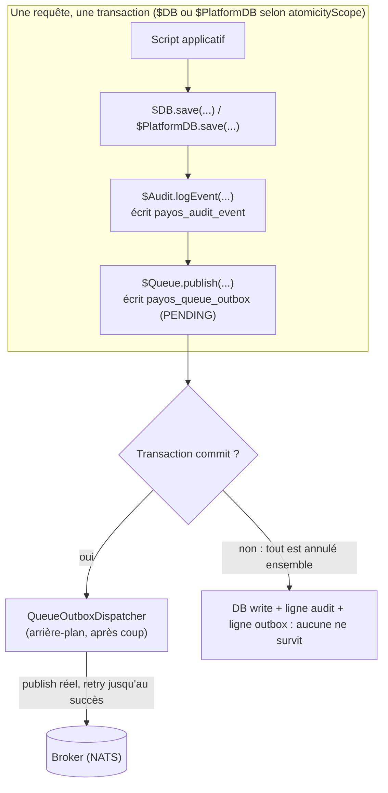

Created: 2026-10-19
Last updated: 2026-10-19
Version: 4 — supersedes v3 : §5 à nouveau révisé — `$Audit` ne refuse plus jamais l'appel : il fonctionne avec **toute** catégorie d'audit-trail, l'atomicité n'étant qu'un bonus apporté uniquement par `"database"` (architecture §3, v9). Le marqueur `AtomicWriteCapable` introduit en v3 est supprimé — plus rien ne vérifie la capacité au préalable. `category: "database"` reste la voie **recommandée** pour obtenir la garantie, mais n'est plus une condition pour utiliser `$Audit` du tout.

# Guide développeur — Atomicité `$DB` + `$Audit` + `$Queue` PayOS : configurer et utiliser (de A à Z)

Ce guide couvre de bout en bout la garantie d'atomicité entre `$DB`/`$PlatformDB`, `$Audit` et `$Queue` : les étapes de configuration **dans l'ordre où il faut les faire**, la déclaration `atomicityScope` dans `mappings.json`, l'écriture d'un script qui utilise les trois ensemble, le démarrage local complet, la vérification que tout est bien câblé, et le dépannage des erreurs les plus fréquentes — en particulier deux pièges d'activation qui ne sont pas évidents (§5.1/§6.2). Il consolide en un seul parcours ce qui est autrement réparti entre [architecture/atomicity-db-audit-queue-v9-2026-10-19.md](../architecture/atomicity-db-audit-queue-v9-2026-10-19.md) (le mécanisme complet, pourquoi il a été conçu ainsi), [configuration/database-service.md](../configuration/database-service.md), [configuration/platform-database-service.md](../configuration/platform-database-service.md), [configuration/audit-trail.md](../configuration/audit-trail.md) et [configuration/servers.md](../configuration/servers.md) (référence de configuration de chaque brique), et [data-access.md](data-access.md), [platform-database-usage.md](platform-database-usage.md), [scripting-bindings.md](scripting-bindings.md#audit-diagnostics) et [queue-messaging.md](queue-messaging.md) (référence de l'API script) — ces pages restent les références détaillées ; ce guide en est le fil conducteur pratique.

## 1. Vue d'ensemble — la garantie et son prix

Un script qui écrit dans `$DB`, appelle `$Audit.logEvent(...)` et appelle `$Queue.publish(...)` fait trois affirmations sur le même événement métier. PayOS garantit que les trois réussissent ou échouent **ensemble**, sans transaction distribuée (2PC/XA) :



- **`$Audit` est strict.** Si la ligne d'audit ne peut pas être écrite, toute la requête échoue.
- **`$Queue` suit le pattern Transactional Outbox.** `publish(...)` écrit une ligne `PENDING` dans `payos_queue_outbox`, **dans la même transaction** que `$DB`/`$Audit` — rien n'est jamais publié sur le broker si cette transaction ne committe pas. Un composant séparé (`QueueOutboxDispatcher`) lit les lignes `PENDING` après coup et publie réellement, avec retry illimité jusqu'au succès (au moins une fois, jamais abandonné).
- **Le prix** : un message peut être publié deux fois en cas de crash entre « publié sur le broker » et « marqué `DISPATCHED` » — le consommateur doit tolérer un doublon occasionnel.

Détail complet du mécanisme et des choix de conception : [architecture/atomicity-db-audit-queue-v9-2026-10-19.md](../architecture/atomicity-db-audit-queue-v9-2026-10-19.md).

## 2. Prérequis

| Outil | Version / note |
| --- | --- |
| JDK | 21 |
| Maven | 3.9+ |
| Base de données (PostgreSQL, H2, ...) | Une pour `$DB` (tenant) ; une seconde, optionnelle, pour `$PlatformDB` si des endpoints déclarent `atomicityScope: "platform"`. |
| Broker NATS avec JetStream activé | Seulement si vous utilisez `$Queue` — voir [queue-setup-guide.md §2](queue-setup-guide.md#2-prérequis). `nats-server -js` en local. |
| `payos-database-audit-trail` sur le classpath des **service adapters** (`service-adapters-dir`) | Fournit `payos_audit_event` et sa création automatique — requis pour utiliser `$Audit`. C'est un `IAuditLogger`, résolu comme `database-service`/`queue-service` via `service-adapters-dir`, voir [configuration/extensions-connectors.md](../configuration/extensions-connectors.md). |
| `payos-server-queue` sur le classpath des **serveurs** (bundled/`servers-dir`), **pas** les service adapters | Fournit `payos_queue_outbox`, le transport `queue` et son dispatcher — requis pour utiliser `$Queue`. C'est un `ServerProvider` (comme `payos-server-http`/`-tcp`), résolu via un `ServiceLoader`/classloader **distinct** de `service-adapters-dir` — en pratique une dépendance Maven ordinaire déjà shadée dans `payos-runtime`, ou un JAR dans `servers-dir` (voir [architecture/extensibility.md](../architecture/extensibility.md) et [configuration/json-configuration-reference.md](../configuration/json-configuration-reference.md) pour `servers-dir`). Rien à installer pour un build standard de `payos-runtime`. |

## 3. Étape 1 — Configurer la base tenant (`$DB`)

`$DB` porte la garantie par défaut (`atomicityScope: "tenant"`). Configurez `database-service` dans `bootstrap.json` :

```json
{
  "database-service": {
    "dialect": "org.hibernate.dialect.PostgreSQLDialect",
    "driver_class": "org.postgresql.Driver",
    "url": "jdbc:postgresql://db:5432/payos",
    "username": "payos",
    "password": "${DB_PASSWORD}",
    "ddl-auto": "update"
  }
}
```

Référence complète des clés : [configuration/database-service.md](../configuration/database-service.md). Rien de spécifique à l'atomicité à ce stade — c'est la configuration `$DB` ordinaire.

## 4. Étape 2 — Configurer la base plateforme (`$PlatformDB`), si besoin

**Seulement si au moins un endpoint doit déclarer `atomicityScope: "platform"`** (§7) — sinon, passez directement à l'étape 3. Configurez `platform-database-service` :

```json
{
  "platform-database-service": {
    "configuration": {
      "dialect": "org.hibernate.dialect.PostgreSQLDialect",
      "driver_class": "org.postgresql.Driver",
      "url": "jdbc:postgresql://db:5432/payos_platform",
      "username": "payos_platform",
      "password": "${PLATFORM_DB_PASSWORD}",
      "ddl-auto": "update"
    },
    "mapping-files": ["model/Country.hbm.xml"]
  }
}
```

Référence complète : [configuration/platform-database-service.md](../configuration/platform-database-service.md). Notez `mapping-files` — contrairement à `database-service`, cette clé est lue **directement** ici (§6.2 ci-dessous en dépend).

## 5. Étape 3 — Activer `$Audit`

`$Audit.logEvent(...)` (le binding script) ne sait rien d'une quelconque table, entité ou colonne — il construit un `AuditEvent` générique et appelle `AuditLogger.logEvent(...)`, **le même point d'entrée inchangé** que les événements système du noyau. Juste avant cet appel, il positionne un canal ambiant (`AtomicWriteContext`, un simple `ThreadLocal`) sur la session qui devrait porter la garantie, sans jamais vérifier au préalable si quiconque va vraiment le lire.

**`$Audit` fonctionne toujours, quelle que soit la catégorie active — l'atomicité est un bonus, pas une condition.** Seule la catégorie `"database"` lit réellement ce canal ambiant et écrit à travers la session qu'il contient, rejoignant la transaction du script. `"buffered-store"` (un buffer en mémoire, le défaut zéro-config) ne le lit jamais, à raison — un buffer n'a aucune notion de transaction externe à rejoindre — et se contente de journaliser l'événement normalement : l'appel réussit quand même, simplement sans la garantie d'atomicité. Choisir `"buffered-store"` est donc un compromis accepté (perdre la garantie), jamais une raison pour que `$Audit` cesse de fonctionner.

### 5.1 Sélectionner la catégorie `database` (recommandé si vous avez besoin de la garantie d'atomicité)

```json
{
  "audit-trail": {
    "implementation": {
      "category": "database",
      "parameters": {
        "retention-days": 90,
        "poll-interval-seconds": 10
      }
    }
  }
}
```

`payos-database-audit-trail` crée `payos_audit_event` automatiquement et vérifie sa résolvabilité au démarrage (§5.2). **Effet de bord à connaître** : `implementation.category` est aussi un choix mutuellement exclusif pour le journal système du noyau (`logAuthSuccess`, `logApiExecution`, `logStartup`, ... — un sujet **séparé** de `$Audit`, voir [configuration/audit-trail.md](../configuration/audit-trail.md)) — un seul `IAuditLogger` actif à la fois. Sélectionner `"database"` ici fait donc aussi basculer le journal système de `"buffered-store"` (le défaut zéro-config, actif quand `audit-trail` est absent) vers `"database"` pour ses **propres** événements. Rien n'est cassé — `buffered-store` reste un code parfaitement fonctionnel, simplement plus actif pour ce rôle-là tant que `"database"` est sélectionné ; les deux catégories partagent de toute façon la même table, voir [architecture §3](../architecture/atomicity-db-audit-queue-v9-2026-10-19.md#3-audit--always-works-atomicity-is-a-bonus-only-some-implementations-provide).

> ℹ️ **Sans cette sélection, `$Audit` continue de fonctionner** — `logEvent(...)` réussit toujours, l'événement est bien journalisé, simplement sans la garantie d'atomicité (il n'est pas rejoué/annulé avec le reste de la transaction du script si celle-ci échoue). Si votre déploiement a vraiment besoin de cette garantie, sélectionnez `"database"` comme ci-dessus — sinon, `"buffered-store"` reste un choix parfaitement valide. Voir [configuration/audit-trail.md §`database` category parameters](../configuration/audit-trail.md#database-category-parameters-implementationparameters) et [architecture §5.3](../architecture/atomicity-db-audit-queue-v9-2026-10-19.md#53-auditqueue-are-injected-unconditionally--and-behave-very-differently-when-their-dependency-is-missing).

### 5.2 Enregistrer le fichier de mapping — l'étape que créer la table ne fait pas

`ensureSchemaFor` crée la table via une `SessionFactory` jetable, distincte de celle que `$DB`/`$Audit` utilisent réellement pour lire/écrire — cela ne suffit jamais à lui seul. Sans l'étape ci-dessous, `"PayosAuditEvent"` reste un nom d'entité non résolvable sur la vraie `SessionFactory` du tenant, même si la table existe physiquement.

- **Pour `$DB` (tenant)** : ajoutez `mappings/PayosAuditEvent.hbm.xml` (ressource classpath livrée dans le jar `payos-database-audit-trail`) au tableau `mapping-files` d'**au moins une** entrée `applications[]` autorisée pour ce tenant :

  ```json
  {
    "applications": [
      {
        "id": "orders",
        "mapping-files": ["model/order.hbm.xml", "mappings/PayosAuditEvent.hbm.xml"]
      }
    ]
  }
  ```

  Ce n'est **pas** une clé `database-service.mapping-files` — cette clé n'existe pas côté tenant ; le noyau résout les fichiers de mapping d'un tenant uniquement via `applications[]`. Une seule application suffit par tenant — les fichiers sont unifiés sur toutes les applications autorisées pour ce tenant.

- **Pour `$PlatformDB`** : ajoutez le même fichier directement dans `platform-database-service.mapping-files` (§4) :

  ```json
  {
    "platform-database-service": {
      "mapping-files": ["model/Country.hbm.xml", "mappings/PayosAuditEvent.hbm.xml"]
    }
  }
  ```

Si cette étape est oubliée, le démarrage échoue immédiatement avec un message explicite (`FatalException`) plutôt qu'au premier appel de script — voir [configuration/audit-trail.md §Required: register the mapping file](../configuration/audit-trail.md#required-register-the-mapping-file) pour le détail du mécanisme de vérification au démarrage.

## 6. Étape 4 — Activer `$Queue` et son dispatcher

### 6.1 Configurer le publisher

```json
{
  "queue-service": {
    "configuration": {
      "enabled": true,
      "type": "nats",
      "host": "localhost",
      "port": 4222,
      "publisher-topic": "payos.events"
    }
  }
}
```

### 6.2 Ajouter une entrée `servers[]` de type `queue`

```json
{
  "servers": [
    { "protocol": "queue", "host": "localhost", "port": 4222,
      "type": "nats", "consumer-topic": "orders.created",
      "maxAttempts": 10, "pollIntervalSeconds": 10 }
  ]
}
```

> ⚠️ **Étape obligatoire, même sans consumer métier.** `publish(...)` est injecté dès que `queue-service` (§6.1) est configuré — indépendamment de cette entrée `servers[]`. Mais `payos_queue_outbox` n'est créée que par `QueueOutboxDispatcher.start()`, qui ne s'exécute **que** depuis `QueueServer.start()`, c'est-à-dire seulement si cette entrée existe. Sans elle, `$Queue` reste présent mais `publish(...)` échoue avec un `org.hibernate.MappingException: Unknown entity` brut au premier appel — **même si personne n'a besoin de consommer réellement un message sur cette destination.** Voir [configuration/servers.md §Queue keys](../configuration/servers.md#queue-keys-queue) et [architecture §5.3](../architecture/atomicity-db-audit-queue-v9-2026-10-19.md#53-auditqueue-are-injected-unconditionally--their-table-isnt-created-unless-something-else-is-also-configured).

### 6.3 Enregistrer le fichier de mapping

Même mécanisme et même piège que pour `$Audit` (§5.2), avec le fichier de `payos-server-queue` :

```json
{
  "applications": [
    { "id": "orders", "mapping-files": ["model/order.hbm.xml", "mappings/PayosQueueOutbox.hbm.xml"] }
  ]
}
```

ou, côté plateforme :

```json
{
  "platform-database-service": {
    "mapping-files": ["model/Country.hbm.xml", "mappings/PayosQueueOutbox.hbm.xml"]
  }
}
```

Référence complète : [configuration/servers.md §Required: register the outbox mapping file](../configuration/servers.md#required-register-the-outbox-mapping-file). Un oubli échoue au démarrage avec une `IllegalStateException` explicite — non fatal pour le reste de PayOS (seul ce `QueueServer`, et son dispatcher, ne démarrent pas), voir [architecture §5.2](../architecture/atomicity-db-audit-queue-v9-2026-10-19.md#52-fatal-vs-non-fatal-by-explicit-choice).

### 6.4 Récapitulatif — pourquoi deux étapes distinctes de mapping (§5.2 et §6.3) ?

`payos_audit_event` et `payos_queue_outbox` sont deux tables indépendantes, possédées par deux modules différents (`payos-database-audit-trail`, `payos-server-queue`) — chacune a son propre fichier `.hbm.xml` à enregistrer séparément. Si vous utilisez `$Audit` **et** `$Queue` sur le même tenant, les deux fichiers peuvent être listés ensemble dans la même entrée `applications[].mapping-files` :

```json
{
  "applications": [
    {
      "id": "orders",
      "mapping-files": [
        "model/order.hbm.xml",
        "mappings/PayosAuditEvent.hbm.xml",
        "mappings/PayosQueueOutbox.hbm.xml"
      ]
    }
  ]
}
```

## 7. Étape 5 — Déclarer `atomicityScope` dans `mappings.json`

Champ **par méthode**, résolu une seule fois au chargement — exactement comme `roles`, mais sans repli au niveau URI :

```json
{
  "mappings": {
    "api": {
      "/orders": {
        "POST": { "handler": "scripts/create-order" }
      },
      "/reference-data/refresh": {
        "POST": { "handler": "scripts/refresh-reference-data", "atomicityScope": "platform" }
      }
    }
  }
}
```

- **Absent, ou `"tenant"`** (défaut) → `$Audit`/`$Queue` écrivent dans la transaction `$DB`. `$PlatformDB`, si configuré, reste disponible en lecture seule.
- **`"platform"`** → `$Audit`/`$Queue` écrivent dans la transaction `$PlatformDB` à la place. `$DB` **disparaît entièrement** de cet endpoint (`typeof $DB === 'undefined'`), pas seulement en lecture seule — voir [architecture §2.2](../architecture/atomicity-db-audit-queue-v9-2026-10-19.md#22-locking-out-the-database-atomicityscope-doesnt-cover) pour pourquoi.

**Si une base d'exécution utile existe déjà avec des endpoints écrivant dans `$PlatformDB`**, auditez-les avant d'activer cette fonctionnalité : tout endpoint écrivant dans `$PlatformDB` sans déclarer `atomicityScope: "platform"` perd cette capacité (`$PlatformDB.save(...)` échoue). Voir [platform-database-usage.md](platform-database-usage.md#atomicityscope-and-the-read-onlyfull-split).

## 8. Étape 6 — Écrire un script utilisant `$DB` + `$Audit` + `$Queue` ensemble

Exemple complet, `atomicityScope` par défaut (`"tenant"`) :

```javascript
// apps/orders/api/scripts/create-order.js
function loadControlData(request) {
    return request.getJsonBody();
}

function execute(request, controlData) {
    var orderId = "order-" + java.util.UUID.randomUUID();

    $DB.save("Order", { id: orderId, amount: controlData.amount, status: "CREATED" });

    $Audit.logEvent("ORDER_CREATED", "SUCCESS",
            { orderId: orderId },
            { amount: controlData.amount });

    $Queue.publish("orders.created", { orderId: orderId, amount: controlData.amount });

    $Response.setStatusCode(201);
    return { orderId: orderId, status: "CREATED" };
}

function emitInsight(request, response, payload) { return null; }
```

- Les trois appels — `$DB.save`, `$Audit.logEvent`, `$Queue.publish` — partagent la **même** transaction. Si une étape ultérieure du script lève une exception (une validation métier qui échoue, un appel `$Api.*` imbriqué qui échoue, ...), le noyau annule la transaction : la ligne `Order`, la ligne `payos_audit_event` et la ligne `payos_queue_outbox` disparaissent **toutes les trois ensemble** — aucune n'est jamais visible seule.
- Si le script réussit, les trois committent ensemble. La ligne `payos_queue_outbox` reste alors `PENDING` jusqu'à ce que `QueueOutboxDispatcher` (démarré avec le `QueueServer` du §6.2) la publie réellement sur le broker, de façon asynchrone — `publish(...)` ne bloque jamais sur ça.
- `$Audit.logEvent(...)` **propage ses erreurs** — un `eventType` vide, ou `atomicityScope` pointant vers une base non configurée, lève immédiatement une exception plutôt que d'échouer silencieusement. `$Queue.publish(...)` fait de même.

## 9. Variante — endpoint `atomicityScope: "platform"`

Même principe, mais via `$PlatformDB` ; `$DB` n'est pas défini sur cet endpoint :

```json
{
  "mappings": {
    "api": {
      "/reference-data/refresh": {
        "POST": { "handler": "scripts/refresh-reference-data", "atomicityScope": "platform" }
      }
    }
  }
}
```

```javascript
// apps/orders/api/scripts/refresh-reference-data.js
function loadControlData(request) {
    return request.getJsonBody();
}

function execute(request, controlData) {
    $PlatformDB.save("Country", { code: controlData.code, name: controlData.name });

    $Audit.logEvent("REFERENCE_DATA_REFRESHED", "SUCCESS", { code: controlData.code });

    $Queue.publish("reference-data.refreshed", { code: controlData.code });

    $Response.setStatusCode(200);
    return { code: controlData.code, status: "REFRESHED" };
}

function emitInsight(request, response, payload) { return null; }
```

`typeof $DB` vaut `"undefined"` à l'intérieur de ce script — tenter de l'utiliser lève une erreur immédiate (`$DB is not defined`), pas un échec silencieux.

## 10. Démarrage complet en local — récapitulatif

1. Démarrer la base de données tenant (et, si besoin, la base plateforme) — §3/§4.
2. Démarrer un broker NATS local avec JetStream si `$Queue` est utilisé — `nats-server -js`, port `4222`.
3. Configurer `audit-trail.implementation.category: "database"` (§5.1) **et** enregistrer `mappings/PayosAuditEvent.hbm.xml` (§5.2).
4. Configurer `queue-service` (§6.1), une entrée `servers[]` de type `queue` (§6.2) **et** enregistrer `mappings/PayosQueueOutbox.hbm.xml` (§6.3).
5. Déclarer `atomicityScope` (si `"platform"` est nécessaire) dans `mappings.json` (§7) et écrire le(s) handler(s) (§8/§9).
6. Lancer `payos-runtime` avec ce bundle (voir [getting-started.md](getting-started.md)). Vérifier les logs de démarrage : aucune `FatalException`/`IllegalStateException` mentionnant `PayosAuditEvent`/`PayosQueueOutbox`.
7. Appeler l'endpoint et vérifier (§11).

## 11. Vérifier que tout est bien câblé

- **Au démarrage** : l'absence de toute erreur mentionnant `payos_audit_event`/`payos_queue_outbox`/`PayosAuditEvent`/`PayosQueueOutbox` dans les logs signifie que la table existe **et** que l'entité est résolvable — les deux conditions sont vérifiées activement à ce moment (§5.1 de l'architecture), pas découvertes plus tard.
- **Après un appel réussi** : une ligne apparaît dans `payos_audit_event` (colonne `event_type` = le type passé à `logEvent`) et une ligne `DISPATCHED` apparaît dans `payos_queue_outbox` après au plus `pollIntervalSeconds` secondes (initialement `PENDING`, puis `DISPATCHED` une fois le dispatcher passé).
- **Après un appel qui échoue intentionnellement** (le script lève une exception après les trois écritures) : ni la ligne métier, ni la ligne d'audit, ni la ligne d'outbox n'apparaissent — c'est la preuve que l'atomicité fonctionne, pas un bug.
- **Schéma complet des deux tables** (colonnes, types, DDL de référence) : [configuration/audit-trail.md §`payos_audit_event` table schema](../configuration/audit-trail.md#payos_audit_event-table-schema) et [configuration/servers.md §`payos_queue_outbox` table schema](../configuration/servers.md#payos_queue_outbox-table-schema).

## 12. Dépannage

| Symptôme | Cause probable | Action |
| --- | --- | --- |
| Les lignes `$Audit.logEvent(...)` apparaissent bien dans `payos_audit_event`, mais **restent visibles même quand le script échoue ensuite** (pas annulées avec le reste) | `audit-trail.implementation.category` n'est pas `"database"` (défaut : `"buffered-store"`) — `$Audit` fonctionne, mais sans la garantie d'atomicité | §5.1 — **ce n'est pas une erreur, aucune exception n'est levée** : l'implémentation active (`"buffered-store"`) ne lit jamais le canal ambiant, donc l'événement est journalisé normalement, hors transaction. Sélectionner `"database"` si la garantie est nécessaire. |
| `org.hibernate.MappingException: Unknown entity: PayosQueueOutbox` au premier appel de script, **sans aucune erreur au démarrage** | Aucune entrée `servers[]` de type `queue` n'existe | §6.2 — `payos_queue_outbox` n'a jamais été créée, car le dispatcher qui la crée ne tourne que si ce `QueueServer` démarre. |
| `FatalException`/`IllegalStateException` **au démarrage**, mentionnant « mapping-files » et `PayosAuditEvent`/`PayosQueueOutbox` | Le fichier `.hbm.xml` du plugin n'a pas été ajouté à `applications[].mapping-files` (tenant) ou `platform-database-service.mapping-files` (plateforme) | §5.2 (`$Audit`) ou §6.3 (`$Queue`) — la table existe mais l'entité n'est pas résolvable sur la vraie `SessionFactory` du tenant/de la plateforme. |
| `$DB is not defined` dans un script | L'endpoint a déclaré `atomicityScope: "platform"` | Comportement voulu (§9) — utiliser `$PlatformDB` à la place, ou retirer `atomicityScope: "platform"` si ce n'était pas intentionnel. |
| `Unknown identifier: save` (ou équivalent) sur `$PlatformDB` | L'endpoint n'a **pas** déclaré `atomicityScope: "platform"` — `$PlatformDB` est alors en lecture seule par défaut | Comportement voulu (§7/§9 de l'architecture) — déclarer `atomicityScope: "platform"` si cet endpoint a vraiment besoin d'écrire dans `$PlatformDB`. |
| `IllegalStateException: $Queue.publish(...) cannot offer its atomicity guarantee: no database is configured ...` (ou équivalent pour `$Audit`) | `atomicityScope` pointe vers une base (`$DB` ou `$PlatformDB`) qui n'est pas configurée du tout | Configurer `database-service`/`platform-database-service` (§3/§4), ou corriger `atomicityScope`. |
| Un message `payos_queue_outbox` reste `PENDING` indéfiniment | Le `QueueServer` associé (même entrée `servers[]`) n'a pas démarré, ou le broker est inaccessible | Vérifier les logs de démarrage de ce `QueueServer` ; le dispatcher réessaie indéfiniment une fois le broker de nouveau joignable — aucun message n'est jamais abandonné. |
| Un message métier semble reçu deux fois côté consumer | Comportement attendu du pattern Transactional Outbox (« au moins une fois ») — pas un bug | Rendre le traitement du consumer idempotent (déduplication par id de message), voir [architecture §4.2](../architecture/atomicity-db-audit-queue-v9-2026-10-19.md#42-guarantee-stated-precisely). |

## 13. Références

- [architecture/atomicity-db-audit-queue-v9-2026-10-19.md](../architecture/atomicity-db-audit-queue-v9-2026-10-19.md) — le mécanisme complet et son raisonnement.
- [configuration/database-service.md](../configuration/database-service.md), [configuration/platform-database-service.md](../configuration/platform-database-service.md) — référence de configuration de `$DB`/`$PlatformDB`.
- [configuration/audit-trail.md](../configuration/audit-trail.md) — référence de configuration de la catégorie `database`, schéma de `payos_audit_event`.
- [configuration/servers.md](../configuration/servers.md) — référence de configuration du transport `queue` et de son dispatcher, schéma de `payos_queue_outbox`.
- [data-access.md](data-access.md), [platform-database-usage.md](platform-database-usage.md) — référence de l'API `$DB`/`$PlatformDB`.
- [scripting-bindings.md#audit-diagnostics](scripting-bindings.md#audit-diagnostics) — référence complète de l'API `$Audit`.
- [queue-messaging.md](queue-messaging.md), [queue-setup-guide.md](queue-setup-guide.md) — référence de l'API `$Queue` et guide complet du transport queue (publisher + consumer).
